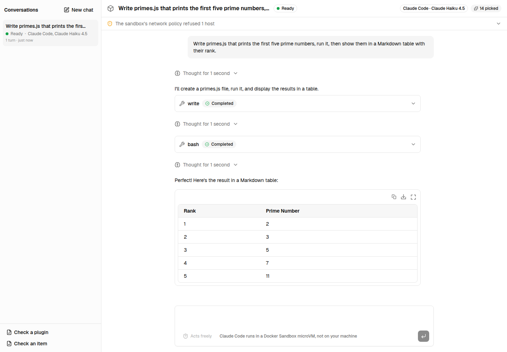

# ai-sdk-harness

<p align="center">
  <a href="https://ai-sdk-harness.pages.dev/"></a>
  <a href="https://github.com/fpasquet/ai-sdk-harness/actions/workflows/ci.yml"></a>
  <a href="https://github.com/fpasquet/ai-sdk-harness/actions/workflows/quality.yml"></a>
  
  
  <a href="LICENSE"></a>
</p>

Community packages for the [Vercel AI SDK harnesses](https://ai-sdk.dev/docs/ai-sdk-harnesses/harness-agent), the `HarnessAgent` that drives Claude Code, Codex, OpenCode and other coding-agent runtimes from your application.

**[Read the documentation](https://ai-sdk-harness.pages.dev/docs)**, or go straight to [Getting started](https://ai-sdk-harness.pages.dev/docs/getting-started).



| Package                                                        | What it does                                                                                                                                                     | npm                                                                                                                           |
| -------------------------------------------------------------- | ---------------------------------------------------------------------------------------------------------------------------------------------------------------- | ----------------------------------------------------------------------------------------------------------------------------- |
| [`ai-sdk-sandbox-sbx`](packages/sandbox-sbx)                   | Runs a harness agent in a local [Docker Sandbox](https://docs.docker.com/ai/sandboxes/) microVM, through `sbx`                                                   | [](https://www.npmjs.com/package/ai-sdk-sandbox-sbx)                   |
| [`ai-sdk-sandbox-microsandbox`](packages/sandbox-microsandbox) | Runs a harness agent in a local [microsandbox](https://github.com/superradcompany/microsandbox) microVM, booted from any OCI image                               | [](https://www.npmjs.com/package/ai-sdk-sandbox-microsandbox) |
| [`ai-sdk-sandbox-cloud-run`](packages/sandbox-cloud-run)       | Runs a harness agent in a [Cloud Run sandbox](https://docs.cloud.google.com/run/docs/code-execution) on Google Cloud, scaled to zero between turns               | [](https://www.npmjs.com/package/ai-sdk-sandbox-cloud-run)       |
| [`ai-sdk-sandbox-gce`](packages/sandbox-gce)                   | Runs a harness agent in a [Compute Engine](https://cloud.google.com/compute) virtual machine of its own on Google Cloud, Docker included, stopped between turns  | [](https://www.npmjs.com/package/ai-sdk-sandbox-gce)                   |
| [`ai-sdk-sandbox-runtime`](packages/sandbox-runtime)           | Runs a harness agent on this machine behind [Anthropic Sandbox Runtime](https://github.com/anthropics/sandbox-runtime) (srt), with no container                  | [](https://www.npmjs.com/package/ai-sdk-sandbox-runtime)           |
| [`ai-sdk-harness-plugins`](packages/harness-plugins)           | Plugins for a harness agent: tools, skills, rules, slash commands, hooks, subagents and MCP servers, Claude Code plugins included                                | [](https://www.npmjs.com/package/ai-sdk-harness-plugins)           |
| [`ai-sdk-harness-sessions`](packages/harness-sessions)         | The lifecycle of a harness agent's sessions: suspended when idle, resumed on the next message and after a restart, several in one sandbox                        | [](https://www.npmjs.com/package/ai-sdk-harness-sessions)         |
| [`ai-sdk-harness-workspace`](packages/harness-workspace)       | A Git checkout of its own for each session, side by side in one sandbox, and what the agent changed back as a patch, credentials kept out                        | [](https://www.npmjs.com/package/ai-sdk-harness-workspace)       |
| [`ai-sdk-harness-approval`](packages/harness-approval)         | A person in the loop: an approval policy for the agent's commands and edits, "always allow" for a session, and the agent's questions answered                    | [](https://www.npmjs.com/package/ai-sdk-harness-approval)         |
| [`ai-sdk-harness-network`](packages/harness-network)           | The hosts a sandbox may reach: forges, registries, toolchains and container registries, each harness's and model provider's, merged into a closed network policy | [](https://www.npmjs.com/package/ai-sdk-harness-network)           |

```ts
import { HarnessAgent } from '@ai-sdk/harness/agent';
import { createClaudeCode } from '@ai-sdk/harness-claude-code';
import { createSbxNetworkSandboxSession } from 'ai-sdk-sandbox-sbx';

const agent = new HarnessAgent({ harness: createClaudeCode() });
const sandboxSession = await createSbxNetworkSandboxSession({
  ports: [4000],
  setup: ['npm install --global --silent pnpm@10'],
  template: await agent.getSandboxTemplate(),
});
const session = await agent.createSession({ sandboxSession });
const { text } = await agent.generate({ session, prompt: 'Write fizzbuzz in Rust and run it' });
```

## Why

The AI SDK has two sandbox packages of its own. [`@ai-sdk/sandbox-vercel`](https://www.npmjs.com/package/@ai-sdk/sandbox-vercel) runs the harnesses in Vercel's cloud. [`@ai-sdk/sandbox-just-bash`](https://www.npmjs.com/package/@ai-sdk/sandbox-just-bash) simulates a shell in your Node.js process: it exposes no port, so it cannot run the harnesses that need a bridge in the sandbox, Claude Code and Codex among them.

The packages here run those harnesses on your own machine or in your own Google Cloud project:

| Package                       | Where                                | Isolation                              | What a stopped sandbox costs                      |
| ----------------------------- | ------------------------------------ | -------------------------------------- | ------------------------------------------------- |
| `@ai-sdk/sandbox-vercel`      | Vercel's cloud                       | A Firecracker microVM                  | Its snapshot's storage                            |
| `@ai-sdk/sandbox-just-bash`   | Your Node.js process                 | A simulated shell, no VM               | Nothing, but its files are gone                   |
| `ai-sdk-sandbox-sbx`          | This host, or Docker Sandboxes Cloud | A microVM                              | On this host, its disk space                      |
| `ai-sdk-sandbox-microsandbox` | This host                            | A microVM                              | Its disk space on this host                       |
| `ai-sdk-sandbox-runtime`      | This host                            | Fenced processes, on the host's kernel | Its disk space on this host                       |
| `ai-sdk-sandbox-cloud-run`    | Your Google Cloud project            | gVisor                                 | Its snapshot's storage                            |
| `ai-sdk-sandbox-gce`          | Your Google Cloud project            | A virtual machine                      | Its disk, and the egress proxy if it is always on |

- **Local or cloud**: prefer `sbx`, `microsandbox` or `runtime` to develop on your machine, with no sandbox to pay for (`sbx` asks for a Docker sign-in). Prefer `cloud-run` or `gce` to run the sandboxes in a Google Cloud project of yours. Prefer `@ai-sdk/sandbox-vercel` when you are on Vercel already, or want a hosted sandbox with no infrastructure of your own to deploy.
- **Isolation**: prefer a microVM or a virtual machine for code you do not trust. `sbx`, `microsandbox` (`docker: true`) and `gce` run Docker and Compose in the sandbox too. `runtime` needs no VM nor container, but shares the host's kernel and lets the agent read the host outside your home directory. `just-bash` is enough for a host-side harness such as Pi that only needs a shell and files.
- **Cost between two turns**: a running sandbox takes resources even when nobody writes to it, so it has to be stopped. [`ai-sdk-harness-sessions`](packages/harness-sessions) stops it once its sessions are idle and resumes it on the next message, with `sandboxPerSession()`, or with `sharedSandbox()` and its `stopWhenUnused` option.

[Choosing a sandbox](https://ai-sdk-harness.pages.dev/docs/choosing-a-sandbox) compares the packages of this repository in detail. Plugins, sessions, workspaces, approvals and network policies are packages of their own, to add to the sandbox you pick here.

## Repository layout

A pnpm + Turborepo monorepo.

```text
packages/
  sandbox-sbx/        ai-sdk-sandbox-sbx, published to npm
  sandbox-microsandbox/  ai-sdk-sandbox-microsandbox, published to npm
  sandbox-cloud-run/  ai-sdk-sandbox-cloud-run, published to npm (client and sandbox service)
  sandbox-gce/        ai-sdk-sandbox-gce, published to npm (client, sandbox service, egress proxy, agent)
  sandbox-runtime/    ai-sdk-sandbox-runtime, published to npm (srt on this host)
  harness-plugins/    ai-sdk-harness-plugins, published to npm
  harness-sessions/   ai-sdk-harness-sessions, published to npm
  harness-workspace/  ai-sdk-harness-workspace, published to npm
  harness-approval/   ai-sdk-harness-approval, published to npm
  harness-network/    ai-sdk-harness-network, published to npm
  configs/            shared @repo/* presets (build, eslint, prettier, typescript, vitest)
examples/
  starter/            the smallest project: Claude Code in a Docker Sandbox, fetched without this repository
  next-chat/          a Next.js useChat page talking to every official harness, Claude Code, Codex, OpenCode and others, in a Docker Sandbox, a microsandbox, a Cloud Run sandbox or behind srt
docs/                 the Fumadocs documentation site
scripts/              screenshots of the example (`pnpm screenshots`)
```

## Quick start

To try the packages, start from the [starter](examples/starter), fetched without this repository: Node.js ≥ 24 and [Docker Sandboxes](https://docs.docker.com/ai/sandboxes/get-started/) are all it needs.

```bash
npx giget@latest gh:fpasquet/ai-sdk-harness/examples/starter my-agent
cd my-agent && npm install
cp .env.example .env   # set CLAUDE_CODE_OAUTH_TOKEN
npm start
```

To work on the monorepo, and run the Next.js example:

Prerequisites: Node.js ≥ 24, pnpm ≥ 10, and [Docker Sandboxes](https://docs.docker.com/ai/sandboxes/get-started/) (`sbx`) to run the example and the e2e tests — or, on Linux, `bubblewrap`, `socat` and `ripgrep` to run them with srt instead (`EXAMPLE_SANDBOX=srt`, see [`ai-sdk-sandbox-runtime`](packages/sandbox-runtime#linux)).

```bash
pnpm install
pnpm build
cp examples/next-chat/.env.example examples/next-chat/.env.local   # set CLAUDE_CODE_OAUTH_TOKEN
pnpm example:dev                                                   # http://localhost:3000
```

## Common commands

```bash
pnpm format:check     # Prettier
pnpm lint             # ESLint
pnpm typecheck        # tsc --noEmit
pnpm test             # unit tests, against a fake sbx, a fake microsandbox SDK, a fake Cloud Run sandbox CLI and a fake srt
pnpm test:e2e         # e2e tests, against the real sbx and srt, microsandbox when the host has KVM, and a deployed Cloud Run service when CLOUD_RUN_SANDBOX_URL is set
pnpm build            # every package, the example and the docs
pnpm docs:dev         # the documentation site on http://localhost:3002
pnpm example:dev      # the Next.js example on http://localhost:3000
pnpm screenshots      # regenerate the screenshots of the example (a real Claude Code and Codex turn)
pnpm changeset        # describe a change to a published package
```

## Contributing

See [CONTRIBUTING.md](CONTRIBUTING.md) for day-to-day development, [MAINTAINERS.md](MAINTAINERS.md) for releases and repository administration, and [SECURITY.md](SECURITY.md) to report a vulnerability. Guidance for coding agents lives in [AGENTS.md](AGENTS.md).

## License

[MIT](LICENSE)
