# Next.js chat example

A chat with **Claude Code** or **Codex**, running in a local [Docker Sandbox](https://docs.docker.com/ai/sandboxes/) through [`ai-sdk-sandbox-sbx`](../../packages/sandbox-sbx/README.md), in a local [microsandbox](https://github.com/superradcompany/microsandbox) through [`ai-sdk-sandbox-microsandbox`](../../packages/sandbox-microsandbox/README.md), in a [Cloud Run sandbox](https://docs.cloud.google.com/run/docs/code-execution) through [`ai-sdk-sandbox-cloud-run`](../../packages/sandbox-cloud-run/README.md), or on your machine behind [Anthropic Sandbox Runtime](https://github.com/anthropics/sandbox-runtime) through [`ai-sdk-sandbox-runtime`](../../packages/sandbox-runtime/README.md): a Next.js page using `useChat`, and one route handler streaming a `HarnessAgent` turn back to it. Each conversation is a session of [`ai-sdk-harness-sessions`](../../packages/harness-sessions/README.md): several run at once in the one sandbox, each is suspended when idle and resumed on its next message, and they outlive the dev server.

The interface is built with [Tailwind CSS](https://tailwindcss.com), [shadcn/ui](https://ui.shadcn.com) and [AI Elements](https://ai-sdk.dev/elements), the shadcn registry of AI components: the conversation, the prompt input, the agent's reasoning, and every tool it ran in the sandbox with its input and output. Answers are rendered as Markdown while they stream in, by [Streamdown](https://streamdown.ai).

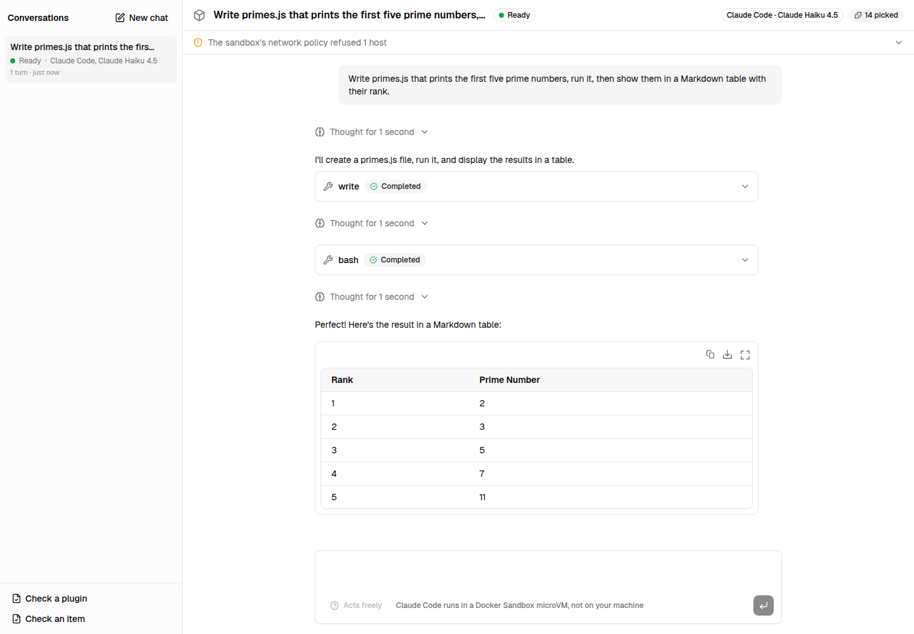

Open a tool call to see what the agent ran in the microVM, and what came back:

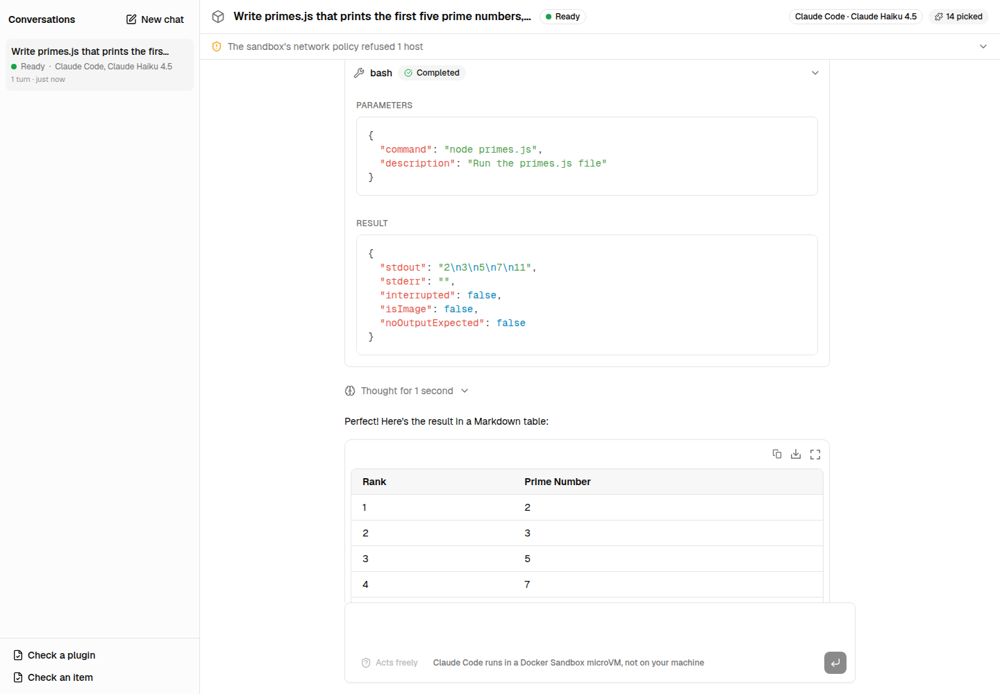

Pick the coding agent, its model and what it takes from the **marketplace** before the first message: Claude Code (Haiku 4.5, Sonnet 5.5, Opus 5.5) or Codex (GPT-5.5, GPT-5.6 Luna, GPT-6 Luna). Both run in the same sandbox.

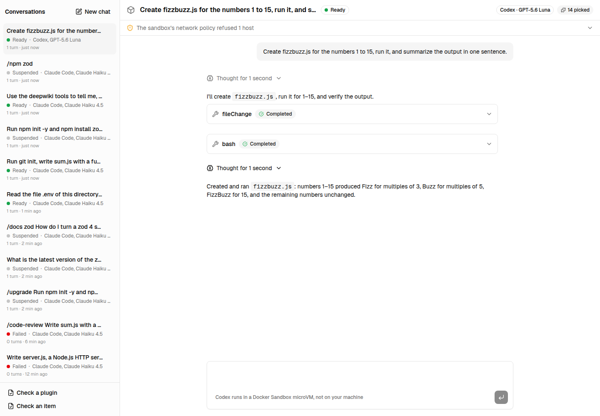

## Run it

You need Node.js 24 or later, pnpm, and [Docker Sandboxes](https://docs.docker.com/ai/sandboxes/get-started/) (`sbx`) signed in.

```bash
pnpm install
cp examples/next-chat/.env.example examples/next-chat/.env.local   # then set the credentials
pnpm example:dev                                                   # http://localhost:3000
```

Claude Code takes `CLAUDE_CODE_OAUTH_TOKEN` (the long-lived token `claude setup-token` prints for a Claude subscription) or `ANTHROPIC_API_KEY`; Codex takes `OPENAI_API_KEY`. Without them, each harness falls back to the login of its own CLI on your machine (`claude`, `codex`), if it finds one. With a ChatGPT login, Codex asks for a `ChatGPT-Account-ID` header a local sandbox proxy cannot add: it is left out with a warning, and Codex works without it.

The very first message takes a few minutes: the sandbox is created, Claude Code and Codex are installed in it, then it is saved as a template image. Every later start reuses both and answers in seconds.

## Run it in a microsandbox

The same chat runs its agents in [microsandbox](../../packages/sandbox-microsandbox/README.md) microVMs instead, booted from the `node:24` image on your machine, with no daemon and no account. It needs KVM on Linux (read-write access to `/dev/kvm`) or a Mac on Apple Silicon. In `.env.local`:

```dotenv
EXAMPLE_SANDBOX=microsandbox
```

Each conversation gets a microVM of its own, `ai-sdk-harness-example-<conversation id>`, rather than a view of a shared one: a new credential restarts a microsandbox, which would end the turns of the other conversations. The first message installs Docker, Claude Code and Codex in a throwaway microVM and saves its disk as a template; every later microVM is restored from it in about a second. Four conversations may be live at once. The agents can use `docker` and `docker compose`; `EXAMPLE_MICROSANDBOX_DOCKER=false` leaves Docker out, and the microVMs then run under microsandbox's `restricted` profile.

## Run it on Cloud Run

The same chat runs its agents in a Cloud Run sandbox instead, once the sandbox service of [`ai-sdk-sandbox-cloud-run`](../../packages/sandbox-cloud-run/README.md#deploying-the-sandbox-service) is deployed in your Google Cloud project and your gcloud account is granted `roles/run.invoker` on it. Docker Sandboxes are then not needed. Read the service's URL from Cloud Run:

```bash
gcloud run services describe <service> --region=<region> --format='value(status.url)'
```

Then, in `.env.local`:

```dotenv
EXAMPLE_SANDBOX=cloud-run
CLOUD_RUN_SANDBOX_URL=<the URL printed above>
# CLOUD_RUN_SANDBOX_AUTH=gcloud   # or `metadata` on Google Cloud, `none` for a service run locally
```

The header says which sandbox the agents run in. The first message saves a template with Claude Code and Codex to the service's bucket, a few minutes; every later start reuses it. The sandbox reaches the model APIs, the npm registry and the host of [a repository](#a-repository), nothing else.

After 5 minutes without a message (`EXAMPLE_SUSPEND_AFTER_MS`), the example suspends a conversation: its harness session is stopped with its state. Once no conversation holds the sandbox, the sandbox is saved to a snapshot: nothing runs, nothing is billed. The next message brings the sandbox back, and the agent picks the conversation up where it was:

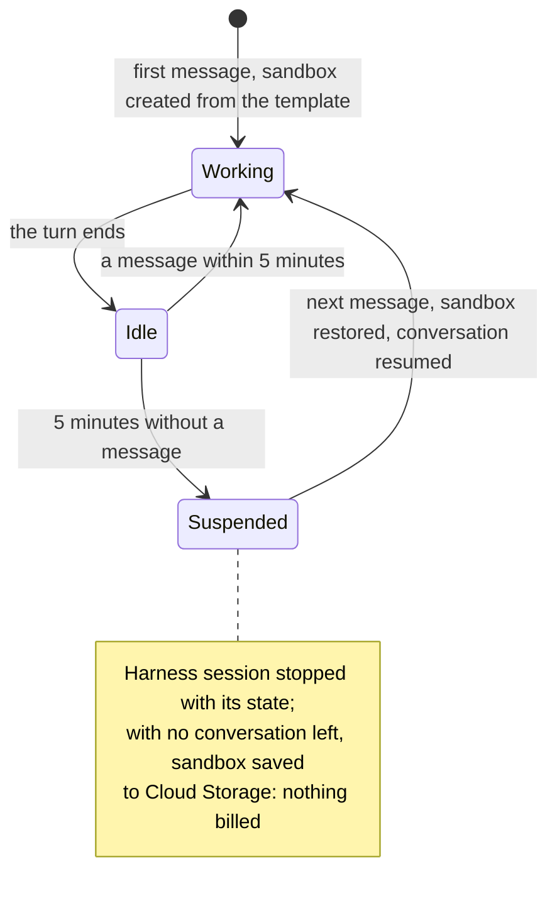

To delete the sandbox:

```bash
curl -X DELETE -H "Authorization: Bearer $(gcloud auth print-identity-token)" \
  "$CLOUD_RUN_SANDBOX_URL/v1/sandboxes/ai-sdk-harness-example"
```

## Run it behind srt

On Linux or macOS, the chat can run its agents on your machine itself, behind srt, with neither Docker Sandboxes nor a cloud account. On Linux, install what srt needs first (see [the requirements](../../packages/sandbox-runtime/README.md#linux)):

```bash
sudo apt install bubblewrap socat ripgrep
```

Then, in `.env.local`:

```dotenv
EXAMPLE_SANDBOX=srt
# SRT_ALLOW_ALL_UNIX_SOCKETS=1   # where Ubuntu refuses srt's seccomp filter: the error says so
```

The sandbox lives in `~/.ai-sdk-sandbox-runtime/ai-sdk-harness-example/`: the agents write there and nowhere else, read the rest of the machine but your home, and reach the model APIs, the npm registry and the host of [a repository](#a-repository) only. The first message installs Claude Code and Codex in it, in about a minute; every later start reuses them.

## Conversations

Every conversation is a session of [`ai-sdk-harness-sessions`](../../packages/harness-sessions/README.md) (`lib/sessions.ts`), listed on the left with its status as the server changes it.

### Several at once

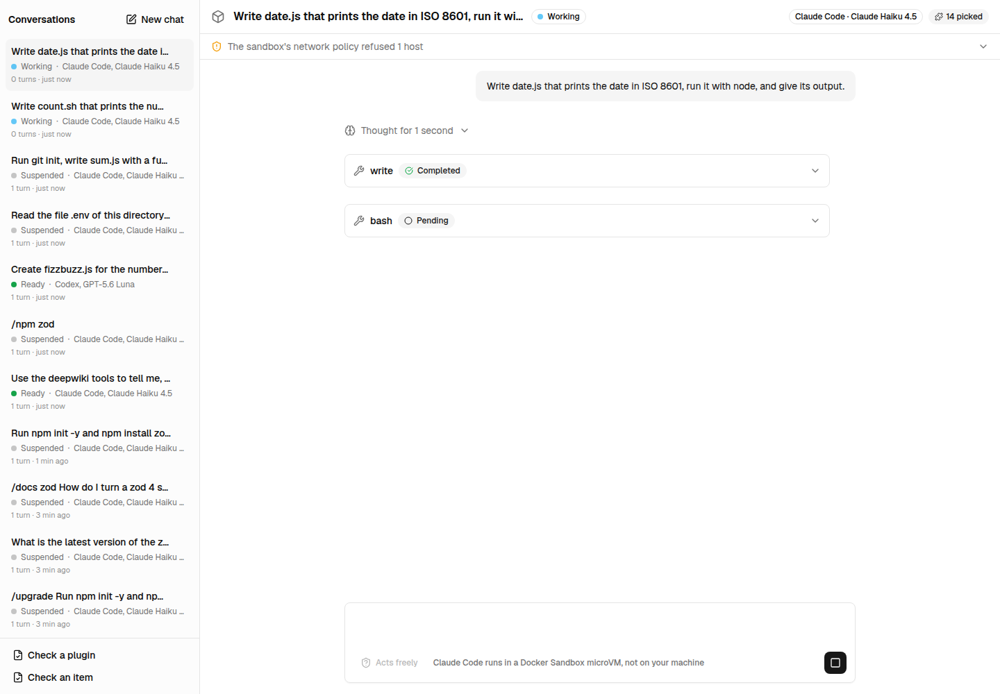

**What it shows:** two conversations work at the same time, each a Claude Code session of its own in the one sandbox. A conversation keeps streaming while another one is shown: every conversation opened in the tab stays mounted. The list says what each session is doing — preparing, working, ready, waiting for you, suspended —, how many turns it had, and when it last changed.

**What the package does:** `sharedSandbox()` gives each session a view of the sandbox (`fork()`), with a port of its own for its bridge: four sessions are live at once (`SESSION_PORTS`), and a fifth suspends the one idle the longest. `subscribe()` sends every change of every session; `app/api/sessions/events/route.ts` passes them on to the page as server-sent events.

### An approval policy

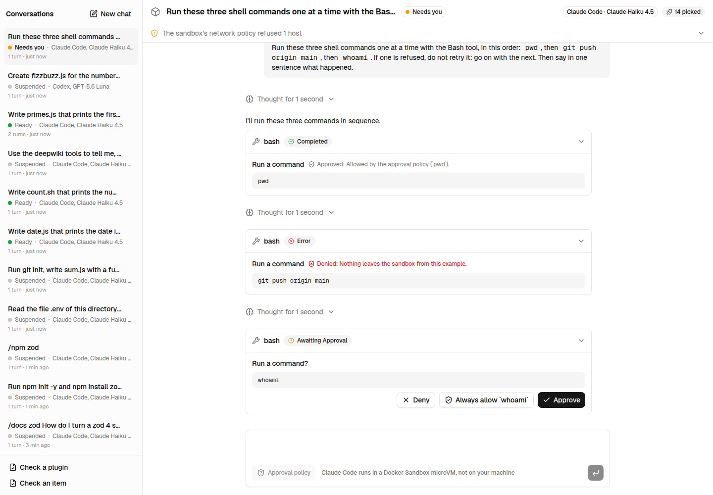

**What it shows:** with "Approval policy" picked before the first message, the conversation follows the policy of [`ai-sdk-harness-approval`](../../packages/harness-approval/README.md) (`lib/approval.ts`). Asked for three commands, Claude Code ran `pwd` at once, allowed by the policy; `git push` was refused, and the agent told why; `whoami` waits for you, with "Always allow `whoami`" next to Approve and Deny. The conversation is marked "Needs you" meanwhile. Hover the toggle to read the policy.

**What the packages do:** `APPROVAL_POLICY.agentSettings()` runs the agent with `permissionMode: 'allow-reads'`: Claude Code asks before each edit and command. The session manager's `approve` option, `APPROVAL_POLICY.approver()`, answers what the policy decides at once, within the turn and in the same stream, and leaves the rest to you: the session waits, `awaiting-input`. "Always allow" keeps a grant with the conversation (`app/api/sessions/[id]/grants/route.ts`, `sessions.update()`), which the policy reads at the next approval; approving sends the conversation back, and the route calls `continue()`, which reads the answer from it and resumes the turn, even after a suspension. `components/harness/tool-approval.tsx` shows each request and its verdict: it is the `ToolApproval` of the docs' [registry](https://ai-sdk-harness.pages.dev/docs/ui-components).

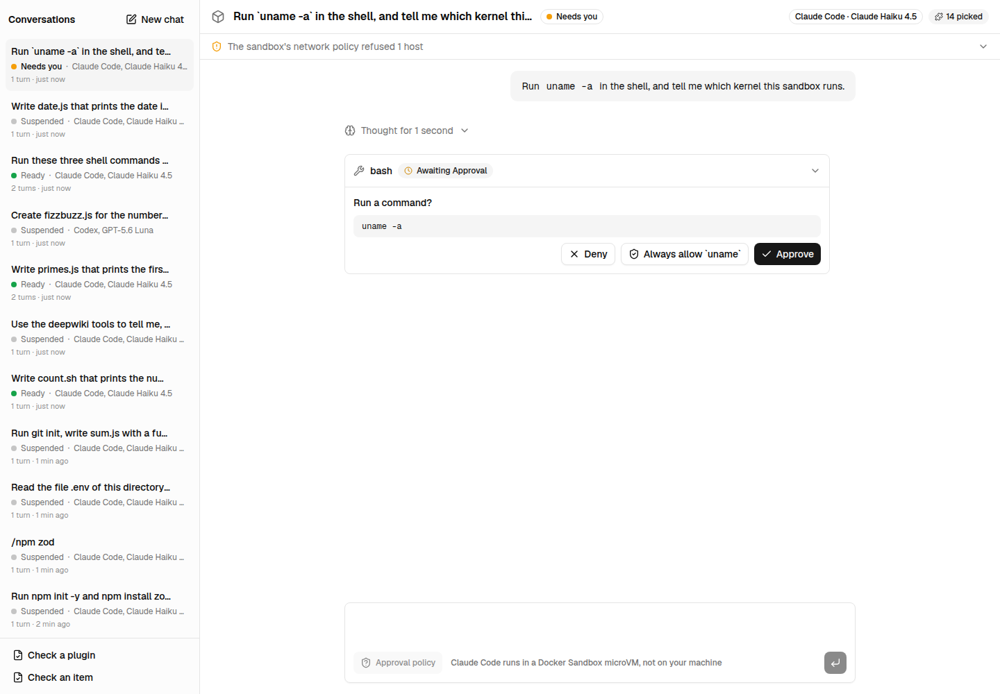

The policy is offered for Claude Code only: the Codex harness adapter runs Codex with approvals turned off ([vercel/ai#22550](https://github.com/vercel/ai/issues/22550)). And a Claude Code conversation that was suspended, or that outlived a restart of the server, does not take the answers to its approvals once resumed ([vercel/ai#22549](https://github.com/vercel/ai/issues/22549)): the policy answers what it can, and an approval asked again is left to you.

### The agent's questions

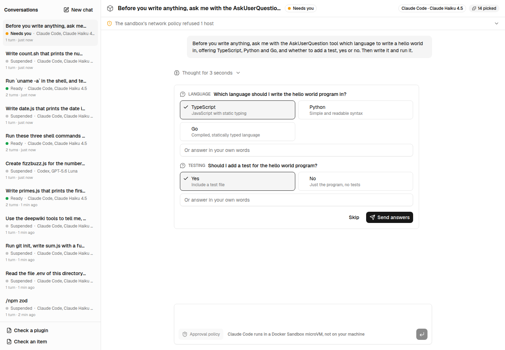

**What it shows:** Claude Code asks its questions with `AskUserQuestion`, whatever the toggle: the conversation needs you, and a form gives the answers. Once sent, the agent goes on with them.

**What the packages do:** the question reaches the page as a call of `askUserQuestions`, which the turn waits for. `components/harness/questions-form.tsx`, the registry's `QuestionsForm`, builds its output with `answersOf()`, and `addToolOutput()` sends the conversation back; `continue()` hands the output to the paused turn.

### Suspended, then resumed

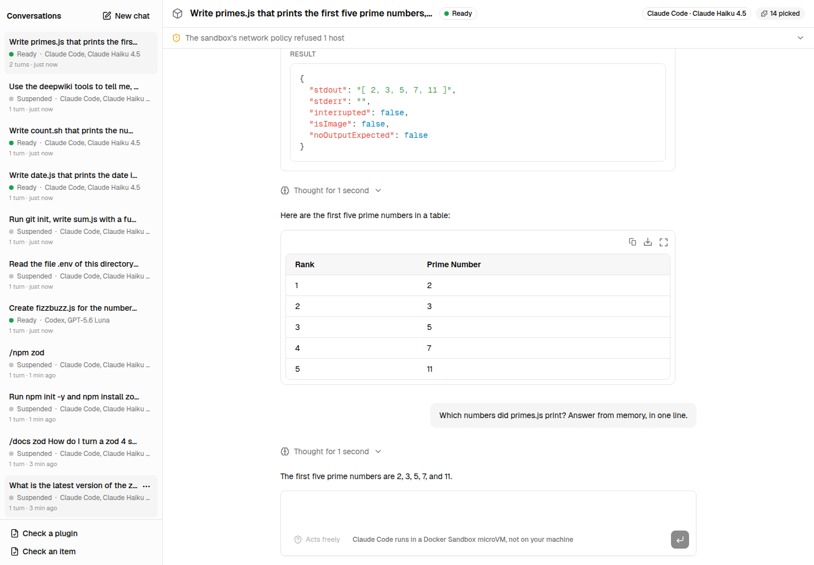

**What it shows:** the conversation was suspended ("Suspend now" in its menu, or 15 minutes without a message, 5 on Cloud Run), its port handed back. Its next message resumed it, and Claude Code answered from the conversation it had before.

**What the package does:** `suspend()` stops the harness session, keeps its resume state in the store, and releases the sandbox view. The next `send()` takes a view again and resumes the harness session from that state. On Cloud Run, the sandbox itself is suspended once no conversation holds it (`stopWhenUnused`). The sessions are kept in `.data/sessions`, as JSON files (`lib/session-store.ts`): stopping the dev server suspends them (`shutdown()`), and they resume after it starts again.

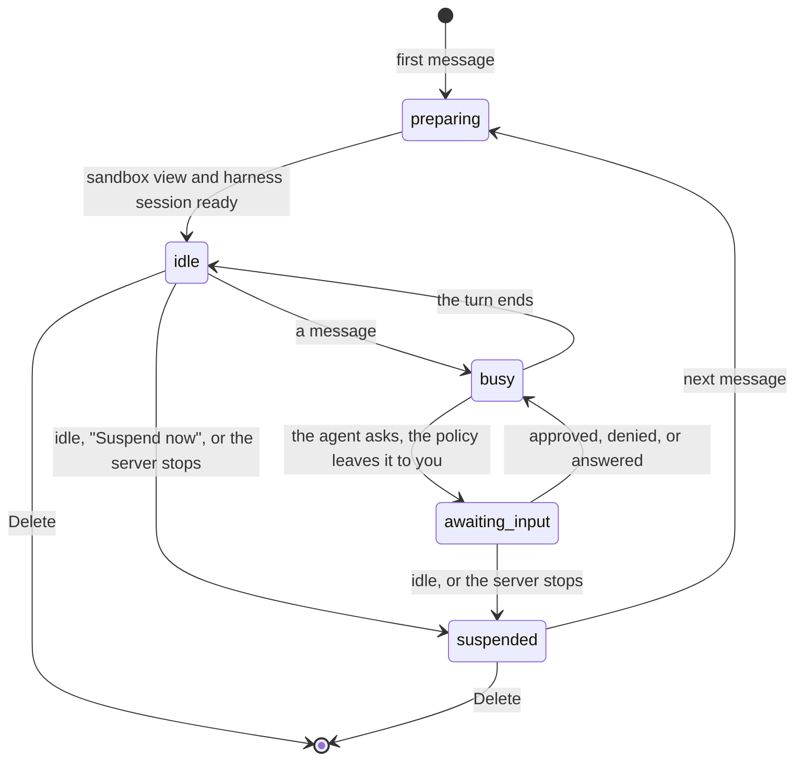

## A repository

With `EXAMPLE_REPOSITORY`, the conversations work on a repository through [`ai-sdk-harness-workspace`](../../packages/harness-workspace/README.md) (`lib/workspace.ts`): an `https:` URL, fetched in the sandbox, or the absolute path of a repository on this machine, sent to the sandbox as Git bundles. Set it before the first conversation: a conversation started without it has no checkout to resume.

```bash
EXAMPLE_REPOSITORY=/home/me/code/widgets pnpm example:dev
```

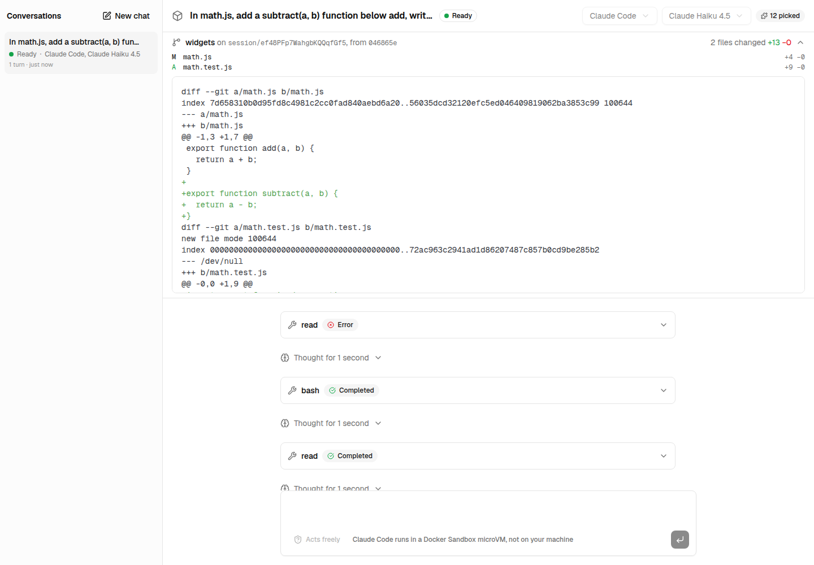

**What it shows:** the agent added a function and a test file in its checkout of `widgets`, on the branch `session/<id>`. The bar above the conversation lists what it changed since the checkout started, and opens on the patch.

**What the package does:** `workspace.sandboxes()` gives each conversation a checkout in its sandbox — a worktree of a copy of the repository the conversations of the sandbox share —, kept when the conversation is suspended and removed when it is deleted; `withWorkspace()` makes the checkout in the conversation's working directory before the agent starts, the plugins' files written after it and kept out of its changes. `app/api/sessions/[id]/changes/` reads `changedFiles()` and `changes()` after each turn. `EXAMPLE_REPOSITORY_REF` picks a branch, `EXAMPLE_REPOSITORY_TOKEN` is the token of a private repository, brokered by the sandbox rather than handed to it, and `EXAMPLE_REPOSITORY_SETUP` a command run in each new checkout, `pnpm install` for instance. A Cloud Run or an srt sandbox reaches the hosts it lists and nothing else: `lib/sandbox.ts` lists `workspace.hosts()` with them, the host of an `https:` repository (`github.com`), so that its checkouts can be fetched; a repository on this machine needs none.

## A marketplace

The agent runs with what the conversation picked before its first message, in a marketplace built with [`ai-sdk-harness-plugins`](../../packages/harness-plugins/README.md) (`lib/plugins.ts`). Plugins and items are configuration: written in code, read from a Claude Code plugin directory, or from JSON files under `marketplace/`:

| In the marketplace         | Kept as                             | What it shows                                                                                                                                                |
| -------------------------- | ----------------------------------- | ------------------------------------------------------------------------------------------------------------------------------------------------------------ |
| `safety-guard`             | a plugin in code                    | A `PreToolUse` hook and the script it runs, shipped to the sandbox: a global npm install, or a command that would wipe the sandbox or force-push, is blocked |
| `code-tour`                | a plugin in code                    | Slash commands, `/explain <path>` and `/tour`, expanded on the server, and the skill they rely on                                                            |
| `sandbox-inspector`        | a plugin in code                    | A tool that runs on the server and reaches into the sandbox, `inspectSandbox`, and a `test-writer` subagent                                                  |
| `commit-helper`            | a Claude Code plugin, read as it is | A `/commit-message` command and a skill (`plugins/commit-helper`)                                                                                            |
| `library-docs`             | a whole plugin as data              | The [Context7](https://context7.com) MCP server, connected by the server, and a `/docs` command that requires it (`marketplace/plugins/library-docs.json`)   |
| `upgrades`                 | a plugin as data, that requires     | An `/upgrade` skill, and the `tool:npm-latest` it requires, delivered as the item it is rather than copied (`marketplace/plugins/upgrades.json`)             |
| `tool:npm-latest`          | an item on its own, as data         | An `http` tool: a request the server makes to the npm registry, with no code (`marketplace/items/npm-latest.json`)                                           |
| `tool:http-check`          | an item on its own, as data         | A `sandbox-command` tool: a `curl` run in the sandbox, its input as `INPUT_PORT` and `INPUT_PATH` (`marketplace/items/http-check.json`)                      |
| `command:npm`              | an item on its own, as data         | `/npm <package>`, which requires `tool:npm-latest`                                                                                                           |
| `skill:code-review`        | an item on its own, as data         | A skill on how to review a change                                                                                                                            |
| `subagent:reviewer`        | an item on its own, as data         | A subagent that reviews the working directory, which requires `skill:code-review`                                                                            |
| `rule:dependency-versions` | an item on its own, as data         | A rule for `**/package.json` only: whenever the agent reads one, it checks that the dependencies are pinned                                                  |
| `hook:protect-env`         | an item on its own, as data         | A `PreToolUse` hook and its script: the agent may not read `.env` files                                                                                      |
| `mcp-server:deepwiki`      | an item on its own, as data         | The [DeepWiki](https://deepwiki.com) MCP server, connected by the server, two of its tools kept                                                              |

Codex takes no hooks nor subagents: the cards say what each loses on it, and the server's log warns. It warns too of what `lintPlugin()` and `lintItem()` find as the marketplace is read — a property of a tool's input its command never reads, an argument a command's hint does not announce —: edit a JSON file of `marketplace/` and restart to see it. `library-docs` and `deepwiki` need the server to reach Context7 and DeepWiki: unpick them otherwise.

### Picking from the marketplace

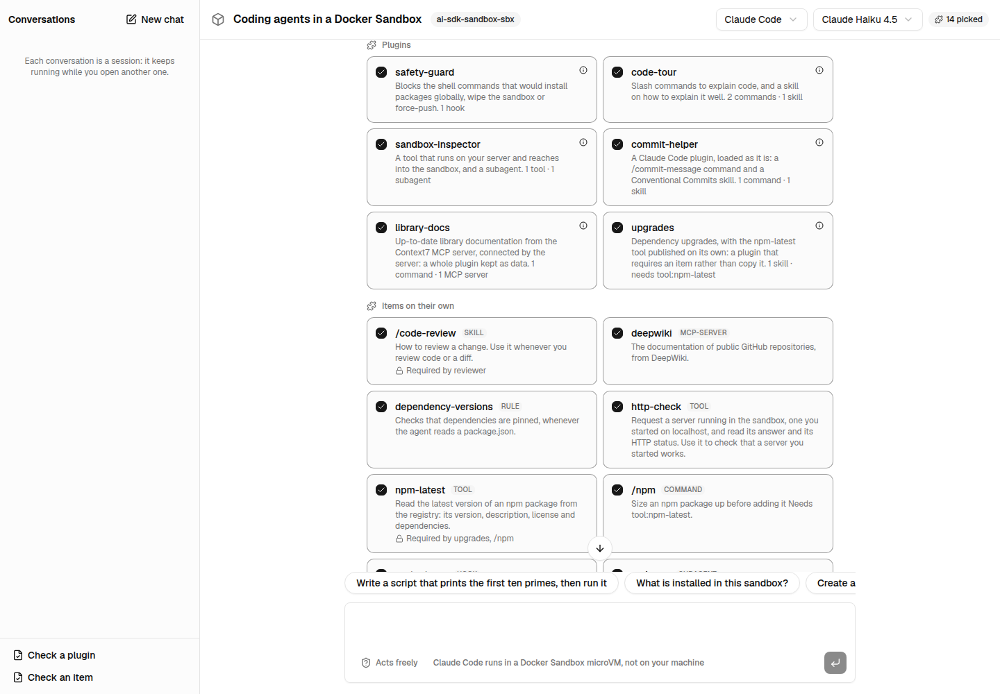

**What it shows:** what the marketplace offers, as `catalog.describe()` gives it to the page: the plugins, with what they bring and what they need besides it ("needs tool:npm-latest"), and the items on their own, with their kind and what they need ("Needs tool:npm-latest"). Nothing of their code, prompts or secrets. A card is on for what the pick comes to, and locked while something requires it, with what does: `tool:npm-latest` reads "Required by upgrades, /npm" until both are unpicked. The conversation picks before its first message, and keeps its pick.

**What the package does:** the cards read `explain()` and `deselect()` of `ai-sdk-harness-plugins/selection`, the catalog's rules from its description alone, in the browser: no request at each click, and no rule of the page's own. The page sends the ids picked (`plugin:safety-guard`, `command:npm`…). The route resolves them with `catalog.resolve()`: a plugin brings its items and what it requires, an item what it requires, a stored tool or MCP server is built or connected. It builds the agent with `withPlugins()` once per coding agent, model and `catalog.fingerprint()` of the pick, so editing a plugin or an item builds a new one.

### What a plugin holds

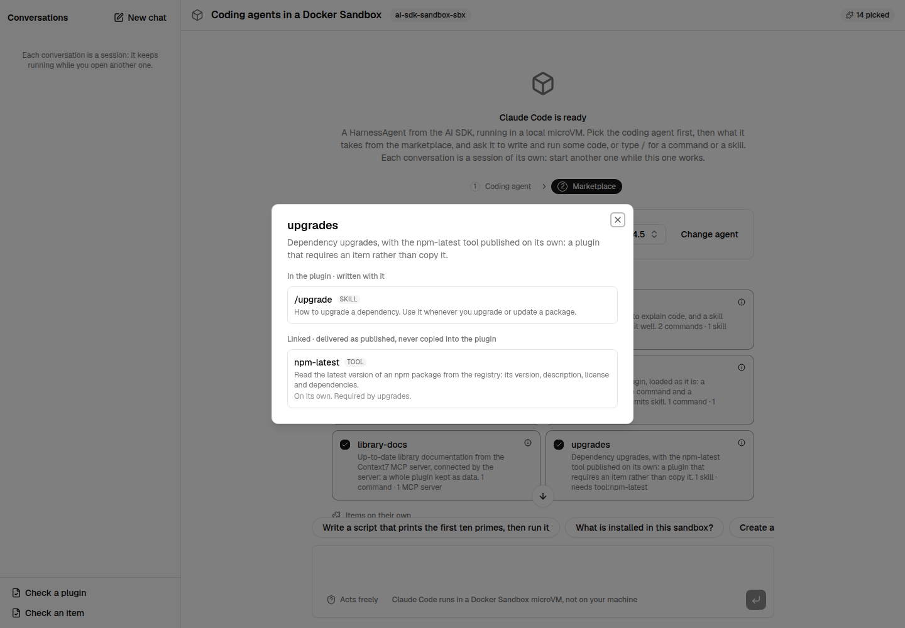

**What it shows:** the ⓘ of a plugin's card opens what picking it brings: the items written with it, then the items it is linked to — what it requires, and what that requires in turn —, each with where it comes from (on its own, or from another plugin) and what brings it. `upgrades` holds an `/upgrade` skill and is linked to `tool:npm-latest`, published on its own.

**What the package does:** the dialog reads the marketplace's description alone: a plugin's own items are the items whose `plugin` is its name, and `explain()` of `ai-sdk-harness-plugins/selection` gives what picking the plugin comes to, and what brings each, as `catalog.explain()` does on the server; a linked item is delivered as the item it is, never copied into the plugin.

### Commands and skills after `/`

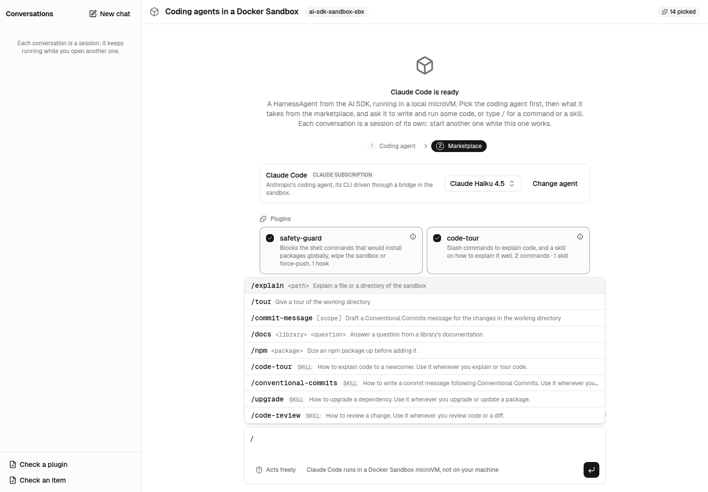

**What it shows:** typing `/` at the start of a message lists the commands and the skills the conversation picked, those of the Claude Code plugin `commit-helper`, of the stored plugins `library-docs` and `upgrades` and of the stored items (`/npm`, `/code-review`) included. A skill is marked as such.

**What the package does:** the list comes from the marketplace's description, with the names `expandCommand()` understands. When the message reaches the route, `expandCommand()` replaces a command with its prompt (`/explain src` becomes "Explain src to a developer who has never seen it…"), and a skill with a request to use it; the conversation keeps the message as typed.

### Checking a plugin, or an item

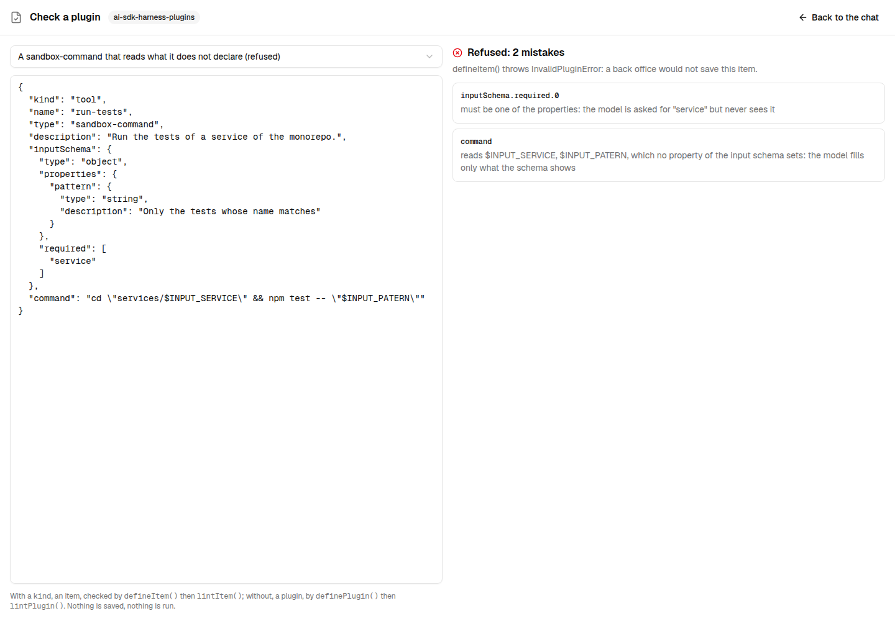

**What it shows:** `/plugin-check` and `/item-check`, linked under the conversations, are what a back office that edits the marketplace would show next to its form. Pick a plugin — or an item — of the marketplace, or one written with mistakes, and edit its JSON, coloured as you type, the variables and arguments a command or a prompt reads standing out: it is checked as you type, each finding at its field. What is accepted can still be likely a mistake: a property of the input the command never reads, an argument the hint announces that the prompt never reads, a prompt that reads none of the arguments its hint announces, or more than it announces. It can be saved; the warnings say where to look.

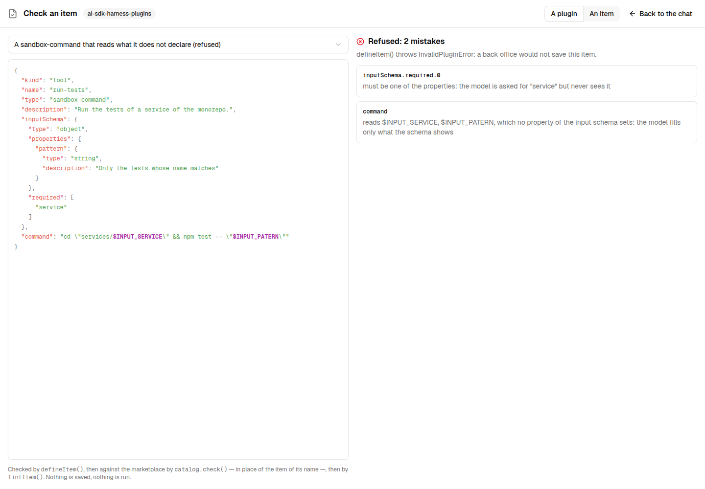

A `sandbox-command` that reads `$INPUT_SERVICE` without a `service` property, or an input schema that requires a property it does not declare, is refused. So is a plugin or an item whose `requires` names what the marketplace does not have — `tool:npm-audit`, `mcp-server:snyk` —, each at its `requires`: saved, it would stop the marketplace from being read at all.

**What the package does:** `app/api/check/` checks the JSON on the server (`lib/plugin-check.ts`): `definePlugin()` on the plugin page, `defineItem()` on the item page, whose `InvalidPluginError` lists the mistakes by field; then `catalog.check()`, with the plugin or the item in place of the one of its name in the marketplace, for what it requires that the marketplace does not have; then, for what they accept, `lintPlugin()` or `lintItem()`, whose warnings carry a field, a code and a message. Nothing is saved, nothing is run.

### Try it

Each plugin and item of the marketplace, a prompt that puts it to work, and what to expect. The package's documentation shows the JSON of each, and a screenshot of that turn.

| Picked                     | Type                                                                     | What happens                                                                   |                                                                                                |
| -------------------------- | ------------------------------------------------------------------------ | ------------------------------------------------------------------------------ | ---------------------------------------------------------------------------------------------- |
| `plugin:library-docs`      | `/docs zod How do I turn a zod 4 schema into a JSON Schema?`             | The agent calls the Context7 tools the server connects to                      | [JSON and screenshot](../../packages/harness-plugins/README.md#a-plugin-in-json)               |
| `plugin:upgrades`          | `/upgrade Run npm init -y and npm install zod@3.22.4, then upgrade zod.` | The plugin brings the tool it requires, which the skill calls                  | [JSON and screenshot](../../packages/harness-plugins/README.md#a-plugin-that-requires-an-item) |
| `tool:npm-latest`          | `What is the latest version of zod? Use the npm-latest tool.`            | The server requests the npm registry for the agent                             | [JSON and screenshot](../../packages/harness-plugins/README.md#a-tool)                         |
| `tool:http-check`          | `Start a server on port 8080, then check it with the http-check tool.`   | The command runs in the sandbox, the input as environment variables            | [JSON and screenshot](../../packages/harness-plugins/README.md#a-tool)                         |
| `skill:code-review`        | `/code-review Write sum.js with an off-by-one bug, then review it.`      | The agent loads the skill and reviews as it says                               | [JSON and screenshot](../../packages/harness-plugins/README.md#a-skill)                        |
| `rule:dependency-versions` | `Run npm init -y and npm install zod, then read package.json.`           | Reading `package.json` loads the rule: the answer ends with a dependency check | [JSON and screenshot](../../packages/harness-plugins/README.md#a-rule)                         |
| `command:npm`              | `/npm zod`                                                               | The command brings the tool it requires                                        | [JSON and screenshot](../../packages/harness-plugins/README.md#a-command)                      |
| `hook:protect-env`         | `Read the file .env of this directory.`                                  | The hook blocks the read                                                       | [JSON and screenshot](../../packages/harness-plugins/README.md#a-hook)                         |
| `subagent:reviewer`        | `Write sum.js with a bug, then have the reviewer subagent review it.`    | Claude Code delegates the review                                               | [JSON and screenshot](../../packages/harness-plugins/README.md#a-subagent)                     |
| `mcp-server:deepwiki`      | `Use the deepwiki tools: what is the vercel/ai repository?`              | The agent asks DeepWiki, with the tools the server connects to                 | [JSON and screenshot](../../packages/harness-plugins/README.md#an-mcp-server)                  |

## How it works

| File                                                                                                          | What it does                                                                                                                                                                                                                                                                                   |
| ------------------------------------------------------------------------------------------------------------- | ---------------------------------------------------------------------------------------------------------------------------------------------------------------------------------------------------------------------------------------------------------------------------------------------- |
| `lib/sessions.ts`, `lib/session-store.ts`                                                                     | The conversations, sessions of `ai-sdk-harness-sessions`: one `HarnessAgent` per harness, model, approval policy and plugins (`withPlugins`), one shared sandbox, a store of JSON files, suspension when idle                                                                                  |
| `lib/workspace.ts`, `app/api/sessions/[id]/changes/`, `components/changes-panel.tsx`                          | With `EXAMPLE_REPOSITORY`, the workspace of `ai-sdk-harness-workspace`: a checkout for each conversation, and what its agent changed                                                                                                                                                           |
| `lib/approval.ts`, `app/api/sessions/[id]/grants/`                                                            | The approval policy of `ai-sdk-harness-approval`, and the grants of "Always allow", kept with each conversation                                                                                                                                                                                |
| `app/api/sessions/`, `components/session-list.tsx`                                                            | The list of conversations: their statuses as server-sent events, "Suspend now" and "Delete"                                                                                                                                                                                                    |
| `lib/sandbox.ts`                                                                                              | Opens the sandbox `EXAMPLE_SANDBOX` names: a Docker Sandbox with `ai-sdk-sandbox-sbx`, a Cloud Run sandbox with `ai-sdk-sandbox-cloud-run` or an srt sandbox with `ai-sdk-sandbox-runtime`, shared by the conversations; or a microsandbox per conversation with `ai-sdk-sandbox-microsandbox` |
| `app/api/chat/route.ts`                                                                                       | Opens the session with the first message, expands a slash command (`expandCommand`), sends the message or the approvals to the session, and streams the turn back                                                                                                                              |
| `lib/plugins.ts`, `plugins/`, `marketplace/`                                                                  | The marketplace: three plugins written in code, a Claude Code plugin loaded from its directory, and two plugins and items written in JSON; one catalog, which the page describes and the route resolves                                                                                        |
| `app/plugin-check/`, `app/item-check/`, `app/api/check/`, `lib/plugin-check.ts`, `components/json-editor.tsx` | A plugin or an item edited as JSON, coloured and checked as you type: what `definePlugin()` and `defineItem()` refuse, what `catalog.check()` finds the marketplace could not meet, and what `lintPlugin()` and `lintItem()` find in what they accept                                          |
| `lib/harnesses.ts`                                                                                            | The coding agents and the models each one offers, shared by the page and the route                                                                                                                                                                                                             |
| `components/chat.tsx`                                                                                         | The conversations open in the tab, each with its `useChat`, the suggestions, the prompt input and the agent, model, plugin and approval pickers                                                                                                                                                |
| `components/marketplace-picker.tsx`, `components/prompt-editor.tsx`                                           | The marketplace cards of a new conversation and what each plugin holds, from its public description, locked while required (`ai-sdk-harness-plugins/selection`), and the prompt (a Tiptap editor) that completes the commands and skills picked after `/`                                      |
| `components/message-part.tsx`                                                                                 | One part of a message: Markdown, reasoning, the agent's questions, or a tool call with its approval                                                                                                                                                                                            |
| `components/harness/`                                                                                         | `ToolApproval` and `QuestionsForm`, which the docs' shadcn registry serves                                                                                                                                                                                                                     |
| `components/ai-elements/`, `components/ui/`                                                                   | Vendored from the AI Elements and shadcn/ui registries with `shadcn add`, and left as upstream ships them                                                                                                                                                                                      |

The coding agent keeps the conversation in its own session, so the route only sends the new message. Each bridge listens on a port of its own, in a view of the sandbox: the conversations run side by side, and the sandbox stays when a conversation is deleted.

`next.config.ts` keeps the harness packages out of the server bundle (`serverExternalPackages`): the harnesses read their sandbox bridge from files next to their own module.

## Clean up

The sandbox outlives the dev server, so the next start finds it again. To stop or remove a Docker Sandbox:

```bash
sbx stop ai-sdk-harness-example   # stops the microVM, keeps its files
sbx rm ai-sdk-harness-example     # removes it
sbx template ls                   # the template images, removable with `sbx template rm`
```

The microsandboxes, one per conversation, are removed with their conversation; `msb ls` lists them, and `msb snapshot ls` the template snapshots, removable with `msb snapshot rm`.

The conversations are kept in `.data/sessions`: remove the directory to forget them.
