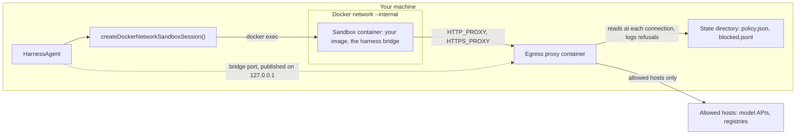

# ai-sdk-sandbox-docker-engine

<p align="center">
  <a href="https://www.npmjs.com/package/ai-sdk-sandbox-docker-engine"></a>
  <a href="https://github.com/fpasquet/ai-sdk-harness/actions/workflows/ci.yml"></a>
  
  
  <a href="https://github.com/fpasquet/ai-sdk-harness/blob/main/LICENSE"></a>
</p>

Run [AI SDK harness agents](https://ai-sdk.dev/docs/ai-sdk-harnesses/harness-agent) (Claude Code, Codex, OpenCode…) in a container of any image, on the Docker Engine of your machine or server, closed to the network but for the hosts you allow: no Docker Desktop feature, no virtual machine, only `docker`.

The package gives `HarnessAgent.createSession({ sandboxSession })` what it expects, a `HarnessV1NetworkSandboxSession`, like [`ai-sdk-sandbox-sbx`](https://www.npmjs.com/package/ai-sdk-sandbox-sbx) does for Docker Sandboxes:

- **A private network**: the sandbox's container is alone on an `--internal` Docker network, which reaches nothing. Its only way out is an egress proxy beside it, which lets through the hosts of the network policy, read again at each connection, and never a private address.
- **Refusals you can read**: the proxy logs every request it refuses, with its host, port, time and reason: `blockedRequests()` tells a person which host to allow.
- **Any image**: the agent works with the toolchain of your project's image, within limits of memory, processors and processes, with no capability.
- **Your directories**: mount a repository or a cache, read-only or not, at the path you choose.

> This package is in its **0.x** series: try it, and tell what works and what does not in the [issues](https://github.com/fpasquet/ai-sdk-harness/issues). Until 1.0.0, a minor release may break its API, and its changelog says how; a patch release never does. It is a community package, not affiliated with Vercel, Docker or Anthropic.

## How it works



Each sandbox is two containers and a network, named after it:

| What                    | Name                           | What it does                                                                                    |
| ----------------------- | ------------------------------ | ----------------------------------------------------------------------------------------------- |
| The sandbox             | `<sandboxId>`                  | Your image, waiting: every command and file operation is a `docker exec` into it                |
| Its network             | `<sandboxId>-net`              | `--internal`: the sandbox reaches its proxy and nothing else                                    |
| The egress proxy        | `<sandboxId>-egress`           | On the sandbox's network as `egress`, and on Docker's default one: the only bridge between them |
| Its state, on this host | `<stateDirectory>/<sandboxId>` | The policy the proxy reads, the requests it refused, what a resume needs                        |

The sandbox's environment sends its traffic to the proxy (`HTTP_PROXY`, `HTTPS_PROXY`, `NODE_USE_ENV_PROXY=1` for Node.js's own `fetch`): npm, pnpm, pip, git, curl and the harnesses' runtimes follow it. A program that ignores it reaches nothing. The proxy tunnels HTTPS without reading it (`CONNECT`), and checks the address a name resolves to before it connects: never this host, its networks, a link-local address nor the cloud metadata service, whatever the policy.

The ports a harness bridge listens on in the sandbox are forwarded by the proxy, and published on this host's loopback alone.

## Requirements

- Node.js 24 or later, and the `docker` CLI talking to a Docker Engine: Linux, or Docker Desktop on macOS and Windows.
- An image with `sh`, `tail` and, for a harness bridge, Node.js; git for [`ai-sdk-harness-workspace`](https://ai-sdk-harness.pages.dev/docs/packages/harness-workspace). The proxy runs on the image's Node.js (22.7 or later), or on the one of `proxyImage`.
- `@ai-sdk/harness` and a harness adapter, such as `@ai-sdk/harness-claude-code`.

## Installation

```bash
pnpm add ai-sdk-sandbox-docker-engine @ai-sdk/harness @ai-sdk/provider-utils
```

## Usage

```ts
import { createClaudeCode } from '@ai-sdk/harness-claude-code';
import { HarnessAgent } from '@ai-sdk/harness/agent';
import { harnessHosts, networkPolicy, trustedHosts } from 'ai-sdk-harness-network';
import { createDockerNetworkSandboxSession } from 'ai-sdk-sandbox-docker-engine';

const harness = createClaudeCode();
const agent = new HarnessAgent({ harness, model: 'claude-sonnet-4-5' });

const sandboxSession = await createDockerNetworkSandboxSession({
  image: 'node:24-bookworm',
  ports: [4000], // the bridge's port
  mounts: [{ from: '/home/ada/www/widgets', to: '/workspace/widgets' }],
  limits: { memory: '4g', cpus: 2, processes: 512 },
  networkPolicy: networkPolicy(harnessHosts(harness.harnessId), trustedHosts('github', 'npm')),
});

const session = await agent.createSession({ sessionId: 'widgets', sandboxSession });
```

### Network policy

`networkPolicy` takes the `HarnessV1NetworkPolicy` of `@ai-sdk/harness`: `{ mode: 'custom', allowedHosts }`, `{ mode: 'allow-all' }` or `{ mode: 'deny-all' }` (the default). A host is a name, `api.github.com`, or `*.<domain>` for its subdomains, never the domain itself: list `example.com` beside `*.example.com`. CIDRs are refused: the proxy sees names.

`setNetworkPolicy(policy)` replaces it while the sandbox runs: the proxy reads it again at each connection, so that it applies to the next one, with no restart.

### Refused requests

```ts
const since = new Date();
// … a turn of the agent …
for (const { host, port, at, reason } of await sandboxSession.blockedRequests({ since })) {
  console.log(`${at.toISOString()} ${host}:${port} refused (${reason})`);
}
```

`blockedRequests({ since })` lists what the proxy refused, the last refused first: the `host`, the `port`, the time (`at`) and the `reason`, `policy` (the policy does not list the host), `private-address` (the name points to a private address) or `unresolved`. The log is kept in the state directory, for as long as the sandbox.

### Mounts, limits and user

- `mounts` are `{ from, to, readOnly? }`, absolute paths. The sandbox runs with no capability: its `root` reads and writes a mounted directory as any other user would. Give `user` the owner's `uid:gid` for it to write there, or make the directory readable to all for a read-only mount.
- `limits` are its `memory` (4 GiB by default), `cpus` (2) and `processes` (512).
- `workingDirectory` (`/workspace` by default) is created by Docker if the image lacks it, owned by `root`: with a `user`, mount it, or choose a directory that user owns.
- `env` sets variables of every command of the sandbox. Never a secret: the agent reads them.

### Resuming a sandbox

`stop()` stops both containers and keeps them; `resumeDockerNetworkSandboxSession({ sandboxId })` starts them again, after a restart of the application or of the machine, with the same `stateDirectory`. `destroy()` removes the containers, the network and the state.

```ts
import { resumeDockerNetworkSandboxSession } from 'ai-sdk-sandbox-docker-engine';

const sandboxSession = await resumeDockerNetworkSandboxSession({ sandboxId: saved.sandboxId });
```

## Credentials

The sandbox has no credential broker yet: `addRequestTransformations` is absent, so a harness forwards its credential into the sandbox, where the agent can read it, and send it to any host the policy allows. Give it a credential it may hold: a key of its own, with a spend limit, and allow the model's API alone besides what the work needs. See [Securing credentials](https://ai-sdk-harness.pages.dev/docs/securing-credentials).

## Options

`createDockerNetworkSandboxSession(options)`:

| Option             | Default                                        | What it is                                                                    |
| ------------------ | ---------------------------------------------- | ----------------------------------------------------------------------------- |
| `image`            | required                                       | The sandbox's image                                                           |
| `sandboxId`        | `ai-sdk-docker-<random>`                       | Its name, its proxy's (`-egress`) and its network's (`-net`)                  |
| `mounts`           | none                                           | `{ from, to, readOnly? }`: directories of this host in the sandbox            |
| `limits`           | 4 GiB, 2 processors, 512 processes             | `{ memory, cpus, processes }`                                                 |
| `networkPolicy`    | `{ mode: 'deny-all' }`                         | What the proxy lets through                                                   |
| `ports`            | none                                           | The ports of the sandbox published on this host's loopback, fixed at creation |
| `workingDirectory` | `/workspace`                                   | The sandbox's working directory                                               |
| `user`             | the image's                                    | `uid[:gid]` or a user of the image                                            |
| `env`              | none                                           | Variables of every command                                                    |
| `proxyImage`       | `image`                                        | The image the proxy runs in, with Node.js 22.7 or later                       |
| `stateDirectory`   | `$XDG_STATE_HOME/ai-sdk-sandbox-docker-engine` | Where each sandbox keeps its policy, its refused requests and its settings    |
| `binary`           | `docker`                                       | The Docker CLI                                                                |

A `DockerNetworkSandboxSession` has the methods of a `HarnessV1NetworkSandboxSession` — `run`, `spawn`, the file methods, `getPortEndpoint`, `setNetworkPolicy`, `restricted()`, `stop()`, `destroy()` — and `blockedRequests({ since })`, `release()`, which stops the processes this session started, and `killAllProcesses()`.

## Errors

- `DockerEngineError`: a `docker` command failed. Carries `args`, `exitCode` and `stderr`.
- `DockerSandboxNotFoundError`: a resume found no sandbox of this name, or its state. Carries `sandboxId`.
- `HarnessCapabilityUnsupportedError` (of `@ai-sdk/harness`): a port the sandbox does not expose, or a policy with CIDRs.

## Limitations

- **Containers, not virtual machines.** The sandbox shares this host's kernel: a kernel flaw is a way out. Use `ai-sdk-sandbox-sbx` or `ai-sdk-sandbox-microsandbox` for a microVM.
- **No credential broker yet**: see [Credentials](#credentials).
- **Ports are fixed at creation**: there is no `setPorts()`. Every port is reached through the proxy.
- **No Docker in the sandbox**: it has no capability, and no socket of this host's Docker.
- **No template**: the harness installs its runtime at each new sandbox; give the image what it needs to save the time.
- **Only HTTP and HTTPS leave**: through the proxy, by programs that follow `HTTP_PROXY`. SSH, plain TCP and DNS from the sandbox reach nothing.

## Development

```bash
pnpm --filter ai-sdk-sandbox-docker-engine test       # the proxy, the policy, the arguments of docker
pnpm --filter ai-sdk-sandbox-docker-engine test:e2e   # real sandboxes on this host's Docker Engine
```

The end-to-end tests create sandboxes from `public.ecr.aws/docker/library/node:24-slim` (`DOCKER_E2E_IMAGE` to choose another), reach `example.com` through the proxy, and remove every container and network they made. They are skipped without Docker, and are not part of CI.

## License

MIT
