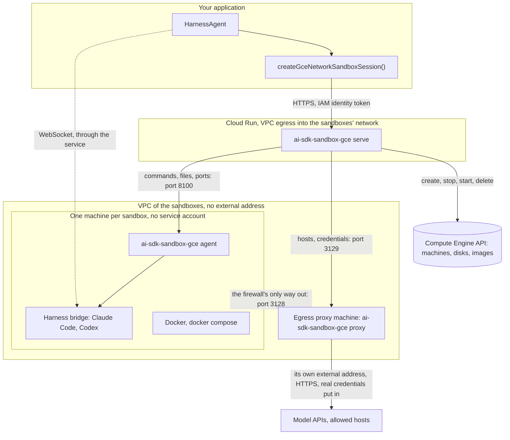
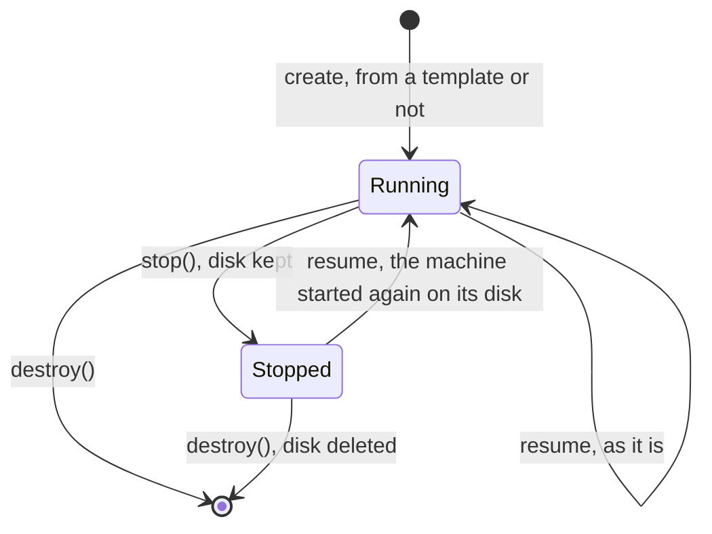

# ai-sdk-sandbox-gce

<p align="center">
  <a href="https://www.npmjs.com/package/ai-sdk-sandbox-gce"></a>
  <a href="https://github.com/fpasquet/ai-sdk-harness/actions/workflows/ci.yml"></a>
  
  
  <a href="https://github.com/fpasquet/ai-sdk-harness/blob/main/LICENSE"></a>
</p>

Run [AI SDK harness agents](https://ai-sdk.dev/docs/ai-sdk-harnesses/harness-agent) (Claude Code, Codex…) in [Compute Engine](https://cloud.google.com/compute) virtual machines on Google Cloud: one machine per sandbox, Docker and Docker Compose included, stopped between turns.

The package gives `HarnessAgent.createSession({ sandboxSession })` what it expects, a `HarnessV1NetworkSandboxSession`, the same way [`ai-sdk-sandbox-cloud-run`](https://www.npmjs.com/package/ai-sdk-sandbox-cloud-run) does for Cloud Run sandboxes, and speaks the same protocol:

- **A virtual machine per sandbox**: the isolation boundary is a hypervisor, and the firewall is applied outside the guest, by the VPC. Docker, `docker compose` and PostgreSQL run in it as on any machine.
- **Nothing running between turns**: `stop()` stops the machine and keeps its disk; a resume starts it again on the same disk. A stopped sandbox costs its disk only.
- **No network of its own**: the machine has no external address and the firewall only lets it reach an egress proxy, which only lets out the hosts you allow, over HTTPS.
- **Credentials stay outside**: the harness hands the sandbox a placeholder, and the proxy swaps the real value in on the way to the model API. A real credential never enters the machine, nor any log. The machine has no service account either.
- **The harness is installed once**: pass `agent.getSandboxTemplate()` and the first sandbox's disk is saved as an image; every later sandbox boots from it.

## How it works

The package comes in four parts: the client your application calls, and three programs you deploy, all in the same package (`ai-sdk-sandbox-gce <serve|proxy|agent>`):



- **The client** (this package's API) creates, resumes, stops and deletes sandboxes, and runs commands, files and ports through the service. It is the client of `ai-sdk-sandbox-cloud-run`, under other names.
- **The sandbox service** (`ai-sdk-sandbox-gce serve`) runs in a Cloud Run service, with VPC egress into the sandboxes' network. It keeps nothing: what a machine is, Compute Engine says; what it may reach and its credentials, the proxy holds; its processes, its agent runs. Any instance serves any sandbox, and it scales to zero.
- **The agent** (`ai-sdk-sandbox-gce agent`) runs in every sandbox machine, started by systemd from the sandbox image. It runs the commands as the sandbox's user, and passes a tunnel on to a port of the machine. It only answers the service, with a token derived for its machine.
- **The egress proxy** (`ai-sdk-sandbox-gce proxy`) runs on a machine of its own, the only one with a way out, through an external address of its own. It knows each sandbox by its machine's internal address, and holds its allowed hosts and credentials in memory.

## Requirements

- Node.js 24 or later: in your application, the service's image, the sandbox image and the proxy's machine.
- A Google Cloud project with Compute Engine, Cloud Run and Cloud DNS, and the `gcloud` CLI.
- `@ai-sdk/harness` and a harness adapter, such as `@ai-sdk/harness-claude-code`.

## Deploying

The commands below set up everything once. Every name is yours to change.

```bash
PROJECT=my-project REGION=europe-west1 ZONE=europe-west1-b
gcloud config set project $PROJECT
```

### 1. The network

One VPC, three subnetworks: the sandboxes, the proxy, and the service's egress from Cloud Run.

```bash
gcloud compute networks create sandboxes --subnet-mode=custom
gcloud compute networks subnets create sandboxes --network=sandboxes --region=$REGION --range=10.8.0.0/20
gcloud compute networks subnets create proxy --network=sandboxes --region=$REGION --range=10.8.16.0/28
gcloud compute networks subnets create service --network=sandboxes --region=$REGION --range=10.8.17.0/26
gcloud compute addresses create sandbox-proxy --region=$REGION --subnet=proxy --addresses=10.8.16.2

# The sandboxes reach the proxy, and nothing else.
gcloud compute firewall-rules create sandboxes-deny-egress --network=sandboxes --direction=EGRESS \
  --action=DENY --rules=all --destination-ranges=0.0.0.0/0 --target-tags=ai-sdk-sandbox --priority=65000
gcloud compute firewall-rules create sandboxes-to-proxy --network=sandboxes --direction=EGRESS \
  --action=ALLOW --rules=tcp:3128 --destination-ranges=10.8.16.2/32 --target-tags=ai-sdk-sandbox --priority=1000
gcloud compute firewall-rules create proxy-from-sandboxes --network=sandboxes --direction=INGRESS \
  --action=ALLOW --rules=tcp:3128 --source-tags=ai-sdk-sandbox --target-tags=ai-sdk-sandbox-proxy

# Only the service reaches the agents and the proxy's administration API.
gcloud compute firewall-rules create agents-from-service --network=sandboxes --direction=INGRESS \
  --action=ALLOW --rules=tcp:8100 --source-ranges=10.8.17.0/26 --target-tags=ai-sdk-sandbox
gcloud compute firewall-rules create proxy-admin-from-service --network=sandboxes --direction=INGRESS \
  --action=ALLOW --rules=tcp:3129 --source-ranges=10.8.17.0/26 --target-tags=ai-sdk-sandbox-proxy
```

A sandbox resolves names through the metadata server, which the firewall does not filter: a DNS query for any name leaves the VPC, a channel for a few bytes at a time. Close it with a [response policy](https://cloud.google.com/dns/docs/zones/manage-response-policies) on the network that answers every name itself, so that no query leaves it:

```bash
gcloud services enable dns.googleapis.com
gcloud dns response-policies create sandboxes-no-dns --networks=sandboxes \
  --description="Every name answered locally: DNS is no way out of a sandbox."
gcloud dns response-policies rules create every-name --response-policy=sandboxes-no-dns \
  --dns-name="*." --local-data=name="*.",type=A,ttl=300,rrdatas=0.0.0.0
```

Keep the `service` subnetwork for the service alone: whatever else runs in it, a Cloud Run job or a machine, reaches the agents and the proxy's administration API like the service does.

Every name then resolves to `0.0.0.0` in the sandboxes, which lose nothing by it: their commands reach hosts through the proxy, which resolves the names, and the metadata server is in their `/etc/hosts`. The proxy, on the same network, resolves names with public resolvers instead, which its startup script below sets up.

### 2. The egress proxy

A small machine, the sandboxes' only way out: always on, or started with the first sandbox and stopped with the last when the service drives it (`SANDBOX_PROXY_INSTANCE`). Its service account may only read its token, from Secret Manager, and write its logs: the token never sits in the machine's metadata, which anyone allowed to read the project's machines reads. Its ephemeral external address is its way out, billed only while it runs; no firewall rule lets anything in from outside.

```bash
printf '%s' "$(openssl rand -hex 32)" | gcloud secrets create sandbox-proxy-token --data-file=-

gcloud iam service-accounts create sandbox-proxy
gcloud secrets add-iam-policy-binding sandbox-proxy-token \
  --member=serviceAccount:sandbox-proxy@$PROJECT.iam.gserviceaccount.com --role=roles/secretmanager.secretAccessor
for role in roles/logging.logWriter roles/monitoring.metricWriter; do
  gcloud projects add-iam-policy-binding $PROJECT \
    --member=serviceAccount:sandbox-proxy@$PROJECT.iam.gserviceaccount.com --role=$role
done

gcloud compute instances create sandbox-proxy --zone=$ZONE --machine-type=e2-small \
  --subnet=proxy --private-network-ip=10.8.16.2 \
  --service-account=sandbox-proxy@$PROJECT.iam.gserviceaccount.com --scopes=cloud-platform \
  --tags=ai-sdk-sandbox-proxy --image-family=debian-12 --image-project=debian-cloud \
  --shielded-secure-boot --metadata-from-file=startup-script=proxy-startup.sh
```

```bash title="proxy-startup.sh"
#!/bin/sh
set -e
# The version of the proxy: the one your application depends on.
VERSION=0.3.2
# Writes $2 to the file $1 when it differs, and says whether it did.
changed() {
  mkdir -p "$(dirname "$1")"
  if printf '%b' "$2" | cmp -s - "$1"; then return 1; fi
  printf '%b' "$2" > "$1"
}
# Public resolvers, not the metadata server's, which the sandboxes' response policy answers.
# After gce-resolved.conf, which adds the metadata server: the empty DNS= resets the list.
dns=false
if changed /etc/systemd/resolved.conf.d/public-dns.conf '[Resolve]\nDNS=\nDNS=8.8.8.8 1.1.1.1\nDomains=~.\n'; then
  dns=true
fi
for network in /run/systemd/network/*.network; do
  if changed "/etc/systemd/network/$(basename "$network").d/no-dhcp-dns.conf" '[DHCPv4]\nUseDNS=false\n'; then
    dns=true
  fi
done
# Restarted on a change only: from the second boot on, the proxy already runs, resolving names.
if [ "$dns" = true ]; then systemctl restart systemd-networkd systemd-resolved; fi
# Node.js and the Ops Agent from their signed apt repositories: no script piped into a shell.
install -m 0755 -d /etc/apt/keyrings
if ! command -v npm >/dev/null; then
  curl -fsSL https://deb.nodesource.com/gpgkey/nodesource-repo.gpg.key -o /etc/apt/keyrings/nodesource.asc
  echo "deb [signed-by=/etc/apt/keyrings/nodesource.asc] https://deb.nodesource.com/node_24.x nodistro main" \
    > /etc/apt/sources.list.d/nodesource.list
  apt-get update
  apt-get install -y nodejs
fi
# Installed again whenever the pinned version changes: the proxy then restarts on it, below.
restart=false
if ! npm ls --global "ai-sdk-sandbox-gce@$VERSION" >/dev/null 2>&1; then
  npm install --global "ai-sdk-sandbox-gce@$VERSION"
  restart=true
fi
# Its logs, the refusals among them, sent to Cloud Logging by the Ops Agent.
if [ ! -d /opt/google-cloud-ops-agent ]; then
  curl -fsSL https://packages.cloud.google.com/apt/doc/apt-key.gpg -o /etc/apt/keyrings/google-cloud.asc
  echo "deb [signed-by=/etc/apt/keyrings/google-cloud.asc] https://packages.cloud.google.com/apt google-cloud-ops-agent-bookworm-all main" \
    > /etc/apt/sources.list.d/google-cloud-ops-agent.list
  apt-get update
  apt-get install -y google-cloud-ops-agent
fi
# Its token, read from Secret Manager as the machine's service account.
cat > /usr/local/bin/ai-sdk-sandbox-proxy-token <<'SCRIPT'
#!/bin/sh
set -e
metadata=http://metadata.google.internal/computeMetadata/v1
project=$(curl -fsS -H Metadata-Flavor:Google $metadata/project/project-id)
access=$(curl -fsS -H Metadata-Flavor:Google $metadata/instance/service-accounts/default/token \
  | python3 -c 'import json, sys; print(json.load(sys.stdin)["access_token"])')
curl -fsS -H "Authorization: Bearer $access" \
  "https://secretmanager.googleapis.com/v1/projects/$project/secrets/sandbox-proxy-token/versions/latest:access" \
  | python3 -c 'import base64, json, sys; print(base64.b64decode(json.load(sys.stdin)["payload"]["data"]).decode(), end="")'
SCRIPT
chmod 755 /usr/local/bin/ai-sdk-sandbox-proxy-token
cat > /tmp/ai-sdk-sandbox-proxy.service <<'UNIT'
[Unit]
Description=ai-sdk-sandbox-gce egress proxy
After=network-online.target
Wants=network-online.target

[Service]
# Started at boot only when it is the version this script pins: an earlier one would take the
# sandboxes the service registers meanwhile, and forget them as the script upgrades it.
ExecCondition=+/usr/local/bin/ai-sdk-sandbox-proxy-pinned
ExecStart=/bin/sh -c 'SANDBOX_PROXY_TOKEN=$(/usr/local/bin/ai-sdk-sandbox-proxy-token) exec ai-sdk-sandbox-gce proxy'
Restart=always
# With SANDBOX_PROXY_INSTANCE on the service: after 10 minutes with no sandbox, the proxy exits
# with 100 and its machine stops, should no sandbox come after prepareGceSandboxService(). Leave
# these three lines out for a proxy always on.
Environment=SANDBOX_PROXY_IDLE_EXIT_MINUTES=10
RestartPreventExitStatus=100
ExecStopPost=+/bin/sh -c 'if [ "$$EXIT_STATUS" = 100 ]; then systemctl poweroff; fi'
DynamicUser=yes
# Every sandbox holds up to SANDBOX_PROXY_MAX_CONNECTIONS (128) connections at once.
LimitNOFILE=65536

[Install]
WantedBy=multi-user.target
UNIT
if ! cmp -s /tmp/ai-sdk-sandbox-proxy.service /etc/systemd/system/ai-sdk-sandbox-proxy.service; then
  mv /tmp/ai-sdk-sandbox-proxy.service /etc/systemd/system/ai-sdk-sandbox-proxy.service
  systemctl daemon-reload
  restart=true
fi
# Whether the installed proxy is the version the startup script in the metadata pins: read anew at
# each boot, before this script runs again.
cat > /usr/local/bin/ai-sdk-sandbox-proxy-pinned <<'SCRIPT'
#!/bin/sh
set -e
pinned=$(curl -fsS -H Metadata-Flavor:Google \
  http://metadata.google.internal/computeMetadata/v1/instance/attributes/startup-script \
  | sed -n 's/^VERSION=//p')
npm ls --global "ai-sdk-sandbox-gce@$pinned" >/dev/null 2>&1
SCRIPT
chmod 755 /usr/local/bin/ai-sdk-sandbox-proxy-pinned
# Started by systemd as the machine boots, seconds before this script runs, when its package is
# the pinned one; started here otherwise, once upgraded.
systemctl enable --quiet ai-sdk-sandbox-proxy
if [ "$restart" = true ]; then
  systemctl restart ai-sdk-sandbox-proxy
else
  systemctl start ai-sdk-sandbox-proxy
fi
```

Pin `ai-sdk-sandbox-gce` to the version your application depends on, here and in the two images below: every side checks that the others speak its protocol. Every version published by the release workflow carries a [provenance attestation](https://docs.npmjs.com/generating-provenance-statements): `npm audit signatures` checks it, in a project that depends on the package. To upgrade the proxy, change `VERSION` in the script, hand it to the machine again, and reboot it, or let the service start it with the next sandbox if it is stopped:

```bash
gcloud compute instances add-metadata sandbox-proxy --zone=$ZONE \
  --metadata-from-file=startup-script=proxy-startup.sh
gcloud compute instances reset sandbox-proxy --zone=$ZONE
```

The proxy need not run when no sandbox does: set `SANDBOX_PROXY_INSTANCE=sandbox-proxy` on the service (step 4), which then starts it with the first sandbox, booting alongside it, and stops it once none runs. A sandbox then waits some 40 s for the proxy to boot: call `prepareGceSandboxService()` (see [Usage](#usage)) as soon as one is likely to be asked for, and it finds the proxy up. Its startup script runs again at each boot, and its registrations, held in memory, are made again by the sandboxes that start.

### 3. The sandbox image

Every sandbox boots from it: put the tools your agent needs in it, and never a secret. Build it with [Packer](https://developer.hashicorp.com/packer/integrations/hashicorp/googlecompute) or by hand, from a machine that ran this script on Debian 12, then `gcloud compute images create --family=ai-sdk-sandbox`:

```bash title="sandbox-image.sh"
#!/bin/sh
set -e
apt-get update
apt-get install -y --no-install-recommends ca-certificates curl git gnupg procps python3 ripgrep sudo

# Docker Engine and Compose.
install -m 0755 -d /etc/apt/keyrings
curl -fsSL https://download.docker.com/linux/debian/gpg -o /etc/apt/keyrings/docker.asc
echo "deb [signed-by=/etc/apt/keyrings/docker.asc] https://download.docker.com/linux/debian bookworm stable" \
  > /etc/apt/sources.list.d/docker.list
apt-get update
apt-get install -y docker-ce docker-ce-cli containerd.io docker-buildx-plugin docker-compose-plugin

# Node.js, the agent, and pnpm: the Claude Code and Codex bridges install their dependencies with it.
curl -fsSL https://deb.nodesource.com/gpgkey/nodesource-repo.gpg.key -o /etc/apt/keyrings/nodesource.asc
echo "deb [signed-by=/etc/apt/keyrings/nodesource.asc] https://deb.nodesource.com/node_24.x nodistro main" \
  > /etc/apt/sources.list.d/nodesource.list
apt-get update
apt-get install -y nodejs
npm install --global ai-sdk-sandbox-gce@0.3.2 pnpm@10

# The sandbox's user: sudo without a password, and Docker.
useradd --create-home --shell /bin/bash agent
usermod -aG docker agent
echo 'agent ALL=(ALL) NOPASSWD:ALL' > /etc/sudoers.d/agent

cat > /etc/systemd/system/ai-sdk-sandbox-agent.service <<'UNIT'
[Unit]
Description=ai-sdk-sandbox-gce agent
After=network-online.target
Wants=network-online.target

[Service]
ExecStart=/usr/bin/ai-sdk-sandbox-gce agent
Restart=always

[Install]
WantedBy=multi-user.target
UNIT
systemctl enable ai-sdk-sandbox-agent
```

The agent runs as root and starts the commands as `agent`. It does not wait for Docker to boot, some 10 s on a small machine: its socket answers the first `docker` command once the daemon is up. It points Docker at the proxy itself, the daemon and the client: images are pulled through the proxy, and containers get its address in their proxy variables. Rebuild the image every week or so for the security updates: the templates made on the previous one are made again on the next sandbox.

### 4. The service

The service's image is published on Docker Hub with each release, `docker.io/fpasquet/ai-sdk-sandbox-gce:<version>`: Node.js and the package, built by the release workflow from the version on npm. Deploy the version your application depends on. Each image carries a provenance attestation, which `gh attestation verify oci://docker.io/fpasquet/ai-sdk-sandbox-gce:0.3.2 --owner fpasquet` checks; its [`Dockerfile`](https://github.com/fpasquet/ai-sdk-harness/blob/main/packages/sandbox-gce/Dockerfile) builds the same image from your own registry.

Its service account gets a role of its own, with what the service calls and nothing else, limited by a condition to the names it uses: the sandboxes' machines and disks (`sbx-`), the proxy's machine, the sandbox images and templates (`ai-sdk-`).

```yaml title="sandbox-condition.yaml"
title: sandbox-resources
description: The sandboxes' machines and disks, the proxy's machine, the sandbox images and templates
expression: >-
  (resource.type != "compute.googleapis.com/Instance"
    || resource.name.extract("/instances/{name}").startsWith("sbx-")
    || resource.name.endsWith("/instances/sandbox-proxy"))
  && (resource.type != "compute.googleapis.com/Disk"
    || resource.name.extract("/disks/{name}").startsWith("sbx-"))
  && (resource.type != "compute.googleapis.com/Image"
    || resource.name.extract("/images/{name}").startsWith("ai-sdk-"))
```

```bash
gcloud iam service-accounts create sandboxes
gcloud iam roles create sandboxService --project=$PROJECT --title="Sandbox service" --permissions=\
compute.instances.create,compute.instances.get,compute.instances.list,compute.instances.start,\
compute.instances.stop,compute.instances.resume,compute.instances.delete,compute.instances.setLabels,\
compute.instances.setMetadata,compute.instances.setTags,compute.instances.setScheduling,\
compute.disks.create,compute.disks.delete,compute.disks.setLabels,compute.disks.useReadOnly,\
compute.images.create,compute.images.get,compute.images.getFromFamily,compute.images.useReadOnly,\
compute.images.setLabels,compute.images.delete,compute.subnetworks.use,\
compute.zoneOperations.get,compute.globalOperations.get
gcloud projects add-iam-policy-binding $PROJECT \
  --member=serviceAccount:sandboxes@$PROJECT.iam.gserviceaccount.com \
  --role=projects/$PROJECT/roles/sandboxService --condition-from-file=sandbox-condition.yaml

printf '%s' "$(openssl rand -hex 32)" | gcloud secrets create sandbox-agent-secret --data-file=-
printf '%s' "$(openssl rand -hex 32)" | gcloud secrets create sandbox-service-token --data-file=-
for secret in sandbox-agent-secret sandbox-proxy-token sandbox-service-token; do
  gcloud secrets add-iam-policy-binding $secret \
    --member=serviceAccount:sandboxes@$PROJECT.iam.gserviceaccount.com --role=roles/secretmanager.secretAccessor
done

gcloud run deploy sandboxes --region=$REGION --image=docker.io/fpasquet/ai-sdk-sandbox-gce:0.3.2 \
  --service-account=sandboxes@$PROJECT.iam.gserviceaccount.com \
  --network=sandboxes --subnet=service --vpc-egress=private-ranges-only \
  --no-allow-unauthenticated --min-instances=0 --timeout=3600 --concurrency=1000 \
  --set-env-vars=SANDBOX_ZONE=$ZONE,SANDBOX_IMAGE=family/ai-sdk-sandbox \
  --set-env-vars=SANDBOX_SUBNETWORK=regions/$REGION/subnetworks/sandboxes \
  --set-env-vars=SANDBOX_PROXY_URL=http://10.8.16.2:3128,SANDBOX_PROXY_ADMIN_URL=http://10.8.16.2:3129 \
  --set-env-vars=SANDBOX_ALLOWED_HOSTS=registry.npmjs.org \
  --set-env-vars=SANDBOX_PROXY_INSTANCE=sandbox-proxy,SANDBOX_MAX_RUNNING=5,SANDBOX_MAX_RUN_HOURS=12 \
  --set-secrets=SANDBOX_AGENT_SECRET=sandbox-agent-secret:latest,SANDBOX_PROXY_TOKEN=sandbox-proxy-token:latest \
  --set-secrets=SANDBOX_SERVICE_TOKEN=sandbox-service-token:latest
```

What these settings are for:

- `--network`, `--subnet`, `--vpc-egress`: Direct VPC egress, so that the service reaches the agents and the proxy on their internal addresses.
- `--image`: Cloud Run resolves the tag to its digest when it deploys a revision, which runs that image whatever is pushed under the tag later. Nothing is built in your project: no Cloud Build, and no build account to keep away from the agents' tokens.
- `sandboxService`: create, stop, start and delete the machines, save a template as an image, start and stop the proxy; nothing outside the names of the condition. A missing permission shows in `pnpm test:e2e`.
- `SANDBOX_PROXY_INSTANCE`: the proxy only runs while a sandbox does. `SANDBOX_MAX_RUNNING`: the machines running at once, a cap on the bill. `SANDBOX_MAX_RUN_HOURS`: Compute Engine stops a machine after so long, whatever happens.
- `SANDBOX_SERVICE_TOKEN`: a second lock beside Cloud Run's IAM, should the service ever be deployed open; the client hands it over as `serviceToken`. The service refuses to start on Cloud Run without it, unless `SANDBOX_INSECURE_NO_TOKEN=true`.
- `--min-instances=0`: no instance and no bill while no call comes; the sandboxes run on without the service.
- `--timeout=3600`: the longest a request lasts, so the longest a bridge WebSocket lasts. The harness reconnects beyond it.
- `--concurrency=1000`: every open bridge holds a request.

### 5. Who may call it

Cloud Run's IAM only lets through the identities granted `roles/run.invoker`:

```bash
gcloud run services add-iam-policy-binding sandboxes --region=$REGION \
  --member=serviceAccount:my-app@$PROJECT.iam.gserviceaccount.com --role=roles/run.invoker
```

Anyone with that role and the service token can run commands in every sandbox of the service: grant it to your application, not to people who only need to read logs, and hand the token to the client as `serviceToken` (`gcloud secrets versions access latest --secret=sandbox-service-token`). Each agent's token sits in its machine's metadata, which anyone allowed `compute.instances.get` on the project reads (`roles/viewer`, `roles/compute.viewer`): with a foothold in the `service` subnetwork as well, they run commands in that sandbox as root, until the sandbox is next stopped, which draws it a new token. Grant those roles sparingly, and keep the subnetwork to the service alone. Roles granted on the project's folder or organization count as well: `gcloud projects get-ancestors-iam-policy $PROJECT` lists them.

Read the service's URL with `gcloud run services describe sandboxes --region=$REGION --format='value(status.url)'`; the examples below read it from `GCE_SANDBOX_URL`.

## Installation

```bash
pnpm add ai-sdk-sandbox-gce @ai-sdk/harness @ai-sdk/harness-claude-code
```

## Usage

```ts title="agent.ts"
import { HarnessAgent } from '@ai-sdk/harness/agent';
import { createClaudeCode } from '@ai-sdk/harness-claude-code';
import { createGceNetworkSandboxSession } from 'ai-sdk-sandbox-gce';

// Authenticated from CLAUDE_CODE_OAUTH_TOKEN or ANTHROPIC_API_KEY, which stay in this process.
const agent = new HarnessAgent({ id: 'coder', harness: createClaudeCode() });

const sandboxSession = await createGceNetworkSandboxSession({
  // The service's URL: `gcloud run services describe` prints it.
  url: process.env.GCE_SANDBOX_URL!,
  // On Google Cloud, the workload's service account; `gcloud` on a developer's machine.
  auth: 'metadata',
  // The Claude Code bridge listens on the first port; the harness reaches it through the service.
  ports: [4000],
  // The bridge installs its dependencies from npm.
  allowedHosts: ['registry.npmjs.org'],
  // Saves a machine with Claude Code installed as an image the first time, reused afterwards.
  template: await agent.getSandboxTemplate(),
});
const session = await agent.createSession({ sandboxSession });

try {
  const result = await agent.generate({
    session,
    prompt: 'Write a docker-compose.yml with PostgreSQL, start it, and check it answers.',
  });
  console.log(result.text);
} finally {
  await session.destroy();
  await sandboxSession.destroy();
}
```

`auth` takes `'gcloud'` (the default: `gcloud auth print-identity-token`), `'metadata'` (the workload's service account on Google Cloud), `'none'`, or a function returning an identity token for the service's URL, such as one from `google-auth-library`.

When the service starts and stops the egress proxy (`SANDBOX_PROXY_INSTANCE`), the first sandbox after a quiet spell waits for the proxy's machine to boot. Ask the service to boot it as soon as a sandbox is likely to be asked for, a person reading what is about to run, say, and the sandbox finds it up:

```ts
import { prepareGceSandboxService } from 'ai-sdk-sandbox-gce';

// Not awaited: it only starts the proxy's machine, and an error changes nothing for the sandboxes.
void prepareGceSandboxService({ url: process.env.GCE_SANDBOX_URL!, auth: 'metadata' }).catch(
  () => undefined,
);
```

The proxy stops again with the next sandbox that stops, or by itself after 10 minutes when none comes (`SANDBOX_PROXY_IDLE_EXIT_MINUTES` in its unit). A service that keeps its proxy always on, or of an earlier version, does nothing.

## Images and toolchains

Every sandbox boots from an image the service offers: `SANDBOX_IMAGE`, its default, and those `SANDBOX_IMAGES` names, one per toolchain say. A caller picks one by its name, never by its path:

```bash
--set-env-vars=SANDBOX_IMAGE=family/ai-sdk-sandbox \
--set-env-vars=SANDBOX_IMAGES=python=family/ai-sdk-sandbox-python,go=family/ai-sdk-sandbox-go
```

```ts
await createGceNetworkSandboxSession({ url, image: 'python', ports: [4000] });
```

Whatever the project's language, a harness needs **Node.js** in the sandbox, for its bridge (Claude Code installs its SDK with pnpm), and **git**, for the repositories. Build every image on the [sandbox image](#3-the-sandbox-image) script, then add the toolchain: `apt-get install -y python3-venv`, Go's tarball, `rustup`… The client checks the sandbox once its `setup` ran, which may install them: one lacking `node` or `git` fails the creation with `GceSandboxImageError`, which names what is missing, and the machine is deleted. `requiredCommands` changes the list, `[]` turns the check off.

A template is made on the image of its sandbox: `python` and `default` get one each.

## Templates

A harness bootstraps itself in the sandbox before its first turn: Claude Code installs `@anthropic-ai/claude-agent-sdk` and the `claude` CLI. Pass the agent's template and it happens once: the first call creates a throwaway sandbox, runs `setup` in it, lets the harness prepare it, stops it, saves its disk as an image and deletes it. Every later sandbox boots from that image.

The image is named after the template's id and a digest of this package's version and the base image, a family resolved to its latest image: `ai-sdk-harness-template-<digest>-<base>`. After a new sandbox image, or a new version of the package, the first sandbox makes the template again. Delete the old images (label `ai-sdk-sandbox=template`) now and then: each costs its storage.

A template is made from a sandbox no agent ever ran in: the client's throwaway one, where only `setup` and the harness's own installation run. Never save a sandbox an agent worked in as a template, through the API or otherwise: whatever the agent left on its disk, the `agent` service of the machine included, would start in every later sandbox.

Making a template takes a few minutes: the machine boots, the harness installs, Compute Engine saves the disk, and the first sandbox on a new image waits a minute more while Compute Engine spreads it. Make it when you deploy, rather than in the first user's session, with a script that creates a sandbox from the agent's template and deletes it:

```ts title="make-template.ts"
const agent = new HarnessAgent({ id: 'coder', harness: createClaudeCode() });
const sandboxSession = await createGceNetworkSandboxSession({
  url: process.env.GCE_SANDBOX_URL!,
  allowedHosts: ['registry.npmjs.org'],
  template: await agent.getSandboxTemplate(),
});
await sandboxSession.destroy();
```

## Speed or cost

`SANDBOX_PROFILE` on the service trades how fast a sandbox starts against what the service costs at rest. It only sets defaults: each setting below can be set on its own.

| Profile          | At rest                                                                                                                                                                                  | A sandbox from a template                                                               |
| ---------------- | ---------------------------------------------------------------------------------------------------------------------------------------------------------------------------------------- | --------------------------------------------------------------------------------------- |
| `cost` (default) | Nothing runs: the disks of stopped sandboxes and the templates' images only. With `SANDBOX_PROXY_INSTANCE`, the proxy runs while a sandbox does                                          | Some 35 to 40 s: a machine boots for it                                                 |
| `fast`           | One machine of `SANDBOX_MACHINE_TYPE` and its disk for each template used in the last 24 h, all the time, at its Spot price with `SANDBOX_SPOT=true`; and the proxy's machine, always on | A few seconds when the pool's machine has booted, less than a cold start while it boots |

`fast` keeps a machine booted from each template in use, the warm pool (`SANDBOX_WARM_POOL=1`, machines per template), and never stops the proxy (`SANDBOX_PROXY_ALWAYS_ON=true`). A creation from a template takes one of its machines as it is, and the service creates the next one in the same request, without waiting for it to boot: Cloud Run throttles the service's CPU once it has answered, so nothing is left to run after. Each machine runs some 730 hours a month: see [Compute Engine's prices](https://cloud.google.com/compute/vm-instance-pricing) for your machine type and region.

- Only a creation from a template takes from the pool: `template: await agent.getSandboxTemplate()`. A creation without one, or a resume, boots its machine as before.
- A machine of the pool never ran an agent: it boots from the template, as a new sandbox does. Once taken it is the sandbox's, and never goes back to the pool.
- Each template has its pool: two harnesses, Claude Code and Codex say, keep a machine each. A new template (a new version of the package or of the sandbox image) gets its own on its first creation.
- A machine that waited 24 h without a creation is deleted, without a replacement, by the next creation that meets it, whatever its template: a template no longer used costs a day of its machine at most.
- A creation takes a running machine of its template first, or else one still booting, the one booting longest: it is ready sooner than a machine booted for the creation. Two creations in a row: the second takes the machine the first one started.
- A machine taken from the pool keeps its name, `sbx-pool-<hex>`: Compute Engine cannot rename a running machine. The sandbox's name is on its label `ai-sdk-sandbox-name`, by which the service finds it.
- `SANDBOX_MAX_RUNNING` does not count the pool's machines, and they do not keep the proxy up.
- `SANDBOX_MAX_RUN_HOURS` applies to the pool's machines as to every other, the bill's guard: for a sandbox taken from the pool, Compute Engine counts it from the machine's boot in the pool, 24 h ago at most. How long a session lasts is the application's to decide, not the limit's. With `SANDBOX_SPOT=true`, Compute Engine may take a machine back. A machine stopped either way is deleted by the next creation that meets it, and the pool fills again.
- With `SANDBOX_PROXY_INSTANCE`, the service starts the proxy with the first sandbox and leaves it running: leave the three lines of `SANDBOX_PROXY_IDLE_EXIT_MINUTES` out of its unit, or the proxy stops itself after 10 minutes with no sandbox. Without `SANDBOX_PROXY_INSTANCE`, the proxy is always on anyway.
- Back to `cost`, the next creation from a template takes what is left in its pool, and makes nothing more.

## Stopping and resuming

`stop()` suspends the sandbox: the processes this session started are stopped, the proxy forgets its credentials, then the machine is stopped, its disk kept. Resume it later, from this process or another one:



```ts
import {
  createGceNetworkSandboxSession,
  GceSandboxNotFoundError,
  resumeGceNetworkSandboxSession,
} from 'ai-sdk-sandbox-gce';

const settings = { url, ports: [4000], allowedHosts: ['registry.npmjs.org'] };

async function openSandbox(sandboxId: string) {
  try {
    const sandbox = await resumeGceNetworkSandboxSession({ ...settings, sandboxId });
    // A previous run may have left a bridge behind, holding the port.
    await sandbox.killAllProcesses();
    return sandbox;
  } catch (error) {
    if (!(error instanceof GceSandboxNotFoundError)) throw error;
    return createGceNetworkSandboxSession({ ...settings, sandboxId });
  }
}
```

A running sandbox is resumed as it is, its credentials kept; a stopped one boots again, its files as they were, its processes and `/tmp` gone. Creation never resumes: a sandbox already named `sandboxId`, running or stopped, is a conflict. The service does not keep `ports`, `allowedHosts` nor `baseUrls`: pass the settings again on every resume.

**Stop idle sandboxes yourself**, after `session.stop()` of the harness session, whose state lets `agent.createSession({ sessionId, resumeFrom })` pick the conversation up again: a running machine is billed by the second. [`ai-sdk-harness-sessions`](https://ai-sdk-harness.pages.dev/docs/packages/harness-sessions) does so after an idle timeout. Delete the sandboxes you will not resume: a stopped machine's disk is billed until then.

## Credentials

The real credentials of a harness, an API key or a subscription token, never enter the machine, where the agent could read them. The sandbox only ever sees a **placeholder**, and the proxy swaps the real value in on the request's way out.

1. The harness reads the credential where your application keeps it, makes a placeholder and starts the agent in the sandbox with it.
2. It hands the service a request transformation: on a request to the API's host carrying the placeholder, put the real value instead. The service passes it on to the proxy, which keeps it in memory, for that sandbox alone.
3. The API's client in the sandbox is pointed at the proxy, in plain HTTP inside the VPC, through its base URL variable: `ANTHROPIC_BASE_URL=https://api.anthropic.com` becomes `http://10.8.16.2:3128/https/api.anthropic.com`.
4. The proxy swaps the placeholder for the real value and sends the request on over HTTPS. The answer comes back without it, even when the API echoes it in a header.

Git over HTTPS goes the same way: the agent hands every command a `url.<proxy>/https/.insteadOf https://` setting, after the command's own `GIT_CONFIG_*` entries, so that a credential brokered for a Git server, such as a repository of [`ai-sdk-harness-workspace`](https://ai-sdk-harness.pages.dev/docs/packages/harness-workspace), is swapped in too. Through the `HTTPS_PROXY` tunnel, which the proxy cannot read, the server would get the placeholder.

The service routes `ANTHROPIC_BASE_URL` (Claude Code) and `OPENAI_BASE_URL` (Codex) by default; add others with `baseUrls`. With a subscription, the refresh token never leaves your application: only the short-lived access token reaches the proxy.

| Protection                                 | What it prevents                                                                                                                                                                                                                                                   |
| ------------------------------------------ | ------------------------------------------------------------------------------------------------------------------------------------------------------------------------------------------------------------------------------------------------------------------ |
| **Brokering is always on**                 | A harness falling back to forwarding the real credential into the sandbox                                                                                                                                                                                          |
| **Commands carrying a credential refused** | A real credential entering the sandbox anyway, on a command line or in a variable: the service asks the proxy, which holds them, before running a command. The standard input, and so the files written, are not checked: a guard against a mistake, not a control |
| **One host per credential**                | The credential reaching another host: it is only put in requests to the host it is for                                                                                                                                                                             |
| **HTTPS only**                             | The credential travelling in clear outside the VPC: a base URL in plain HTTP is refused                                                                                                                                                                            |
| **No private address**                     | The sandbox reaching the proxy's metadata server, the service or the rest of the VPC through the proxy: see [Network](#network)                                                                                                                                    |
| **No service account**                     | A Google credential in the machine: its metadata server has no token to give                                                                                                                                                                                       |
| **Forgotten when done**                    | The credential outliving its use: `release()`, `stop()` and `destroy()` drop it from the proxy's memory, and a proxy restart drops all                                                                                                                             |

## Network

The machine has no external address, and the VPC firewall, applied outside the guest, only lets it reach the proxy. Everything goes through it:

- `HTTPS_PROXY` points at the proxy: it tunnels a `CONNECT` to port 443 of an allowed host, end to end encrypted, and refuses anything else. The tunnel only carries TLS that names that host (SNI): a client cannot open it to an allowed host behind a CDN, then name another site of the same CDN. The proxy reads nothing past the ClientHello, an HTTP `Host` header inside the TLS included.
- The base URLs go to the proxy too, as above.
- `HTTP_PROXY` points at the proxy as well: plain HTTP to an allowed host, as Debian's package mirrors serve, is passed on as it is, no credential put in. Anything else in plain HTTP is refused.
- `NO_PROXY` covers the machine itself, the proxy and the private ranges Docker puts its containers in. A container reached by its Compose service name is not covered: add the names to `NO_PROXY` in the Compose file.
- The proxy never connects to a private address, however it is named or allowed: loopback, link-local (its own metadata server), the private ranges of the VPC. It checks the address a name resolves to, at the moment it connects. In IPv6, it only reaches global unicast addresses (`2000::/3`), never one carrying a private IPv4 address (NAT64, 6to4, IPv4-mapped) nor a Teredo one.

`allowedHosts` adds hosts for one sandbox, on top of the service's `SANDBOX_ALLOWED_HOSTS`. `*.example.com` covers the subdomains of `example.com`. `setNetworkPolicy` replaces the sandbox's own hosts: `allow-all` lets it reach any host over HTTPS, `deny-all` none but the service's and the base URLs'. CIDR rules are not supported.

Docker pulls images from Docker Hub through the proxy: allow `registry-1.docker.io`, `auth.docker.io`, `production.cloudflare.docker.com` and `production.cloudfront.docker.com` (Docker Hub serves layers from either), or [`ai-sdk-harness-network`](https://ai-sdk-harness.pages.dev/docs/packages/harness-network)'s presets.

## Ports

`ports` lists the ports inside the sandbox the harness may reach. `getPortEndpoint()` returns a WebSocket URL on the service, `wss://<service>/v1/sandboxes/<name>/ports/<port>`, with the identity token as a header, read anew at each connection. The service passes the connection on to the machine's agent, with the agent's token in place of the caller's, and the agent on to `127.0.0.1:<port>`. A port outside the list is refused with `HarnessCapabilityUnsupportedError`.

## Lifecycle

| Method                     | What it does                                                                                      |
| -------------------------- | ------------------------------------------------------------------------------------------------- |
| `release()`                | Stops the processes this session started and forgets its credentials, leaving the sandbox running |
| `killAllProcesses()`       | Stops every process the machine's agent started                                                   |
| `stop()`                   | Stops the machine, its disk kept. Idempotent                                                      |
| `destroy()`                | Deletes the machine and its disk. Idempotent                                                      |
| `setNetworkPolicy(policy)` | Replaces the hosts the sandbox may reach                                                          |
| `restricted()`             | The files-and-processes view of the same sandbox, to hand to tools                                |
| `fork({ ports })`          | Another view of the same sandbox, with ports, processes and credentials of its own                |

`fork()` lets several harness sessions run side by side in one machine, each with a bridge on its own port, as with `ai-sdk-sandbox-cloud-run`.

## Options

`createGceNetworkSandboxSession(options)` takes every option below; `resumeGceNetworkSandboxSession(options)` takes `sandboxId`, `abortSignal` and the connection settings.

| Option             | Default           | Description                                                                                         |
| ------------------ | ----------------- | --------------------------------------------------------------------------------------------------- |
| `url`              | required          | _Connection._ The URL of the sandbox service                                                        |
| `auth`             | `'gcloud'`        | _Connection._ `'gcloud'`, `'metadata'`, `'none'`, or a function returning an identity token         |
| `ports`            | `[]`              | _Connection._ Ports the harness may reach, through the service                                      |
| `allowedHosts`     | `[]`              | _Connection._ Hosts the sandbox may reach over HTTPS, on top of the service's                       |
| `baseUrls`         | `{}`              | _Connection._ Base URL variables routed through the proxy, on top of the service's                  |
| `serviceToken`     | none              | _Connection._ The service's `SANDBOX_SERVICE_TOKEN`, when it has one                                |
| `sandboxId`        | `ai-sdk-<hex>`    | The sandbox's name: lowercase letters, digits and dashes, 55 at most. Creation fails if it is taken |
| `template`         | none              | `await agent.getSandboxTemplate()`: prepare once, boot every later sandbox from it                  |
| `image`            | `default`         | The image the machine boots from, by the name the service gives it in `SANDBOX_IMAGES`              |
| `requiredCommands` | `['node', 'git']` | Commands the sandbox must have once `setup` ran                                                     |
| `setup`            | `[]`              | Commands run once after creation, as the sandbox's user (who has `sudo`), saved in the template     |
| `abortSignal`      | none              | Aborts the creation or the resume                                                                   |

## Configuration

### The service (`serve`)

| Variable                    | Default                                                                                  | Description                                                                                                                                                                                                                                                                                                                                |
| --------------------------- | ---------------------------------------------------------------------------------------- | ------------------------------------------------------------------------------------------------------------------------------------------------------------------------------------------------------------------------------------------------------------------------------------------------------------------------------------------ |
| `SANDBOX_ZONE`              | required                                                                                 | The zone of the machines                                                                                                                                                                                                                                                                                                                   |
| `SANDBOX_IMAGE`             | required                                                                                 | The sandbox image: a name, `family/<family>`, or `projects/<project>/global/images/…`                                                                                                                                                                                                                                                      |
| `SANDBOX_IMAGES`            | none                                                                                     | Other images callers may pick by name, as `NAME=image` pairs: `python=family/ai-sdk-sandbox-python`                                                                                                                                                                                                                                        |
| `SANDBOX_AGENT_SECRET`      | required                                                                                 | 32 characters at least: the agents' tokens are derived from it. Keep it in Secret Manager                                                                                                                                                                                                                                                  |
| `SANDBOX_PROXY_URL`         | required                                                                                 | The proxy, as the machines reach it: `http://10.8.16.2:3128`                                                                                                                                                                                                                                                                               |
| `SANDBOX_PROXY_ADMIN_URL`   | required                                                                                 | Its administration API: `http://10.8.16.2:3129`                                                                                                                                                                                                                                                                                            |
| `SANDBOX_PROXY_TOKEN`       | required                                                                                 | The proxy's token                                                                                                                                                                                                                                                                                                                          |
| `SANDBOX_PROJECT`           | the service's project                                                                    | The project of the machines                                                                                                                                                                                                                                                                                                                |
| `SANDBOX_NETWORK`           | the default network                                                                      | The machines' VPC network                                                                                                                                                                                                                                                                                                                  |
| `SANDBOX_SUBNETWORK`        | none                                                                                     | Their subnetwork: `regions/<region>/subnetworks/<name>`                                                                                                                                                                                                                                                                                    |
| `SANDBOX_NETWORK_TAGS`      | `ai-sdk-sandbox`                                                                         | Their network tags, which the firewall rules apply to                                                                                                                                                                                                                                                                                      |
| `SANDBOX_MACHINE_TYPE`      | `e2-standard-4`                                                                          | Their machine type, a custom one included: `e2-custom-4-8192`                                                                                                                                                                                                                                                                              |
| `SANDBOX_DISK_GB`           | `20`                                                                                     | The size of their disk                                                                                                                                                                                                                                                                                                                     |
| `SANDBOX_DISK_TYPE`         | `pd-balanced`                                                                            | Its type                                                                                                                                                                                                                                                                                                                                   |
| `SANDBOX_SPOT`              | `false`                                                                                  | `true` for Spot machines: cheaper, stopped when Compute Engine takes them back, resumable after                                                                                                                                                                                                                                            |
| `SANDBOX_SPOT_FALLBACK`     | `true`                                                                                   | With Spot, a machine the zone has no Spot capacity for is created or started as a standard one, billed as such; `false` fails instead                                                                                                                                                                                                      |
| `SANDBOX_INSTANCE_PREFIX`   | `sbx-`                                                                                   | Put before a sandbox's name to make its machine's, 8 characters at most                                                                                                                                                                                                                                                                    |
| `SANDBOX_AGENT_PORT`        | `8100`                                                                                   | The port of the agents                                                                                                                                                                                                                                                                                                                     |
| `SANDBOX_START_TIMEOUT`     | `300`                                                                                    | Seconds a machine has to boot and its agent to answer                                                                                                                                                                                                                                                                                      |
| `SANDBOX_MAX_RUNNING`       | none                                                                                     | The most sandboxes running at once: a creation or a resume beyond it is answered with a 429. Counted at each call, so two at the same instant may both pass                                                                                                                                                                                |
| `SANDBOX_MAX_RUN_HOURS`     | none                                                                                     | The longest a machine runs at a time: Compute Engine stops it then (`maxRunDuration`), disk kept, whatever the service or the application do. 30 s at least                                                                                                                                                                                |
| `SANDBOX_RECONCILE_MINUTES` | `10`                                                                                     | How often, at most, the service makes the proxy forget the sandboxes whose machine no longer runs, in the background of a creation or a resume. A sandbox of another service sharing the proxy in the zone is left alone, under another `SANDBOX_INSTANCE_PREFIX`. `0` for never: a proxy shared with a service of another zone or project |
| `SANDBOX_PROXY_INSTANCE`    | none                                                                                     | The egress proxy's machine, in the sandboxes' zone: started with the first sandbox that runs, stopped once none does. Always on without it                                                                                                                                                                                                 |
| `SANDBOX_PROFILE`           | `cost`                                                                                   | `cost` or `fast`: the defaults of the two settings below, see [Speed or cost](#speed-or-cost)                                                                                                                                                                                                                                              |
| `SANDBOX_WARM_POOL`         | `0`, `1` with `fast`                                                                     | How many machines are kept booted from each template used in the last 24 h, for the next creations from it to take at once. Each one is billed all the time                                                                                                                                                                                |
| `SANDBOX_PROXY_ALWAYS_ON`   | `false`, `true` with `fast`                                                              | `true`: the service starts the proxy's machine of `SANDBOX_PROXY_INSTANCE` with the first sandbox, and never stops it. No sandbox waits for it to boot, and it is billed all the time                                                                                                                                                      |
| `SANDBOX_ALLOWED_HOSTS`     | none                                                                                     | Hosts every sandbox may reach over HTTPS, comma-separated; `*.domain` allowed. `*`, any host, is logged as a warning at startup                                                                                                                                                                                                            |
| `SANDBOX_BASE_URLS`         | `ANTHROPIC_BASE_URL=https://api.anthropic.com,OPENAI_BASE_URL=https://api.openai.com/v1` | Base URL variables routed through the proxy, as `NAME=url` pairs                                                                                                                                                                                                                                                                           |
| `SANDBOX_SERVICE_TOKEN`     | required on Cloud Run                                                                    | A secret every call must carry, beside Cloud Run's IAM                                                                                                                                                                                                                                                                                     |
| `SANDBOX_INSECURE_NO_TOKEN` | `false`                                                                                  | `true` to run on Cloud Run without `SANDBOX_SERVICE_TOKEN`, its IAM the only lock                                                                                                                                                                                                                                                          |
| `COMPUTE_AUTH`              | `metadata` on Cloud Run, `gcloud` elsewhere                                              | How the service gets its access tokens for the Compute Engine API                                                                                                                                                                                                                                                                          |
| `PORT`, `HOST`              | `8080`, `0.0.0.0` on Cloud Run and `127.0.0.1` elsewhere                                 | Where the service listens                                                                                                                                                                                                                                                                                                                  |
| `LOG_FORMAT`                | `json` on Cloud Run, `text` elsewhere                                                    | JSON lines for Cloud Logging, or plain text                                                                                                                                                                                                                                                                                                |

### The proxy (`proxy`)

| Variable                        | Default   | Description                                                                                                        |
| ------------------------------- | --------- | ------------------------------------------------------------------------------------------------------------------ |
| `SANDBOX_PROXY_TOKEN`           | required  | The token the service proves itself with, 16 characters at least                                                   |
| `SANDBOX_PROXY_PORT`            | `3128`    | The port the sandboxes reach                                                                                       |
| `SANDBOX_PROXY_ADMIN_PORT`      | `3129`    | The port of the administration API                                                                                 |
| `SANDBOX_ALLOW_PRIVATE_NETWORK` | `false`   | For tests only: lets the sandboxes reach private addresses and plain HTTP base URLs                                |
| `SANDBOX_PROXY_MAX_CONNECTIONS` | `128`     | The most connections a sandbox holds open through the proxy at once: one more is cut, and the first one cut logged |
| `HOST`, `LOG_FORMAT`            | `0.0.0.0` | Where it listens; `text` for plain logs                                                                            |

### The agent (`agent`)

| Variable                   | Default                                      | Description                                             |
| -------------------------- | -------------------------------------------- | ------------------------------------------------------- |
| `SANDBOX_USER`             | `agent`                                      | The user the commands run as, when the agent is root    |
| `SANDBOX_HOME`             | `/home/<user>`                               | Their `HOME`                                            |
| `SANDBOX_WORKDIR`          | `/workspace`                                 | Their working directory, made the user's                |
| `SANDBOX_PATH`             | `/usr/local/sbin:/usr/local/bin:/usr/sbin:…` | Their `PATH`                                            |
| `SANDBOX_AGENT_PORT`       | `8100`                                       | Where the agent listens                                 |
| `SANDBOX_AGENT_TOKEN`      | the instance's `ai-sdk-sandbox-agent-token`  | Its token: the service puts it in the instance metadata |
| `SANDBOX_STATE_DIR`        | `/var/lib/ai-sdk-sandbox`                    | Where it keeps the network configuration, root's        |
| `SANDBOX_CONFIGURE_DOCKER` | `true`                                       | `false` to leave Docker's proxy settings alone          |

A sandbox's commands run with nothing of the agent's environment: only their `PATH`, `HOME`, `USER`, the proxy and base URL variables, and the variables the command sets.

## Errors

- `GceSandboxImageError`: the image of a new sandbox lacks a command of `requiredCommands`. Carries `sandboxId` and `missing`.
- `GceSandboxNotFoundError`: `resumeGceNetworkSandboxSession()` found no sandbox of that name, running or stopped. Carries `sandboxId`.
- `GceSandboxServiceError`: the service answered with an error status: 409 for a name already taken, 400 for an image it does not offer or a command carrying a credential, 504 for a machine whose agent did not answer in time. Carries `request` and `status`.
- `HarnessSandboxAuthenticationError` (from `@ai-sdk/harness`): Cloud Run refused the call (401 or 403), or the service token is missing or wrong.
- `HarnessCapabilityUnsupportedError` (from `@ai-sdk/harness`): a port that is not exposed, or a network policy with CIDR rules.

## Cost

A machine is billed by the second while it runs, and only for its disk once stopped: in `europe-west1`, an `e2-standard-4` is in the order of $0.15 an hour, Spot much less, and a stopped 20 GB balanced disk about $2 a month. The proxy machine, an `e2-small`, is about $15 a month when always on, its external address a few dollars more; with `SANDBOX_PROXY_INSTANCE`, both are billed only while a sandbox runs. The service scales to zero. Check the current [Compute Engine pricing](https://cloud.google.com/compute/vm-instance-pricing).

To keep the bill down: stop idle sandboxes early, delete finished ones, delete old template images, and cap the region's vCPU quota: unlike a budget alert, a quota really stops the spending.

## Security

- **A virtual machine per sandbox**: its kernel is its own; the firewall rules apply outside it, and no rule written inside the guest weakens them.
- **Nothing leaves the machine but through the proxy**, which only opens allowed hosts and the base URLs' APIs, and never a private address, once DNS is closed as [the network](#1-the-network) shows.
- **No service account, no external address**: the machine holds no Google credential, and nothing on the internet reaches it.
- **The agents answer the service alone**: the firewall lets only the service's subnetwork reach their port, and every call carries a token derived from `SANDBOX_AGENT_SECRET` for that machine and its run, drawn anew when the machine is made and at each `stop()`: a token read once serves until the next stop. A machine only ever learns its own token, from its metadata, which whoever may read the project's machines reads too: see [Who may call it](#5-who-may-call-it).
- **Inside the VPC, traffic is plain HTTP**: the service's calls to the agents and to the proxy's administration API, real credentials included, and the sandboxes' requests to the base URL routes. Google Cloud encrypts traffic between its hosts and lets no machine listen to another's; nothing of the package adds TLS on top.
- **The sandbox's user has `sudo`, and Docker**: inside the machine, the agent's code can do anything. The machine is the boundary, not the user. What the agent changes on the disk, the machine's own `agent` service included, survives a stop: never hand a sandbox to another user, and never save one an agent worked in as a template.
- **An allowed host is a way out for data**: the allow list says where the sandbox's requests may go, not what they carry. An agent led astray by a prompt injection may push the sandbox's files to `github.com`, or publish them to a registry, with credentials of its own. Allow only the hosts a task needs; keep `*` and wildcards on shared domains (`*.googleapis.com`, `*.amazonaws.com`, `*.githubusercontent.com`, `*.cloudfront.net`) out of production, since anyone can own a bucket or a site under them. The service logs a warning when `SANDBOX_ALLOWED_HOSTS` holds `*`. The proxy logs the bytes each sandbox sent out and received when it forgets it (`box forgotten, having sent 12.3 MB out and received 450.0 MB`), and gives them for every sandbox it holds at `GET /v1/sandboxes`: an alert on that log line catches a sandbox that sent out far more than its task needs.
- **A credential goes to every request its transformation matches**: the harnesses' own transformations match the placeholder the sandbox sends, so only a request carrying it gets the real value. A transformation of yours that names a host alone puts the credential in any request to that host. Cap the credential at the provider as well: a budget, the narrowest scope a token takes.
- **The proxy holds the credentials of every running sandbox**, in memory. Keep it a machine of its own, with nothing else on it, a service account that may only read its token and write logs, and its administration port open to the service alone.
- **The service trusts its callers**: anyone granted `roles/run.invoker` can run commands in any sandbox. It has no notion of a user: your application decides which sandbox a user reaches. Name sandboxes after a random id, kept beside the user's session on the server, never after anything a user can guess or send. Never deploy it with `--allow-unauthenticated`; `SANDBOX_SERVICE_TOKEN` is the second lock, required on Cloud Run.
- **A machine stopped outside the service keeps its credentials in the proxy for a while**: a Spot machine taken back, one stopped at `SANDBOX_MAX_RUN_HOURS` or from the console. The service makes the proxy forget them once it sees the machine no longer runs, in the background of a creation or a resume, every `SANDBOX_RECONCILE_MINUTES` at most; the application stopping or deleting the sandbox does so at once, and so does the proxy restarting. With `SANDBOX_PROXY_INSTANCE`, the proxy keeps running meanwhile. Stop idle sandboxes from the application even when their machine already stopped.
- **Disks and template images hold the sandbox's files**: the agent's work and its transcript. They stay in your project; delete them with the sandbox.
- **Metadata**: a machine reads its own metadata, project metadata included. Keep secrets out of the project's metadata, and SSH keys too (the service blocks project SSH keys on the machines).

## Security checklist

What the sandbox does, or does not, against the essential risks of running an agent's code: ✅ covered, ⚠️ partly or with care, ❌ not covered. The same table describes every sandbox package of this repository.

| Control                        | Status | How                                                                                                                                    |
| ------------------------------ | ------ | -------------------------------------------------------------------------------------------------------------------------------------- |
| Isolation boundary             | ✅     | A Compute Engine virtual machine per sandbox                                                                                           |
| Nothing of the host by default | ✅     | The machine sees its image and its disk, nothing of the service or the proxy                                                           |
| Writes to the host             | ✅     | No host: files go through the agent                                                                                                    |
| Privileges                     | ⚠️     | The sandbox's user has `sudo` and Docker: root in the machine, and only in it                                                          |
| Docker and Compose             | ✅     | Docker Engine and Compose in the image, pulled through the proxy                                                                       |
| Outbound allow list            | ⚠️     | `allowedHosts` and `setNetworkPolicy()`, applied by the proxy; the VPC firewall closes all else. An allowed host is a way out for data |
| Private networks and metadata  | ⚠️     | Refused by the proxy after DNS resolution; the machine's own metadata server stays readable, with no token in it                       |
| Inbound ports                  | ✅     | Through the service only, behind Cloud Run's IAM, `SANDBOX_SERVICE_TOKEN` and the agent token                                          |
| Credentials out of the sandbox | ✅     | The real value only lives in the proxy's memory                                                                                        |
| Credential scope               | ⚠️     | Only to its API's host, in the headers its transformation names; echoed back in a body, not taken out                                  |
| Environment                    | ✅     | The commands never see the agent's environment                                                                                         |
| Resource limits                | ✅     | The machine type: vCPUs, memory and disk of its own                                                                                    |
| Lifetime limits                | ✅     | `SANDBOX_MAX_RUN_HOURS`: Compute Engine stops a machine after so long, whatever the service or the application do; `stop()` sooner     |
| Teardown                       | ✅     | `destroy()` deletes the machine and its disk; the proxy forgets its credentials                                                        |

## Before production

The steps above set up the network, the proxy and the service as they ran on Google Cloud: DNS closed, the proxy on demand with a service account of its own, a narrow role for the service, the limits and the service token. What they leave to you:

- [ ] **Run `pnpm test:e2e` against your deployment**: a missing permission, a closed host or a wrong token fails it.
- [ ] **Stop idle sandboxes** from your application: `stop()` after a few minutes without a turn, `destroy()` when done, and a timeout on every turn. A stopped machine starts again in some 30 s.
- [ ] **Automate in CI** what keeps the sandboxes current, rather than by hand:
  - make the template on every deploy (see [Templates](#templates)): the first user then waits some 40 s, not 5 minutes, and a new harness version gets its template there;
  - rebuild the sandbox image every week for the security updates, with [Packer](https://developer.hashicorp.com/packer/integrations/hashicorp/googlecompute) or the script of [step 3](#3-the-sandbox-image) on a throwaway machine: the next deploy makes the template again on it;
  - delete the template images made on the previous ones (label `ai-sdk-sandbox=template`), which bill their storage.

  Give the CI its Google identity through [Workload Identity Federation](https://cloud.google.com/iam/docs/workload-identity-federation-with-deployment-pipelines), not a service account key.

- [ ] **Set a budget alert** on the project, and keep the region's vCPU quota low: unlike an alert, a quota stops the spending.
- [ ] **Restrict the service's ingress** when your application runs on Google Cloud: `gcloud run services update sandboxes --region=$REGION --ingress=internal`, the application then reaching it through the VPC (Direct VPC egress with `--vpc-egress=all-traffic`). Called from outside Google Cloud, the service stays public, guarded by IAM and its token.
- [ ] **Review the allowed hosts**: no `*`, no wildcard on a shared domain, a package registry only where the agent installs packages. Each is a way out for the sandbox's files.
- [ ] **Grant `roles/viewer` and `roles/compute.viewer` sparingly**: they read the agents' tokens in the machines' metadata. Check the roles inherited from the folder and the organization too (`gcloud projects get-ancestors-iam-policy $PROJECT`), and that no service account, the Compute Engine default one first, holds `roles/editor`.
- [ ] **Authenticate your users** before anything reaches the service: whoever can call your application runs commands in its sandboxes. With Google accounts, a sign-in limited to your domain (Google OAuth, the `hd` claim checked on the server); on Google Cloud, [Identity-Aware Proxy](https://cloud.google.com/iap/docs/enabling-cloud-run) in front of the application. Either way, `roles/run.invoker` on the service goes to the application's service account alone, and the application checks on the server, at every call, that the sandbox belongs to the user.

## Limitations

- **Booting takes time**: expect tens of seconds from an image, a template included, against seconds for a container. No machine is kept warm.
- **The proxy is one machine**: while it restarts, the sandboxes have no network, and it forgets every credential and allowed host. Resume the running sandboxes afterwards: the harness hands its credentials over again when its session resumes.
- **HTTPS, and plain HTTP to allowed hosts.** The proxy only tunnels to port 443: no SSH, no `git` over SSH, no other port.
- **32 MiB per request.** Cloud Run limits HTTP/1 request bodies: a larger file cannot be written in one call.
- **A process's output stops after an hour**, the request timeout of the service. Its exit code is still found.
- **One bridge per port.** Run one harness session at a time per sandbox view, and give each session a view of its own with `fork()`.
- **A writable stdin costs a request per write.** `spawn({ stdin: true })` hands a process a writable `stdin`, but each write reaches the service in a request of its own: what is written meanwhile leaves with the next one, and a request that fails on the way is sent again without writing anything twice. Fine for the messages of a protocol; for a large input written in small pieces, write a file first.

## Development

This package lives in the [`ai-sdk-harness`](https://github.com/fpasquet/ai-sdk-harness) monorepo.

- `pnpm test` runs the client against the real service and the real proxy, over a fake Compute Engine API whose machines are agent processes of this host, isolating nothing.
- `pnpm test:e2e` runs against a service deployed on Google Cloud. Set `GCE_SANDBOX_URL` to its URL, sign gcloud in with an account granted `roles/run.invoker`, and set `GCE_SANDBOX_SERVICE_TOKEN` if the service has a token. It boots real machines, runs Docker in one and saves a template.

## License

[MIT](https://github.com/fpasquet/ai-sdk-harness/blob/main/LICENSE)
