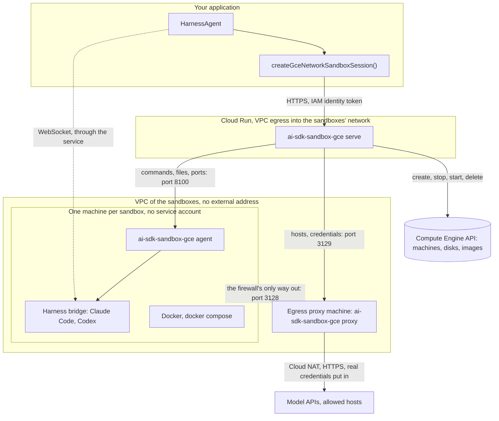
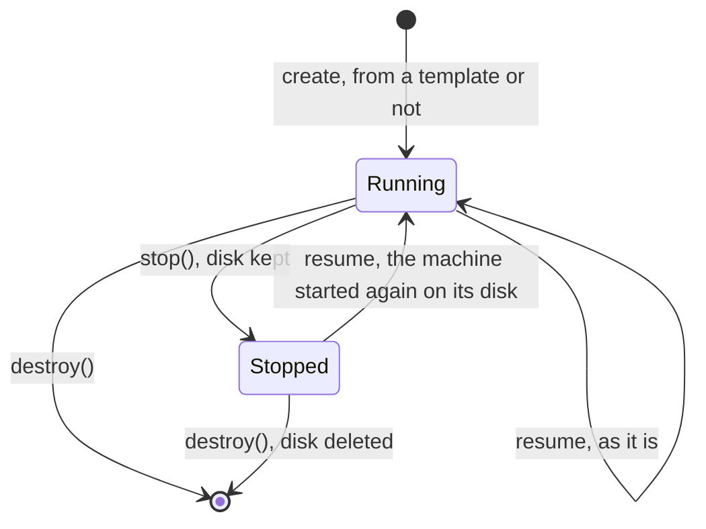

# ai-sdk-sandbox-gce

<p align="center">
  <a href="https://www.npmjs.com/package/ai-sdk-sandbox-gce"></a>
  <a href="https://github.com/fpasquet/ai-sdk-harness/actions/workflows/ci.yml"></a>
  
  
  <a href="https://github.com/fpasquet/ai-sdk-harness/blob/main/LICENSE"></a>
</p>

Run [AI SDK harness agents](https://ai-sdk.dev/docs/ai-sdk-harnesses/harness-agent) (Claude Code, Codex…) in [Compute Engine](https://cloud.google.com/compute) virtual machines on Google Cloud: one machine per sandbox, Docker and Docker Compose included, stopped between turns.

The package gives `HarnessAgent.createSession({ sandboxSession })` what it expects, a `HarnessV1NetworkSandboxSession`, the same way [`ai-sdk-sandbox-cloud-run`](https://www.npmjs.com/package/ai-sdk-sandbox-cloud-run) does for Cloud Run sandboxes, and speaks the same protocol:

- **A virtual machine per sandbox**: the isolation boundary is a hypervisor, and the firewall is applied outside the guest, by the VPC. Docker, `docker compose` and PostgreSQL run in it as on any machine.
- **Nothing running between turns**: `stop()` stops the machine and keeps its disk; a resume starts it again on the same disk. A stopped sandbox costs its disk only.
- **No network of its own**: the machine has no external address and the firewall only lets it reach an egress proxy, which only lets out the hosts you allow, over HTTPS.
- **Credentials stay outside**: the harness hands the sandbox a placeholder, and the proxy swaps the real value in on the way to the model API. A real credential never enters the machine, nor any log. The machine has no service account either.
- **The harness is installed once**: pass `agent.getSandboxTemplate()` and the first sandbox's disk is saved as an image; every later sandbox boots from it.

## How it works

The package comes in four parts: the client your application calls, and three programs you deploy, all in the same package (`ai-sdk-sandbox-gce <serve|proxy|agent>`):



- **The client** (this package's API) creates, resumes, stops and deletes sandboxes, and runs commands, files and ports through the service. It is the client of `ai-sdk-sandbox-cloud-run`, under other names.
- **The sandbox service** (`ai-sdk-sandbox-gce serve`) runs in a Cloud Run service, with VPC egress into the sandboxes' network. It keeps nothing: what a machine is, Compute Engine says; what it may reach and its credentials, the proxy holds; its processes, its agent runs. Any instance serves any sandbox, and it scales to zero.
- **The agent** (`ai-sdk-sandbox-gce agent`) runs in every sandbox machine, started by systemd from the sandbox image. It runs the commands as the sandbox's user, and passes a tunnel on to a port of the machine. It only answers the service, with a token derived for its machine.
- **The egress proxy** (`ai-sdk-sandbox-gce proxy`) runs on a machine of its own, the only one with a way out, through Cloud NAT. It knows each sandbox by its machine's internal address, and holds its allowed hosts and credentials in memory.

## Requirements

- Node.js 24 or later: in your application, the service's image, the sandbox image and the proxy's machine.
- A Google Cloud project with Compute Engine, Cloud Run and Cloud NAT, and the `gcloud` CLI.
- `@ai-sdk/harness` and a harness adapter, such as `@ai-sdk/harness-claude-code`.

## Deploying

The commands below set up everything once. Every name is yours to change.

```bash
PROJECT=my-project REGION=europe-west1 ZONE=europe-west1-b
gcloud config set project $PROJECT
```

### 1. The network

One VPC, three subnetworks: the sandboxes, the proxy, and the service's egress from Cloud Run.

```bash
gcloud compute networks create sandboxes --subnet-mode=custom
gcloud compute networks subnets create sandboxes --network=sandboxes --region=$REGION --range=10.8.0.0/20
gcloud compute networks subnets create proxy --network=sandboxes --region=$REGION --range=10.8.16.0/28
gcloud compute networks subnets create service --network=sandboxes --region=$REGION --range=10.8.17.0/26
gcloud compute addresses create sandbox-proxy --region=$REGION --subnet=proxy --addresses=10.8.16.2

# The sandboxes reach the proxy, and nothing else.
gcloud compute firewall-rules create sandboxes-deny-egress --network=sandboxes --direction=EGRESS \
  --action=DENY --rules=all --destination-ranges=0.0.0.0/0 --target-tags=ai-sdk-sandbox --priority=65000
gcloud compute firewall-rules create sandboxes-to-proxy --network=sandboxes --direction=EGRESS \
  --action=ALLOW --rules=tcp:3128 --destination-ranges=10.8.16.2/32 --target-tags=ai-sdk-sandbox --priority=1000
gcloud compute firewall-rules create proxy-from-sandboxes --network=sandboxes --direction=INGRESS \
  --action=ALLOW --rules=tcp:3128 --source-tags=ai-sdk-sandbox --target-tags=ai-sdk-sandbox-proxy

# Only the service reaches the agents and the proxy's administration API.
gcloud compute firewall-rules create agents-from-service --network=sandboxes --direction=INGRESS \
  --action=ALLOW --rules=tcp:8100 --source-ranges=10.8.17.0/26 --target-tags=ai-sdk-sandbox
gcloud compute firewall-rules create proxy-admin-from-service --network=sandboxes --direction=INGRESS \
  --action=ALLOW --rules=tcp:3129 --source-ranges=10.8.17.0/26 --target-tags=ai-sdk-sandbox-proxy

# The proxy's way out: Cloud NAT, for its subnetwork alone.
gcloud compute routers create sandboxes --network=sandboxes --region=$REGION
gcloud compute routers nats create proxy --router=sandboxes --region=$REGION \
  --nat-custom-subnet-ip-ranges=proxy --auto-allocate-nat-external-ips
```

A sandbox resolves names through the metadata server, which the firewall does not filter: a DNS query for any name leaves the VPC, a channel for a few bytes at a time. Close it with a [response policy](https://cloud.google.com/dns/docs/zones/manage-response-policies) on the sandboxes' network that answers every name with `NXDOMAIN`: the commands only ever resolve names through the proxy, which resolves them on its own machine.

### 2. The egress proxy

A small machine, always on: the sandboxes' only way out. It needs no service account.

```bash
PROXY_TOKEN=$(openssl rand -hex 32)
printf '%s' "$PROXY_TOKEN" | gcloud secrets create sandbox-proxy-token --data-file=-

gcloud compute instances create sandbox-proxy --zone=$ZONE --machine-type=e2-small \
  --subnet=proxy --private-network-ip=10.8.16.2 --no-address --no-service-account --no-scopes \
  --tags=ai-sdk-sandbox-proxy --image-family=debian-12 --image-project=debian-cloud \
  --shielded-secure-boot --metadata=ai-sdk-sandbox-proxy-token=$PROXY_TOKEN \
  --metadata-from-file=startup-script=proxy-startup.sh
```

```bash title="proxy-startup.sh"
#!/bin/sh
set -e
if ! command -v ai-sdk-sandbox-gce >/dev/null; then
  curl -fsSL https://deb.nodesource.com/setup_24.x | bash -
  apt-get install -y nodejs
  npm install --global ai-sdk-sandbox-gce@0.1.0
fi
cat > /etc/systemd/system/ai-sdk-sandbox-proxy.service <<'UNIT'
[Unit]
Description=ai-sdk-sandbox-gce egress proxy
After=network-online.target
Wants=network-online.target

[Service]
ExecStart=/bin/sh -c 'SANDBOX_PROXY_TOKEN=$(curl -fsS -H Metadata-Flavor:Google http://metadata.google.internal/computeMetadata/v1/instance/attributes/ai-sdk-sandbox-proxy-token) exec ai-sdk-sandbox-gce proxy'
Restart=always
DynamicUser=yes

[Install]
WantedBy=multi-user.target
UNIT
systemctl daemon-reload
systemctl enable --now ai-sdk-sandbox-proxy
```

Pin `ai-sdk-sandbox-gce` to the version your application depends on, here and in the two images below: every side checks that the others speak its protocol.

### 3. The sandbox image

Every sandbox boots from it: put the tools your agent needs in it, and never a secret. Build it with [Packer](https://developer.hashicorp.com/packer/integrations/hashicorp/googlecompute) or by hand, from a machine that ran this script on Debian 12, then `gcloud compute images create --family=ai-sdk-sandbox`:

```bash title="sandbox-image.sh"
#!/bin/sh
set -e
apt-get update
apt-get install -y --no-install-recommends ca-certificates curl git gnupg procps python3 ripgrep sudo

# Docker Engine and Compose.
install -m 0755 -d /etc/apt/keyrings
curl -fsSL https://download.docker.com/linux/debian/gpg -o /etc/apt/keyrings/docker.asc
echo "deb [signed-by=/etc/apt/keyrings/docker.asc] https://download.docker.com/linux/debian bookworm stable" \
  > /etc/apt/sources.list.d/docker.list
apt-get update
apt-get install -y docker-ce docker-ce-cli containerd.io docker-buildx-plugin docker-compose-plugin

# Node.js and the agent.
curl -fsSL https://deb.nodesource.com/setup_24.x | bash -
apt-get install -y nodejs
npm install --global ai-sdk-sandbox-gce@0.1.0

# The sandbox's user: sudo without a password, and Docker.
useradd --create-home --shell /bin/bash agent
usermod -aG docker agent
echo 'agent ALL=(ALL) NOPASSWD:ALL' > /etc/sudoers.d/agent

cat > /etc/systemd/system/ai-sdk-sandbox-agent.service <<'UNIT'
[Unit]
Description=ai-sdk-sandbox-gce agent
After=network-online.target docker.service
Wants=network-online.target

[Service]
ExecStart=/usr/bin/ai-sdk-sandbox-gce agent
Restart=always

[Install]
WantedBy=multi-user.target
UNIT
systemctl enable ai-sdk-sandbox-agent
```

The agent runs as root and starts the commands as `agent`. It points Docker at the proxy itself, the daemon and the client: images are pulled through the proxy, and containers get its address in their proxy variables. Rebuild the image every week or so for the security updates: the templates made on the previous one are made again on the next sandbox.

### 4. The service

The service's image is the package and Node.js:

```dockerfile title="Dockerfile"
FROM node:24-bookworm-slim
RUN npm install --global --silent ai-sdk-sandbox-gce@0.1.0 && npm cache clean --force
CMD ["ai-sdk-sandbox-gce", "serve"]
```

```bash
gcloud iam service-accounts create sandboxes
for role in roles/compute.instanceAdmin.v1 roles/compute.storageAdmin; do
  gcloud projects add-iam-policy-binding $PROJECT \
    --member=serviceAccount:sandboxes@$PROJECT.iam.gserviceaccount.com --role=$role
done

printf '%s' "$(openssl rand -hex 32)" | gcloud secrets create sandbox-agent-secret --data-file=-
for secret in sandbox-agent-secret sandbox-proxy-token; do
  gcloud secrets add-iam-policy-binding $secret \
    --member=serviceAccount:sandboxes@$PROJECT.iam.gserviceaccount.com --role=roles/secretmanager.secretAccessor
done

gcloud run deploy sandboxes --region=$REGION --source=. \
  --service-account=sandboxes@$PROJECT.iam.gserviceaccount.com \
  --network=sandboxes --subnet=service --vpc-egress=private-ranges-only \
  --no-allow-unauthenticated --min-instances=0 --timeout=3600 --concurrency=1000 \
  --set-env-vars=SANDBOX_ZONE=$ZONE,SANDBOX_IMAGE=family/ai-sdk-sandbox \
  --set-env-vars=SANDBOX_SUBNETWORK=regions/$REGION/subnetworks/sandboxes \
  --set-env-vars=SANDBOX_PROXY_URL=http://10.8.16.2:3128,SANDBOX_PROXY_ADMIN_URL=http://10.8.16.2:3129 \
  --set-env-vars=SANDBOX_ALLOWED_HOSTS=registry.npmjs.org \
  --set-secrets=SANDBOX_AGENT_SECRET=sandbox-agent-secret:latest,SANDBOX_PROXY_TOKEN=sandbox-proxy-token:latest
```

What these settings are for:

- `--network`, `--subnet`, `--vpc-egress`: Direct VPC egress, so that the service reaches the agents and the proxy on their internal addresses.
- `roles/compute.instanceAdmin.v1`: create, stop, start and delete the machines. `roles/compute.storageAdmin`: save a template as an image. Narrow both to a custom role if you like.
- `--min-instances=0`: no instance and no bill while no call comes; the sandboxes run on without the service.
- `--timeout=3600`: the longest a request lasts, so the longest a bridge WebSocket lasts. The harness reconnects beyond it.
- `--concurrency=1000`: every open bridge holds a request.

### 5. Who may call it

Cloud Run's IAM only lets through the identities granted `roles/run.invoker`:

```bash
gcloud run services add-iam-policy-binding sandboxes --region=$REGION \
  --member=serviceAccount:my-app@$PROJECT.iam.gserviceaccount.com --role=roles/run.invoker
```

Anyone with that role can run commands in every sandbox of the service: grant it to your application, not to people who only need to read logs. For a second lock, set `SANDBOX_SERVICE_TOKEN` on the service and hand the same to the client as `serviceToken`. Read the service's URL with `gcloud run services describe sandboxes --region=$REGION --format='value(status.url)'`; the examples below read it from `GCE_SANDBOX_URL`.

## Installation

```bash
pnpm add ai-sdk-sandbox-gce @ai-sdk/harness @ai-sdk/harness-claude-code
```

## Usage

```ts title="agent.ts"
import { HarnessAgent } from '@ai-sdk/harness/agent';
import { createClaudeCode } from '@ai-sdk/harness-claude-code';
import { createGceNetworkSandboxSession } from 'ai-sdk-sandbox-gce';

// Authenticated from CLAUDE_CODE_OAUTH_TOKEN or ANTHROPIC_API_KEY, which stay in this process.
const agent = new HarnessAgent({ id: 'coder', harness: createClaudeCode() });

const sandboxSession = await createGceNetworkSandboxSession({
  // The service's URL: `gcloud run services describe` prints it.
  url: process.env.GCE_SANDBOX_URL!,
  // On Google Cloud, the workload's service account; `gcloud` on a developer's machine.
  auth: 'metadata',
  // The Claude Code bridge listens on the first port; the harness reaches it through the service.
  ports: [4000],
  // The bridge installs its dependencies from npm.
  allowedHosts: ['registry.npmjs.org'],
  // Saves a machine with Claude Code installed as an image the first time, reused afterwards.
  template: await agent.getSandboxTemplate(),
});
const session = await agent.createSession({ sandboxSession });

try {
  const result = await agent.generate({
    session,
    prompt: 'Write a docker-compose.yml with PostgreSQL, start it, and check it answers.',
  });
  console.log(result.text);
} finally {
  await session.destroy();
  await sandboxSession.destroy();
}
```

`auth` takes `'gcloud'` (the default: `gcloud auth print-identity-token`), `'metadata'` (the workload's service account on Google Cloud), `'none'`, or a function returning an identity token for the service's URL, such as one from `google-auth-library`.

## Templates

A harness bootstraps itself in the sandbox before its first turn: Claude Code installs `@anthropic-ai/claude-agent-sdk` and the `claude` CLI. Pass the agent's template and it happens once: the first call creates a throwaway sandbox, runs `setup` in it, lets the harness prepare it, stops it, saves its disk as an image and deletes it. Every later sandbox boots from that image.

The image is named after the template's id and a digest of this package's version and the base image, a family resolved to its latest image: `ai-sdk-harness-template-<digest>-<base>`. After a new sandbox image, or a new version of the package, the first sandbox makes the template again. Delete the old images (label `ai-sdk-sandbox=template`) now and then: each costs its storage.

Making a template takes a few minutes: the machine boots, the harness installs, and Compute Engine saves the disk.

## Stopping and resuming

`stop()` suspends the sandbox: the processes this session started are stopped, the proxy forgets its credentials, then the machine is stopped, its disk kept. Resume it later, from this process or another one:



```ts
import {
  createGceNetworkSandboxSession,
  GceSandboxNotFoundError,
  resumeGceNetworkSandboxSession,
} from 'ai-sdk-sandbox-gce';

const settings = { url, ports: [4000], allowedHosts: ['registry.npmjs.org'] };

async function openSandbox(sandboxId: string) {
  try {
    const sandbox = await resumeGceNetworkSandboxSession({ ...settings, sandboxId });
    // A previous run may have left a bridge behind, holding the port.
    await sandbox.killAllProcesses();
    return sandbox;
  } catch (error) {
    if (!(error instanceof GceSandboxNotFoundError)) throw error;
    return createGceNetworkSandboxSession({ ...settings, sandboxId });
  }
}
```

A running sandbox is resumed as it is, its credentials kept; a stopped one boots again, its files as they were, its processes and `/tmp` gone. Creation never resumes: a sandbox already named `sandboxId`, running or stopped, is a conflict. The service does not keep `ports`, `allowedHosts` nor `baseUrls`: pass the settings again on every resume.

**Stop idle sandboxes yourself**, after `session.stop()` of the harness session, whose state lets `agent.createSession({ sessionId, resumeFrom })` pick the conversation up again: a running machine is billed by the second. [`ai-sdk-harness-sessions`](https://ai-sdk-harness.pages.dev/docs/packages/harness-sessions) does so after an idle timeout. Delete the sandboxes you will not resume: a stopped machine's disk is billed until then.

## Credentials

The real credentials of a harness, an API key or a subscription token, never enter the machine, where the agent could read them. The sandbox only ever sees a **placeholder**, and the proxy swaps the real value in on the request's way out.

1. The harness reads the credential where your application keeps it, makes a placeholder and starts the agent in the sandbox with it.
2. It hands the service a request transformation: on a request to the API's host carrying the placeholder, put the real value instead. The service passes it on to the proxy, which keeps it in memory, for that sandbox alone.
3. The API's client in the sandbox is pointed at the proxy, in plain HTTP inside the VPC, through its base URL variable: `ANTHROPIC_BASE_URL=https://api.anthropic.com` becomes `http://10.8.16.2:3128/https/api.anthropic.com`.
4. The proxy swaps the placeholder for the real value and sends the request on over HTTPS. The answer comes back without it, even when the API echoes it in a header.

The service routes `ANTHROPIC_BASE_URL` (Claude Code) and `OPENAI_BASE_URL` (Codex) by default; add others with `baseUrls`. With a subscription, the refresh token never leaves your application: only the short-lived access token reaches the proxy.

| Protection                                 | What it prevents                                                                                                                       |
| ------------------------------------------ | -------------------------------------------------------------------------------------------------------------------------------------- |
| **Brokering is always on**                 | A harness falling back to forwarding the real credential into the sandbox                                                              |
| **Commands carrying a credential refused** | A real credential entering the sandbox anyway: the service asks the proxy, which holds them, before running a command                  |
| **One host per credential**                | The credential reaching another host: it is only put in requests to the host it is for                                                 |
| **HTTPS only**                             | The credential travelling in clear outside the VPC: a base URL in plain HTTP is refused                                                |
| **No private address**                     | The sandbox reaching the proxy's metadata server, the service or the rest of the VPC through the proxy: see [Network](#network)        |
| **No service account**                     | A Google credential in the machine: its metadata server has no token to give                                                           |
| **Forgotten when done**                    | The credential outliving its use: `release()`, `stop()` and `destroy()` drop it from the proxy's memory, and a proxy restart drops all |

## Network

The machine has no external address, and the VPC firewall, applied outside the guest, only lets it reach the proxy. Everything goes through it:

- `HTTPS_PROXY` points at the proxy: it tunnels a `CONNECT` to port 443 of an allowed host, end to end encrypted, and refuses anything else.
- The base URLs go to the proxy too, as above.
- `HTTP_PROXY` points at the proxy as well: plain HTTP to an allowed host, as Debian's package mirrors serve, is passed on as it is, no credential put in. Anything else in plain HTTP is refused.
- `NO_PROXY` covers the machine itself, the proxy and the private ranges Docker puts its containers in. A container reached by its Compose service name is not covered: add the names to `NO_PROXY` in the Compose file.
- The proxy never connects to a private address, however it is named or allowed: loopback, link-local (its own metadata server), the private ranges of the VPC. It checks the address a name resolves to, at the moment it connects, an IPv6 address carrying a private IPv4 one included.

`allowedHosts` adds hosts for one sandbox, on top of the service's `SANDBOX_ALLOWED_HOSTS`. `*.example.com` covers the subdomains of `example.com`. `setNetworkPolicy` replaces the sandbox's own hosts: `allow-all` lets it reach any host over HTTPS, `deny-all` none but the service's and the base URLs'. CIDR rules are not supported.

Docker pulls images from Docker Hub through the proxy: allow `registry-1.docker.io`, `auth.docker.io` and `production.cloudflare.docker.com`, or [`ai-sdk-harness-network`](https://ai-sdk-harness.pages.dev/docs/packages/harness-network)'s presets.

## Ports

`ports` lists the ports inside the sandbox the harness may reach. `getPortEndpoint()` returns a WebSocket URL on the service, `wss://<service>/v1/sandboxes/<name>/ports/<port>`, with the identity token as a header, read anew at each connection. The service passes the connection on to the machine's agent, with the agent's token in place of the caller's, and the agent on to `127.0.0.1:<port>`. A port outside the list is refused with `HarnessCapabilityUnsupportedError`.

## Lifecycle

| Method                     | What it does                                                                                      |
| -------------------------- | ------------------------------------------------------------------------------------------------- |
| `release()`                | Stops the processes this session started and forgets its credentials, leaving the sandbox running |
| `killAllProcesses()`       | Stops every process the machine's agent started                                                   |
| `stop()`                   | Stops the machine, its disk kept. Idempotent                                                      |
| `destroy()`                | Deletes the machine and its disk. Idempotent                                                      |
| `setNetworkPolicy(policy)` | Replaces the hosts the sandbox may reach                                                          |
| `restricted()`             | The files-and-processes view of the same sandbox, to hand to tools                                |
| `fork({ ports })`          | Another view of the same sandbox, with ports, processes and credentials of its own                |

`fork()` lets several harness sessions run side by side in one machine, each with a bridge on its own port, as with `ai-sdk-sandbox-cloud-run`.

## Options

`createGceNetworkSandboxSession(options)` takes every option below; `resumeGceNetworkSandboxSession(options)` takes `sandboxId`, `abortSignal` and the connection settings.

| Option         | Default        | Description                                                                                         |
| -------------- | -------------- | --------------------------------------------------------------------------------------------------- |
| `url`          | required       | _Connection._ The URL of the sandbox service                                                        |
| `auth`         | `'gcloud'`     | _Connection._ `'gcloud'`, `'metadata'`, `'none'`, or a function returning an identity token         |
| `ports`        | `[]`           | _Connection._ Ports the harness may reach, through the service                                      |
| `allowedHosts` | `[]`           | _Connection._ Hosts the sandbox may reach over HTTPS, on top of the service's                       |
| `baseUrls`     | `{}`           | _Connection._ Base URL variables routed through the proxy, on top of the service's                  |
| `serviceToken` | none           | _Connection._ The service's `SANDBOX_SERVICE_TOKEN`, when it has one                                |
| `sandboxId`    | `ai-sdk-<hex>` | The sandbox's name: lowercase letters, digits and dashes, 55 at most. Creation fails if it is taken |
| `template`     | none           | `await agent.getSandboxTemplate()`: prepare once, boot every later sandbox from it                  |
| `setup`        | `[]`           | Commands run once after creation, as the sandbox's user (who has `sudo`), saved in the template     |
| `abortSignal`  | none           | Aborts the creation or the resume                                                                   |

## Configuration

### The service (`serve`)

| Variable                  | Default                                                                                  | Description                                                                                     |
| ------------------------- | ---------------------------------------------------------------------------------------- | ----------------------------------------------------------------------------------------------- |
| `SANDBOX_ZONE`            | required                                                                                 | The zone of the machines                                                                        |
| `SANDBOX_IMAGE`           | required                                                                                 | The sandbox image: a name, `family/<family>`, or `projects/<project>/global/images/…`           |
| `SANDBOX_AGENT_SECRET`    | required                                                                                 | 32 characters at least: the agents' tokens are derived from it. Keep it in Secret Manager       |
| `SANDBOX_PROXY_URL`       | required                                                                                 | The proxy, as the machines reach it: `http://10.8.16.2:3128`                                    |
| `SANDBOX_PROXY_ADMIN_URL` | required                                                                                 | Its administration API: `http://10.8.16.2:3129`                                                 |
| `SANDBOX_PROXY_TOKEN`     | required                                                                                 | The proxy's token                                                                               |
| `SANDBOX_PROJECT`         | the service's project                                                                    | The project of the machines                                                                     |
| `SANDBOX_NETWORK`         | the default network                                                                      | The machines' VPC network                                                                       |
| `SANDBOX_SUBNETWORK`      | none                                                                                     | Their subnetwork: `regions/<region>/subnetworks/<name>`                                         |
| `SANDBOX_NETWORK_TAGS`    | `ai-sdk-sandbox`                                                                         | Their network tags, which the firewall rules apply to                                           |
| `SANDBOX_MACHINE_TYPE`    | `e2-standard-4`                                                                          | Their machine type, a custom one included: `e2-custom-4-8192`                                   |
| `SANDBOX_DISK_GB`         | `20`                                                                                     | The size of their disk                                                                          |
| `SANDBOX_DISK_TYPE`       | `pd-balanced`                                                                            | Its type                                                                                        |
| `SANDBOX_SPOT`            | `false`                                                                                  | `true` for Spot machines: cheaper, stopped when Compute Engine takes them back, resumable after |
| `SANDBOX_INSTANCE_PREFIX` | `sbx-`                                                                                   | Put before a sandbox's name to make its machine's, 8 characters at most                         |
| `SANDBOX_AGENT_PORT`      | `8100`                                                                                   | The port of the agents                                                                          |
| `SANDBOX_START_TIMEOUT`   | `300`                                                                                    | Seconds a machine has to boot and its agent to answer                                           |
| `SANDBOX_ALLOWED_HOSTS`   | none                                                                                     | Hosts every sandbox may reach over HTTPS, comma-separated; `*.domain` allowed                   |
| `SANDBOX_BASE_URLS`       | `ANTHROPIC_BASE_URL=https://api.anthropic.com,OPENAI_BASE_URL=https://api.openai.com/v1` | Base URL variables routed through the proxy, as `NAME=url` pairs                                |
| `SANDBOX_SERVICE_TOKEN`   | none                                                                                     | A secret every call must carry, beside Cloud Run's IAM                                          |
| `COMPUTE_AUTH`            | `metadata` on Cloud Run, `gcloud` elsewhere                                              | How the service gets its access tokens for the Compute Engine API                               |
| `PORT`, `HOST`            | `8080`, `0.0.0.0` on Cloud Run and `127.0.0.1` elsewhere                                 | Where the service listens                                                                       |
| `LOG_FORMAT`              | `json` on Cloud Run, `text` elsewhere                                                    | JSON lines for Cloud Logging, or plain text                                                     |

### The proxy (`proxy`)

| Variable                        | Default   | Description                                                                         |
| ------------------------------- | --------- | ----------------------------------------------------------------------------------- |
| `SANDBOX_PROXY_TOKEN`           | required  | The token the service proves itself with, 16 characters at least                    |
| `SANDBOX_PROXY_PORT`            | `3128`    | The port the sandboxes reach                                                        |
| `SANDBOX_PROXY_ADMIN_PORT`      | `3129`    | The port of the administration API                                                  |
| `SANDBOX_ALLOW_PRIVATE_NETWORK` | `false`   | For tests only: lets the sandboxes reach private addresses and plain HTTP base URLs |
| `HOST`, `LOG_FORMAT`            | `0.0.0.0` | Where it listens; `text` for plain logs                                             |

### The agent (`agent`)

| Variable                   | Default                                      | Description                                             |
| -------------------------- | -------------------------------------------- | ------------------------------------------------------- |
| `SANDBOX_USER`             | `agent`                                      | The user the commands run as, when the agent is root    |
| `SANDBOX_HOME`             | `/home/<user>`                               | Their `HOME`                                            |
| `SANDBOX_WORKDIR`          | `/workspace`                                 | Their working directory, made the user's                |
| `SANDBOX_PATH`             | `/usr/local/sbin:/usr/local/bin:/usr/sbin:…` | Their `PATH`                                            |
| `SANDBOX_AGENT_PORT`       | `8100`                                       | Where the agent listens                                 |
| `SANDBOX_AGENT_TOKEN`      | the instance's `ai-sdk-sandbox-agent-token`  | Its token: the service puts it in the instance metadata |
| `SANDBOX_STATE_DIR`        | `/var/lib/ai-sdk-sandbox`                    | Where it keeps the network configuration, root's        |
| `SANDBOX_CONFIGURE_DOCKER` | `true`                                       | `false` to leave Docker's proxy settings alone          |

A sandbox's commands run with nothing of the agent's environment: only their `PATH`, `HOME`, `USER`, the proxy and base URL variables, and the variables the command sets.

## Cost

A machine is billed by the second while it runs, and only for its disk once stopped: in `europe-west1`, an `e2-standard-4` is in the order of $0.15 an hour, Spot much less, and a stopped 20 GB balanced disk about $2 a month. The proxy machine, an `e2-small`, is about $15 a month, and Cloud NAT bills its hours and the gigabytes it processes. The service scales to zero. Check the current [Compute Engine pricing](https://cloud.google.com/compute/vm-instance-pricing).

To keep the bill down: stop idle sandboxes early, delete finished ones, delete old template images, and cap the region's vCPU quota: unlike a budget alert, a quota really stops the spending.

## Security

- **A virtual machine per sandbox**: its kernel is its own; the firewall rules apply outside it, and no rule written inside the guest weakens them.
- **Nothing leaves the machine but through the proxy**, which only opens allowed hosts and the base URLs' APIs, and never a private address.
- **No service account, no external address**: the machine holds no Google credential, and nothing on the internet reaches it.
- **The agents answer the service alone**: the firewall lets only the service's subnetwork reach their port, and every call carries a token derived from `SANDBOX_AGENT_SECRET` for that machine. A machine only ever learns its own token, from its metadata.
- **The sandbox's user has `sudo`, and Docker**: inside the machine, the agent's code can do anything. The machine is the boundary, not the user.
- **The proxy holds the credentials of every running sandbox**, in memory. Keep it a machine of its own, with nothing else on it, no service account, and its administration port open to the service alone.
- **The service trusts its callers**: anyone granted `roles/run.invoker` can run commands in any sandbox. Never deploy it with `--allow-unauthenticated`; add `SANDBOX_SERVICE_TOKEN` as a second lock.
- **Disks and template images hold the sandbox's files**: the agent's work and its transcript. They stay in your project; delete them with the sandbox.
- **Metadata**: a machine reads its own metadata, project metadata included. Keep secrets out of the project's metadata, and SSH keys too (the service blocks project SSH keys on the machines).

## Security checklist

What the sandbox does, or does not, against the essential risks of running an agent's code: ✅ covered, ⚠️ partly or with care, ❌ not covered. The same table describes every sandbox package of this repository.

| Control                        | Status | How                                                                                                              |
| ------------------------------ | ------ | ---------------------------------------------------------------------------------------------------------------- |
| Isolation boundary             | ✅     | A Compute Engine virtual machine per sandbox                                                                     |
| Nothing of the host by default | ✅     | The machine sees its image and its disk, nothing of the service or the proxy                                     |
| Writes to the host             | ✅     | No host: files go through the agent                                                                              |
| Privileges                     | ⚠️     | The sandbox's user has `sudo` and Docker: root in the machine, and only in it                                    |
| Docker and Compose             | ✅     | Docker Engine and Compose in the image, pulled through the proxy                                                 |
| Outbound allow list            | ✅     | `allowedHosts` and `setNetworkPolicy()`, applied by the proxy; the VPC firewall closes all else                  |
| Private networks and metadata  | ⚠️     | Refused by the proxy after DNS resolution; the machine's own metadata server stays readable, with no token in it |
| Inbound ports                  | ✅     | Through the service only, behind Cloud Run's IAM, `SANDBOX_SERVICE_TOKEN` and the agent token                    |
| Credentials out of the sandbox | ✅     | The real value only lives in the proxy's memory                                                                  |
| Credential scope               | ⚠️     | Only to its API's host, in the headers its transformation names; echoed back in a body, not taken out            |
| Environment                    | ✅     | The commands never see the agent's environment                                                                   |
| Resource limits                | ✅     | The machine type: vCPUs, memory and disk of its own                                                              |
| Lifetime limits                | ⚠️     | None: stop idle sandboxes yourself with `stop()`                                                                 |
| Teardown                       | ✅     | `destroy()` deletes the machine and its disk; the proxy forgets its credentials                                  |

## Limitations

- **Booting takes time**: expect tens of seconds from an image, a template included, against seconds for a container. No machine is kept warm.
- **The proxy is one machine**: while it restarts, the sandboxes have no network, and it forgets every credential and allowed host. Resume the running sandboxes afterwards: the harness hands its credentials over again when its session resumes.
- **HTTPS, and plain HTTP to allowed hosts.** The proxy only tunnels to port 443: no SSH, no `git` over SSH, no other port.
- **32 MiB per request.** Cloud Run limits HTTP/1 request bodies: a larger file cannot be written in one call.
- **A process's output stops after an hour**, the request timeout of the service. Its exit code is still found.
- **One bridge per port.** Run one harness session at a time per sandbox view, and give each session a view of its own with `fork()`.

## Development

This package lives in the [`ai-sdk-harness`](https://github.com/fpasquet/ai-sdk-harness) monorepo.

- `pnpm test` runs the client against the real service and the real proxy, over a fake Compute Engine API whose machines are agent processes of this host, isolating nothing.
- `pnpm test:e2e` runs against a service deployed on Google Cloud. Set `GCE_SANDBOX_URL` to its URL, sign gcloud in with an account granted `roles/run.invoker`, and set `GCE_SANDBOX_SERVICE_TOKEN` if the service has a token. It boots real machines, runs Docker in one and saves a template.

## License

[MIT](https://github.com/fpasquet/ai-sdk-harness/blob/main/LICENSE)
