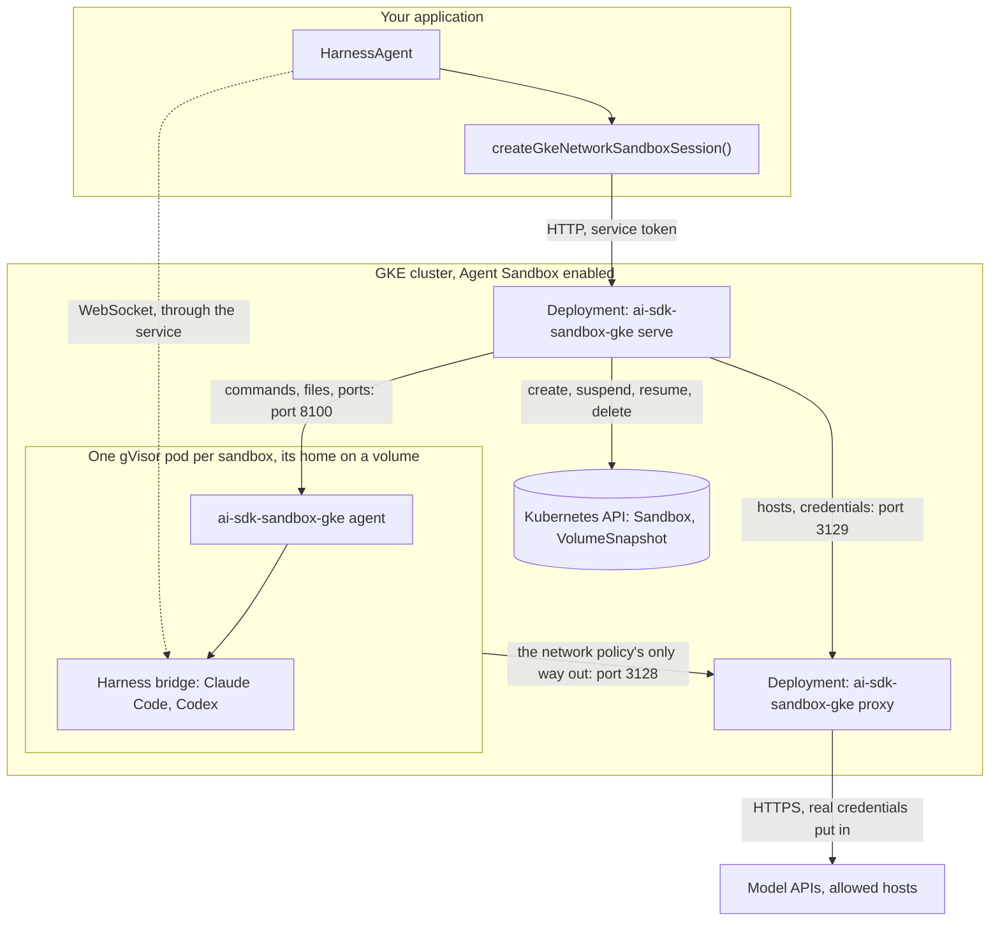
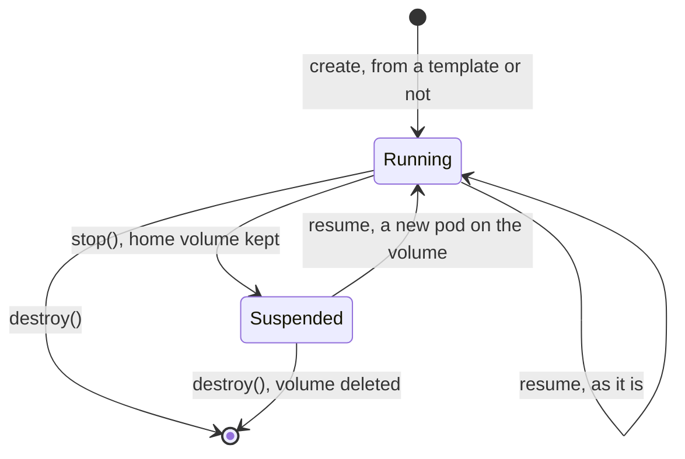

# ai-sdk-sandbox-gke

<p align="center">
  <a href="https://www.npmjs.com/package/ai-sdk-sandbox-gke"></a>
  <a href="https://github.com/fpasquet/ai-sdk-harness/actions/workflows/ci.yml"></a>
  
  
  <a href="https://github.com/fpasquet/ai-sdk-harness/blob/main/LICENSE"></a>
</p>

Run [AI SDK harness agents](https://ai-sdk.dev/docs/ai-sdk-harnesses/harness-agent) (Claude Code, Codex…) in [GKE Sandbox](https://cloud.google.com/kubernetes-engine/docs/concepts/sandbox-pods) pods on Google Kubernetes Engine: one pod per sandbox under gVisor, made by [Agent Sandbox](https://agent-sandbox.sigs.k8s.io), suspended between turns, its home kept on a volume of its own.

The package gives `HarnessAgent.createSession({ sandboxSession })` what it expects, a `HarnessV1NetworkSandboxSession`, the same way [`ai-sdk-sandbox-gce`](https://www.npmjs.com/package/ai-sdk-sandbox-gce) does for Compute Engine machines, and speaks the same protocol:

- **A gVisor pod per sandbox**: the pod runs on GKE Sandbox's nodes, its system calls served by gVisor's kernel in user space rather than the node's. It runs as a user who is not root, with no capability and no Kubernetes credential.
- **Nothing running between turns**: `stop()` suspends the sandbox: its pod is deleted and its home volume kept; a resume makes the pod again on the same volume. A suspended sandbox costs its volume only.
- **No network of its own**: a network policy only lets the pod reach an egress proxy, which only lets out the hosts you allow, over HTTPS. The pod has no resolver either.
- **Credentials stay outside**: the harness hands the sandbox a placeholder, and the proxy swaps the real value in on the way to the model API. A real credential never enters the pod, nor any log.
- **The harness is installed once**: pass `agent.getSandboxTemplate()` and the first sandbox's home volume is saved as a snapshot; every later sandbox's volume starts from it.

## How it works

The package comes in four parts: the client your application calls, and three programs you deploy, all in the same package (`ai-sdk-sandbox-gke <serve|proxy|agent>`):



- **The client** (this package's API) creates, resumes, suspends and deletes sandboxes, and runs commands, files and ports through the service. It is the client of `ai-sdk-sandbox-gce`, under other names.
- **The sandbox service** (`ai-sdk-sandbox-gke serve`) runs in a Deployment of the cluster. It keeps nothing: what a sandbox is, Kubernetes says, as an Agent Sandbox `Sandbox`; what it may reach and its credentials, the proxy holds; its processes, its agent runs. Any replica serves any sandbox.
- **The agent** (`ai-sdk-sandbox-gke agent`) is the command of every sandbox's pod. It runs the commands as the pod's user, and passes a tunnel on to a port of the pod. It only answers the service, with a token derived for its sandbox.
- **The egress proxy** (`ai-sdk-sandbox-gke proxy`) runs in a Deployment of its own, one replica, the sandboxes' only way out. It knows each sandbox by its pod's address, and holds its allowed hosts and credentials in memory.

## Requirements

- Node.js 24 or later: in your application, the service's image and the sandbox image.
- A GKE cluster with [Agent Sandbox](https://cloud.google.com/kubernetes-engine/docs/how-to/how-install-agent-sandbox) enabled, version 1.36.3-gke.1767000 or later, network policies enforced (GKE Dataplane V2, which Autopilot always has), and the Compute Engine persistent disk CSI driver's snapshots.
- `@ai-sdk/harness` and a harness adapter, such as `@ai-sdk/harness-claude-code`.

## Deploying

The commands below set up everything once. Every name is yours to change.

```bash
PROJECT=my-project REGION=europe-west1 CLUSTER=agents
gcloud config set project $PROJECT
```

### 1. The cluster

An Autopilot cluster with Agent Sandbox, its nodes without external addresses, and Cloud NAT for the proxy's way out:

```bash
gcloud beta container clusters create-auto $CLUSTER --location=$REGION \
  --enable-agent-sandbox --enable-private-nodes
gcloud compute routers create agents --network=default --region=$REGION
gcloud compute routers nats create agents --router=agents --region=$REGION \
  --nat-all-subnet-ip-ranges --auto-allocate-nat-external-ips
gcloud container clusters get-credentials $CLUSTER --location=$REGION
```

On a Standard cluster, add a node pool with `--sandbox=type=gvisor` and enable network policy enforcement, then `gcloud beta container clusters update $CLUSTER --enable-agent-sandbox`.

**Check that network policies are enforced** before running any agent: without them, the sandboxes reach the internet, the cluster and the metadata server directly. `kubectl get networkpolicies` lists them, Dataplane V2 enforces them.

### 2. The namespace, its accounts and secrets

```yaml title="namespace.yaml"
apiVersion: v1
kind: Namespace
metadata:
  name: ai-sdk-sandbox
---
# The sandboxes' pods: granted nothing, and their token is never mounted.
apiVersion: v1
kind: ServiceAccount
metadata: { name: sandbox, namespace: ai-sdk-sandbox }
automountServiceAccountToken: false
---
apiVersion: v1
kind: ServiceAccount
metadata: { name: proxy, namespace: ai-sdk-sandbox }
automountServiceAccountToken: false
---
# The service: drives the sandboxes and their snapshots, in this namespace alone.
apiVersion: v1
kind: ServiceAccount
metadata: { name: service, namespace: ai-sdk-sandbox }
---
apiVersion: rbac.authorization.k8s.io/v1
kind: Role
metadata: { name: service, namespace: ai-sdk-sandbox }
rules:
  - apiGroups: [agents.x-k8s.io]
    resources: [sandboxes]
    verbs: [get, create, patch, delete]
  - apiGroups: [snapshot.storage.k8s.io]
    resources: [volumesnapshots]
    verbs: [get, create, delete]
---
apiVersion: rbac.authorization.k8s.io/v1
kind: RoleBinding
metadata: { name: service, namespace: ai-sdk-sandbox }
subjects: [{ kind: ServiceAccount, name: service, namespace: ai-sdk-sandbox }]
roleRef: { apiGroup: rbac.authorization.k8s.io, kind: Role, name: service }
---
# Where the templates' snapshots go.
apiVersion: snapshot.storage.k8s.io/v1
kind: VolumeSnapshotClass
metadata: { name: ai-sdk-sandbox }
driver: pd.csi.storage.gke.io
deletionPolicy: Delete
```

```bash
kubectl apply -f namespace.yaml
kubectl -n ai-sdk-sandbox create secret generic ai-sdk-sandbox \
  --from-literal=agent-secret=$(openssl rand -hex 32) \
  --from-literal=service-token=$(openssl rand -hex 32) \
  --from-literal=proxy-token=$(openssl rand -hex 32)
```

### 3. The images

The service and the proxy run the package on Node.js; the sandbox image adds what your agent needs, with Node.js and git, which every harness needs:

```dockerfile title="service.Dockerfile"
FROM node:24-bookworm-slim
RUN npm install --global --silent ai-sdk-sandbox-gke@0.1.0 && npm cache clean --force
USER node
```

```dockerfile title="sandbox.Dockerfile"
FROM node:24-bookworm-slim
RUN apt-get update \
  && apt-get install -y --no-install-recommends bash ca-certificates curl git procps ripgrep \
  && rm -rf /var/lib/apt/lists/* \
  && npm install --global --silent ai-sdk-sandbox-gke@0.1.0 && npm cache clean --force
USER 1000
```

Pin `ai-sdk-sandbox-gke` to the version your application depends on, in both images: every side checks that the others speak its protocol. Push them to Artifact Registry, and name them by digest in the service's settings: a template is made on an image, and a tag that moves would keep the templates of the previous one. The pod runs as user 1000, never root: put every system package in the image, since nothing installs one in the sandbox.

### 4. The egress proxy

One replica: it keeps the sandboxes' registrations in memory.

```yaml title="proxy.yaml"
apiVersion: apps/v1
kind: Deployment
metadata: { name: proxy, namespace: ai-sdk-sandbox }
spec:
  replicas: 1
  strategy: { type: Recreate }
  selector: { matchLabels: { app: ai-sdk-sandbox-proxy } }
  template:
    metadata: { labels: { app: ai-sdk-sandbox-proxy } }
    spec:
      serviceAccountName: proxy
      securityContext: { runAsNonRoot: true, seccompProfile: { type: RuntimeDefault } }
      containers:
        - name: proxy
          image: europe-docker.pkg.dev/my-project/agents/ai-sdk-sandbox-gke@sha256:…
          command: [ai-sdk-sandbox-gke, proxy]
          env:
            - name: SANDBOX_PROXY_TOKEN
              valueFrom: { secretKeyRef: { name: ai-sdk-sandbox, key: proxy-token } }
          ports: [{ containerPort: 3128 }, { containerPort: 3129 }]
          resources: { requests: { cpu: 250m, memory: 256Mi } }
          securityContext: { allowPrivilegeEscalation: false, capabilities: { drop: [ALL] } }
---
apiVersion: v1
kind: Service
metadata: { name: proxy, namespace: ai-sdk-sandbox }
spec:
  selector: { app: ai-sdk-sandbox-proxy }
  ports:
    - { name: proxy, port: 3128 }
    - { name: admin, port: 3129 }
```

### 5. The service

```yaml title="service.yaml"
apiVersion: apps/v1
kind: Deployment
metadata: { name: service, namespace: ai-sdk-sandbox }
spec:
  replicas: 2
  selector: { matchLabels: { app: ai-sdk-sandbox-service } }
  template:
    metadata: { labels: { app: ai-sdk-sandbox-service } }
    spec:
      serviceAccountName: service
      securityContext: { runAsNonRoot: true, seccompProfile: { type: RuntimeDefault } }
      containers:
        - name: service
          image: europe-docker.pkg.dev/my-project/agents/ai-sdk-sandbox-gke@sha256:…
          command: [ai-sdk-sandbox-gke, serve]
          env:
            - {
                name: SANDBOX_IMAGE,
                value: europe-docker.pkg.dev/my-project/agents/sandbox@sha256:…,
              }
            - { name: SANDBOX_SERVICE_ACCOUNT, value: sandbox }
            - { name: SANDBOX_SNAPSHOT_CLASS, value: ai-sdk-sandbox }
            - { name: SANDBOX_PROXY_URL, value: http://proxy.ai-sdk-sandbox.svc.cluster.local:3128 }
            - {
                name: SANDBOX_PROXY_ADMIN_URL,
                value: http://proxy.ai-sdk-sandbox.svc.cluster.local:3129,
              }
            - { name: SANDBOX_ALLOWED_HOSTS, value: registry.npmjs.org }
            - name: SANDBOX_AGENT_SECRET
              valueFrom: { secretKeyRef: { name: ai-sdk-sandbox, key: agent-secret } }
            - name: SANDBOX_SERVICE_TOKEN
              valueFrom: { secretKeyRef: { name: ai-sdk-sandbox, key: service-token } }
            - name: SANDBOX_PROXY_TOKEN
              valueFrom: { secretKeyRef: { name: ai-sdk-sandbox, key: proxy-token } }
          ports: [{ containerPort: 8080 }]
          readinessProbe: { httpGet: { path: /health, port: 8080 } }
          resources: { requests: { cpu: 250m, memory: 256Mi } }
          securityContext: { allowPrivilegeEscalation: false, capabilities: { drop: [ALL] } }
---
# Reached from your application's VPC, never from the internet.
apiVersion: v1
kind: Service
metadata:
  name: service
  namespace: ai-sdk-sandbox
  annotations: { networking.gke.io/load-balancer-type: Internal }
spec:
  type: LoadBalancer
  selector: { app: ai-sdk-sandbox-service }
  ports: [{ port: 80, targetPort: 8080 }]
```

The pods have no resolver: the service resolves the proxy's name and hands its agents the address.

### 6. The network policies

What makes the proxy the sandboxes' only way out, and the service the only one to reach them:

```yaml title="network-policies.yaml"
apiVersion: networking.k8s.io/v1
kind: NetworkPolicy
metadata: { name: sandboxes, namespace: ai-sdk-sandbox }
spec:
  podSelector: { matchLabels: { ai-sdk-sandbox: sandbox } }
  policyTypes: [Ingress, Egress]
  ingress:
    - from: [{ podSelector: { matchLabels: { app: ai-sdk-sandbox-service } } }]
      ports: [{ port: 8100 }]
  egress:
    - to: [{ podSelector: { matchLabels: { app: ai-sdk-sandbox-proxy } } }]
      ports: [{ port: 3128 }]
---
apiVersion: networking.k8s.io/v1
kind: NetworkPolicy
metadata: { name: proxy, namespace: ai-sdk-sandbox }
spec:
  podSelector: { matchLabels: { app: ai-sdk-sandbox-proxy } }
  policyTypes: [Ingress]
  ingress:
    - from: [{ podSelector: { matchLabels: { ai-sdk-sandbox: sandbox } } }]
      ports: [{ port: 3128 }]
    - from: [{ podSelector: { matchLabels: { app: ai-sdk-sandbox-service } } }]
      ports: [{ port: 3129 }]
```

```bash
kubectl apply -f proxy.yaml -f service.yaml -f network-policies.yaml
kubectl -n ai-sdk-sandbox get service service -o jsonpath='{.status.loadBalancer.ingress[0].ip}'
```

The examples below read that address from `GKE_SANDBOX_URL` (`http://10.…`), and the service token from `GKE_SANDBOX_SERVICE_TOKEN`.

## Installation

```bash
pnpm add ai-sdk-sandbox-gke @ai-sdk/harness @ai-sdk/harness-claude-code
```

## Usage

```ts title="agent.ts"
import { HarnessAgent } from '@ai-sdk/harness/agent';
import { createClaudeCode } from '@ai-sdk/harness-claude-code';
import { createGkeNetworkSandboxSession } from 'ai-sdk-sandbox-gke';

// Authenticated from CLAUDE_CODE_OAUTH_TOKEN or ANTHROPIC_API_KEY, which stay in this process.
const agent = new HarnessAgent({ id: 'coder', harness: createClaudeCode() });

const sandboxSession = await createGkeNetworkSandboxSession({
  // The service's internal load balancer.
  url: process.env.GKE_SANDBOX_URL!,
  // The service's SANDBOX_SERVICE_TOKEN: whoever holds it drives every sandbox.
  serviceToken: process.env.GKE_SANDBOX_SERVICE_TOKEN!,
  // The Claude Code bridge listens on the first port; the harness reaches it through the service.
  ports: [4000],
  // The bridge installs its dependencies from npm.
  allowedHosts: ['registry.npmjs.org'],
  // Saves a home with Claude Code installed as a snapshot the first time, reused afterwards.
  template: await agent.getSandboxTemplate(),
});
const session = await agent.createSession({ sandboxSession });

try {
  const result = await agent.generate({
    session,
    prompt: 'Write a FizzBuzz in Python, and run it.',
  });
  console.log(result.text);
} finally {
  await session.destroy();
  await sandboxSession.destroy();
}
```

`auth` adds a Google identity token to every call, for a service behind Identity-Aware Proxy or a load balancer that checks one: `'gcloud'`, `'metadata'`, or a function returning one. It is `'none'` by default: the service token alone.

## Images and toolchains

Every sandbox's pod runs an image the service offers: `SANDBOX_IMAGE`, its default, and those `SANDBOX_IMAGES` names, one per toolchain say. A caller picks one by its name, never by its reference:

```yaml
- { name: SANDBOX_IMAGES, value: 'python=europe-docker.pkg.dev/…/sandbox-python@sha256:…,go=…' }
```

```ts
await createGkeNetworkSandboxSession({ url, serviceToken, image: 'python', ports: [4000] });
```

Whatever the project's language, a harness needs **Node.js** in the sandbox, for its bridge (Claude Code installs its SDK with pnpm), and **git**, for the repositories. Build every image on the [sandbox image](#3-the-images), then add the toolchain, as root, before `USER 1000`: `apt-get install -y python3-venv`, Go's tarball… The client checks the sandbox once its `setup` ran: one lacking `node` or `git` fails the creation with `GkeSandboxImageError`, which names what is missing, and the sandbox is deleted. `requiredCommands` changes the list, `[]` turns the check off.

`setup` runs as the pod's user, who is not root: what it installs goes in the home, the only directory kept, `~/.local/bin` first in `PATH`. Point npm there with `npm config set prefix ~/.local`.

A template is made on the image of its sandbox: `python` and `default` get one each.

## Templates

A harness bootstraps itself in the sandbox before its first turn: Claude Code installs `@anthropic-ai/claude-agent-sdk` and the `claude` CLI. Pass the agent's template and it happens once: the first call creates a throwaway sandbox, runs `setup` in it, lets the harness prepare it, suspends it, snapshots its home volume and deletes it. Every later sandbox's volume starts from that snapshot.

The snapshot is named after the template's id and a digest of this package's version and the image's reference: `ai-sdk-harness-template-<digest>-<base>`. After a new image, or a new version of the package, the first sandbox makes the template again. Delete the old snapshots (label `ai-sdk-sandbox=template`) now and then: each costs its storage.

Only the home is in the template: what the harness installs elsewhere is lost. Claude Code and Codex install in the home.

## Stopping and resuming

`stop()` suspends the sandbox: the processes this session started are stopped, the proxy forgets its credentials, then the sandbox's operating mode turns to `Suspended`: Agent Sandbox deletes its pod and keeps its volume. Resume it later, from this process or another one:



```ts
import {
  createGkeNetworkSandboxSession,
  GkeSandboxNotFoundError,
  resumeGkeNetworkSandboxSession,
} from 'ai-sdk-sandbox-gke';

const settings = { url, serviceToken, ports: [4000], allowedHosts: ['registry.npmjs.org'] };

async function openSandbox(sandboxId: string) {
  try {
    const sandbox = await resumeGkeNetworkSandboxSession({ ...settings, sandboxId });
    // A previous run may have left a bridge behind, holding the port.
    await sandbox.killAllProcesses();
    return sandbox;
  } catch (error) {
    if (!(error instanceof GkeSandboxNotFoundError)) throw error;
    return createGkeNetworkSandboxSession({ ...settings, sandboxId });
  }
}
```

A running sandbox is resumed as it is, its credentials kept; a suspended one gets a new pod, its home as it was, its processes and everything outside its home gone. Creation never resumes: a sandbox already named `sandboxId`, running or suspended, is a conflict. The service does not keep `ports`, `allowedHosts` nor `baseUrls`: pass the settings again on every resume.

**Suspend idle sandboxes yourself**, after `session.stop()` of the harness session, whose state lets `agent.createSession({ sessionId, resumeFrom })` pick the conversation up again: a running pod holds its node's room. [`ai-sdk-harness-sessions`](https://ai-sdk-harness.pages.dev/docs/packages/harness-sessions) does so after an idle timeout. Delete the sandboxes you will not resume: a suspended sandbox's volume is billed until then.

## Credentials

The real credentials of a harness, an API key or a subscription token, never enter the pod, where the agent could read them. The sandbox only ever sees a **placeholder**, and the proxy swaps the real value in on the request's way out.

1. The harness reads the credential where your application keeps it, makes a placeholder and starts the agent in the sandbox with it.
2. It hands the service a request transformation: on a request to the API's host carrying the placeholder, put the real value instead. The service passes it on to the proxy, which keeps it in memory, for that sandbox alone.
3. The API's client in the sandbox is pointed at the proxy, in plain HTTP inside the cluster, through its base URL variable: `ANTHROPIC_BASE_URL=https://api.anthropic.com` becomes `http://10.12.0.40:3128/https/api.anthropic.com`.
4. The proxy swaps the placeholder for the real value and sends the request on over HTTPS. The answer comes back without it, even when the API echoes it in a header.

The service routes `ANTHROPIC_BASE_URL` (Claude Code) and `OPENAI_BASE_URL` (Codex) by default; add others with `baseUrls`. With a subscription, the refresh token never leaves your application: only the short-lived access token reaches the proxy.

| Protection                                 | What it prevents                                                                                                                       |
| ------------------------------------------ | -------------------------------------------------------------------------------------------------------------------------------------- |
| **Brokering is always on**                 | A harness falling back to forwarding the real credential into the sandbox                                                              |
| **Commands carrying a credential refused** | A real credential entering the sandbox anyway: the service asks the proxy, which holds them, before running a command                  |
| **One host per credential**                | The credential reaching another host: it is only put in requests to the host it is for                                                 |
| **HTTPS only**                             | The credential travelling in clear outside the cluster: a base URL in plain HTTP is refused                                            |
| **No private address**                     | The sandbox reaching the proxy's metadata server, the cluster or the VPC through the proxy: see [Network](#network)                    |
| **No Kubernetes credential**               | A token of the cluster in the pod: its service account's is never mounted, and the account is granted nothing                          |
| **Forgotten when done**                    | The credential outliving its use: `release()`, `stop()` and `destroy()` drop it from the proxy's memory, and a proxy restart drops all |

## Network

The network policy, enforced by the node outside the pod, only lets the pod reach the proxy, and the pod has no resolver: a name fails at once. Everything goes through the proxy:

- `HTTPS_PROXY` points at the proxy, by its address: it tunnels a `CONNECT` to port 443 of an allowed host, end to end encrypted, and refuses anything else.
- The base URLs go to the proxy too, as above.
- `HTTP_PROXY` points at the proxy as well: plain HTTP to an allowed host is passed on as it is, no credential put in. Anything else in plain HTTP is refused.
- `NO_PROXY` covers the pod itself and the proxy.
- The proxy never connects to a private address, however it is named or allowed: loopback, link-local (the metadata server), the private ranges of the cluster and the VPC. It checks the address a name resolves to, at the moment it connects, an IPv6 address carrying a private IPv4 one included.

`allowedHosts` adds hosts for one sandbox, on top of the service's `SANDBOX_ALLOWED_HOSTS`. `*.example.com` covers the subdomains of `example.com`. `setNetworkPolicy` replaces the sandbox's own hosts: `allow-all` lets it reach any host over HTTPS, `deny-all` none but the service's and the base URLs'. CIDR rules are not supported. [`ai-sdk-harness-network`](https://ai-sdk-harness.pages.dev/docs/packages/harness-network) has presets for the package registries of each ecosystem.

## Ports

`ports` lists the ports inside the sandbox the harness may reach. `getPortEndpoint()` returns a WebSocket URL on the service, `ws://<service>/v1/sandboxes/<name>/ports/<port>`, with the service token as a header. The service passes the connection on to the pod's agent, with the agent's token in place of the caller's, and the agent on to `127.0.0.1:<port>`. A port outside the list is refused with `HarnessCapabilityUnsupportedError`.

## Lifecycle

| Method                     | What it does                                                                                      |
| -------------------------- | ------------------------------------------------------------------------------------------------- |
| `release()`                | Stops the processes this session started and forgets its credentials, leaving the sandbox running |
| `killAllProcesses()`       | Stops every process the pod's agent started                                                       |
| `stop()`                   | Suspends the sandbox: its pod deleted, its home volume kept. Idempotent                           |
| `destroy()`                | Deletes the sandbox, its pod and its volume. Idempotent                                           |
| `setNetworkPolicy(policy)` | Replaces the hosts the sandbox may reach                                                          |
| `restricted()`             | The files-and-processes view of the same sandbox, to hand to tools                                |
| `fork({ ports })`          | Another view of the same sandbox, with ports, processes and credentials of its own                |

## Options

`createGkeNetworkSandboxSession(options)` takes every option below; `resumeGkeNetworkSandboxSession(options)` takes `sandboxId`, `abortSignal` and the connection settings.

| Option             | Default           | Description                                                                                         |
| ------------------ | ----------------- | --------------------------------------------------------------------------------------------------- |
| `url`              | required          | _Connection._ The URL of the sandbox service                                                        |
| `serviceToken`     | required          | _Connection._ The service's `SANDBOX_SERVICE_TOKEN`                                                 |
| `auth`             | `'none'`          | _Connection._ An identity token besides: `'gcloud'`, `'metadata'`, or a function returning one      |
| `ports`            | `[]`              | _Connection._ Ports the harness may reach, through the service                                      |
| `allowedHosts`     | `[]`              | _Connection._ Hosts the sandbox may reach over HTTPS, on top of the service's                       |
| `baseUrls`         | `{}`              | _Connection._ Base URL variables routed through the proxy, on top of the service's                  |
| `sandboxId`        | `ai-sdk-<hex>`    | The sandbox's name: lowercase letters, digits and dashes, 54 at most. Creation fails if it is taken |
| `template`         | none              | `await agent.getSandboxTemplate()`: prepare once, start every later sandbox from it                 |
| `image`            | `default`         | The image the pod runs, by the name the service gives it in `SANDBOX_IMAGES`                        |
| `requiredCommands` | `['node', 'git']` | Commands the sandbox must have once `setup` ran                                                     |
| `setup`            | `[]`              | Commands run once after creation, as the pod's user, never root, saved in the template              |
| `abortSignal`      | none              | Aborts the creation or the resume                                                                   |

## Configuration

### The service (`serve`)

| Variable                     | Default                                                                                  | Description                                                                                      |
| ---------------------------- | ---------------------------------------------------------------------------------------- | ------------------------------------------------------------------------------------------------ |
| `SANDBOX_IMAGE`              | required                                                                                 | The sandbox image, by digest preferably                                                          |
| `SANDBOX_IMAGES`             | none                                                                                     | Other images callers may pick by name, as `NAME=image` pairs: `python=…/sandbox-python@sha256:…` |
| `SANDBOX_AGENT_SECRET`       | required                                                                                 | 32 characters at least: the agents' tokens are derived from it                                   |
| `SANDBOX_SERVICE_TOKEN`      | required                                                                                 | 32 characters at least: every call must carry it                                                 |
| `SANDBOX_PROXY_URL`          | required                                                                                 | The proxy, as the pods reach it: its Service's name, resolved by the service, or its address     |
| `SANDBOX_PROXY_ADMIN_URL`    | required                                                                                 | Its administration API                                                                           |
| `SANDBOX_PROXY_TOKEN`        | required                                                                                 | The proxy's token                                                                                |
| `SANDBOX_NAMESPACE`          | the service's own                                                                        | The namespace of the sandboxes and their snapshots                                               |
| `SANDBOX_RUNTIME_CLASS`      | `gvisor`                                                                                 | The pods' runtime class; empty for none, outside GKE Sandbox, for tests only                     |
| `SANDBOX_SERVICE_ACCOUNT`    | the namespace's `default`                                                                | The pods' service account: one granted nothing                                                   |
| `SANDBOX_CPU`                | `2`                                                                                      | What a pod is given and held to                                                                  |
| `SANDBOX_MEMORY`             | `4Gi`                                                                                    | Likewise                                                                                         |
| `SANDBOX_EPHEMERAL_STORAGE`  | `10Gi`                                                                                   | The room of its filesystem outside its home                                                      |
| `SANDBOX_VOLUME_SIZE`        | `20Gi`                                                                                   | The size of its home volume                                                                      |
| `SANDBOX_STORAGE_CLASS`      | the cluster's default                                                                    | The volumes' storage class                                                                       |
| `SANDBOX_SNAPSHOT_CLASS`     | the cluster's default                                                                    | The templates' snapshot class                                                                    |
| `SANDBOX_UID`                | `1000`                                                                                   | The user and group the pods run as, never 0                                                      |
| `SANDBOX_HOME`               | `/home/agent`                                                                            | Where the home volume is mounted; the working directory is its `workspace/`                      |
| `SANDBOX_NAME_PREFIX`        | `sbx-`                                                                                   | Put before a sandbox's name to make its resource's, 8 characters at most                         |
| `SANDBOX_AGENT_PORT`         | `8100`                                                                                   | The port of the agents                                                                           |
| `SANDBOX_START_TIMEOUT`      | `300`                                                                                    | Seconds a pod has to be scheduled, pull its image and answer                                     |
| `SANDBOX_SNAPSHOT_TIMEOUT`   | `600`                                                                                    | Seconds a template's snapshot has to be cut                                                      |
| `SANDBOX_ALLOWED_HOSTS`      | none                                                                                     | Hosts every sandbox may reach over HTTPS, comma-separated; `*.domain` allowed                    |
| `SANDBOX_BASE_URLS`          | `ANTHROPIC_BASE_URL=https://api.anthropic.com,OPENAI_BASE_URL=https://api.openai.com/v1` | Base URL variables routed through the proxy, as `NAME=url` pairs                                 |
| `KUBERNETES_API_URL`         | the cluster's, from the pod; `http://127.0.0.1:8001` elsewhere                           | The Kubernetes API: `kubectl proxy`'s address, off the cluster                                   |
| `KUBERNETES_AUTH`            | `service-account` in a pod, `none` elsewhere                                             | The pod's service account token and certificate authority, or nothing                            |
| `PORT`, `HOST`, `LOG_FORMAT` | `8080`; `0.0.0.0` and `json` in a pod, `127.0.0.1` and `text` elsewhere                  | Where the service listens, and its logs                                                          |

### The proxy (`proxy`)

| Variable                        | Default   | Description                                                                         |
| ------------------------------- | --------- | ----------------------------------------------------------------------------------- |
| `SANDBOX_PROXY_TOKEN`           | required  | The token the service proves itself with, 16 characters at least                    |
| `SANDBOX_PROXY_PORT`            | `3128`    | The port the sandboxes reach                                                        |
| `SANDBOX_PROXY_ADMIN_PORT`      | `3129`    | The port of the administration API                                                  |
| `SANDBOX_ALLOW_PRIVATE_NETWORK` | `false`   | For tests only: lets the sandboxes reach private addresses and plain HTTP base URLs |
| `HOST`, `LOG_FORMAT`            | `0.0.0.0` | Where it listens; `text` for plain logs                                             |

### The agent (`agent`)

The service sets these in the pod; an image needs none of them.

| Variable              | Default                                     | Description                                                      |
| --------------------- | ------------------------------------------- | ---------------------------------------------------------------- |
| `SANDBOX_AGENT_TOKEN` | required                                    | Its token, derived by the service for this sandbox               |
| `SANDBOX_HOME`        | `$HOME`                                     | The commands' `HOME`, the volume's mount                         |
| `SANDBOX_WORKDIR`     | `$SANDBOX_HOME/workspace`                   | Their working directory                                          |
| `SANDBOX_PATH`        | `$SANDBOX_HOME/.local/bin:/usr/local/sbin…` | Their `PATH`                                                     |
| `SANDBOX_USER`        | `$USER`, or `agent`                         | Their `USER`                                                     |
| `SANDBOX_AGENT_PORT`  | `8100`                                      | Where the agent listens                                          |
| `SANDBOX_STATE_DIR`   | `/tmp/ai-sdk-sandbox`                       | Where it keeps the network configuration, should it be restarted |

A sandbox's commands run with nothing of the agent's environment, nor of the image's: only their `PATH`, `HOME`, `USER`, the proxy and base URL variables, and the variables the command sets.

## Errors

- `GkeSandboxImageError`: the image of a new sandbox lacks a command of `requiredCommands`. Carries `sandboxId` and `missing`.
- `GkeSandboxNotFoundError`: `resumeGkeNetworkSandboxSession()` found no sandbox of that name, running or suspended. Carries `sandboxId`.
- `GkeSandboxServiceError`: the service answered with an error status: 409 for a name already taken, 400 for an image it does not offer or a command carrying a credential, 503 for a pod that stopped, 504 for a pod that was not ready in time (the message says why: unschedulable, image not pulled…). Carries `request` and `status`.
- `HarnessSandboxAuthenticationError` (from `@ai-sdk/harness`): the service token is missing or wrong, or a load balancer refused the identity token (401 or 403).
- `HarnessCapabilityUnsupportedError` (from `@ai-sdk/harness`): a port that is not exposed, or a network policy with CIDR rules.

## Cost

On Autopilot, a running sandbox is billed for its pod's requests, by the second: `SANDBOX_CPU` and `SANDBOX_MEMORY`, at GKE Sandbox's rates. A suspended one costs its volume only, a persistent disk billed by the gigabyte and the month, and a template its snapshot. The service and the proxy are always on, small pods; the cluster has its management fee, and Cloud NAT its hours and gigabytes. Check the current [GKE pricing](https://cloud.google.com/kubernetes-engine/pricing).

To keep the bill down: suspend idle sandboxes early, delete finished ones, delete old template snapshots, and set a [resource quota](https://kubernetes.io/docs/concepts/policy/resource-quotas/) on the namespace: unlike a budget alert, a quota really stops the spending.

## Security

- **A gVisor pod per sandbox**: its system calls are served by gVisor's kernel, in user space, not by the node's. The network policy is enforced by the node, outside the pod: nothing written inside weakens it.
- **Nothing leaves the pod but through the proxy**, which only opens allowed hosts and the base URLs' APIs, and never a private address. The pod has no resolver: no name leaks through DNS.
- **No root, no credential**: the pod runs as user 1000, with no capability, no privilege escalation, and no service account token. GKE's admission policy for Agent Sandbox refuses a pod that would.
- **The agents answer the service alone**: the network policy lets only the service's pods reach their port, and every call carries a token derived from `SANDBOX_AGENT_SECRET` for that sandbox. The token is in the pod's settings: the sandbox's own code can read it, which opens it nothing it cannot already do.
- **The proxy holds the credentials of every running sandbox**, in memory. Keep it in a pod of its own, with no service account token, and its administration port open to the service alone.
- **The service trusts whoever holds its token**: anyone with `SANDBOX_SERVICE_TOKEN` can run commands in any sandbox. Keep it in a secret manager, and the service on an internal load balancer.
- **Whoever reads the namespace's `Sandbox` objects reads the agents' tokens**: grant that to the service alone.
- **Volumes and snapshots hold the sandbox's files**: the agent's work and its transcript. They stay in your project; delete them with the sandbox.

## Security checklist

What the sandbox does, or does not, against the essential risks of running an agent's code: ✅ covered, ⚠️ partly or with care, ❌ not covered. The same table describes every sandbox package of this repository.

| Control                        | Status | How                                                                                                    |
| ------------------------------ | ------ | ------------------------------------------------------------------------------------------------------ |
| Isolation boundary             | ✅     | gVisor: a user-space kernel per pod, on GKE Sandbox's nodes                                            |
| Nothing of the host by default | ✅     | The pod sees its image and its volume; no host path, no service links, no Kubernetes token             |
| Writes to the host             | ✅     | No host path: files go through the agent                                                               |
| Privileges                     | ✅     | Not root, every capability dropped, no privilege escalation                                            |
| Docker and Compose             | ❌     | None: no daemon runs without privileges                                                                |
| Outbound allow list            | ✅     | `allowedHosts` and `setNetworkPolicy()`, applied by the proxy; the network policy closes all else      |
| Private networks and metadata  | ✅     | The network policy only opens the proxy, which refuses private addresses after resolution; no resolver |
| Inbound ports                  | ✅     | Through the service only, behind `SANDBOX_SERVICE_TOKEN`, the network policy and the agent token       |
| Credentials out of the sandbox | ✅     | The real value only lives in the proxy's memory                                                        |
| Credential scope               | ⚠️     | Only to its API's host, in the headers its transformation names; echoed back in a body, not taken out  |
| Environment                    | ✅     | The commands never see the agent's environment                                                         |
| Resource limits                | ✅     | CPU, memory and ephemeral storage limits on every pod, a volume of a fixed size                        |
| Lifetime limits                | ⚠️     | None: suspend idle sandboxes yourself with `stop()`                                                    |
| Teardown                       | ✅     | `destroy()` deletes the sandbox, its pod and its volume; the proxy forgets its credentials             |

## Limitations

- **No root, no Docker**: system packages go in the image, and `setup` installs in the home alone.
- **Only the home is kept**: across a suspension and in a template, everything outside the home volume is the image's again.
- **Starting takes time**: scheduling, pulling the image, attaching the volume, and on Autopilot perhaps a new node: from seconds to a minute or more. No pod is kept warm: Agent Sandbox's warm pools hand out pods made before the sandbox, without its token and its volume.
- **The proxy is one replica**: while it restarts, the sandboxes have no network, and it forgets every credential and allowed host. Resume the running sandboxes afterwards: the harness hands its credentials over again when its session resumes.
- **HTTPS, and plain HTTP to allowed hosts.** The proxy only tunnels to port 443: no SSH, no `git` over SSH, no other port.
- **One bridge per port.** Run one harness session at a time per sandbox view, and give each session a view of its own with `fork()`.

## Development

This package lives in the [`ai-sdk-harness`](https://github.com/fpasquet/ai-sdk-harness) monorepo.

- `pnpm test` runs the client against the real service and the real proxy, over a fake Kubernetes API whose pods are agent processes of this host, isolating nothing.
- `pnpm test:e2e` runs against a service deployed in a cluster. Set `GKE_SANDBOX_URL` to its address (`kubectl -n ai-sdk-sandbox port-forward service/service 8080:80`, then `http://127.0.0.1:8080`), and `GKE_SANDBOX_SERVICE_TOKEN` to its token. It makes real pods, suspends and resumes one and saves a template.

## License

[MIT](https://github.com/fpasquet/ai-sdk-harness/blob/main/LICENSE)
